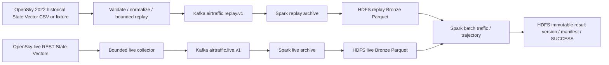
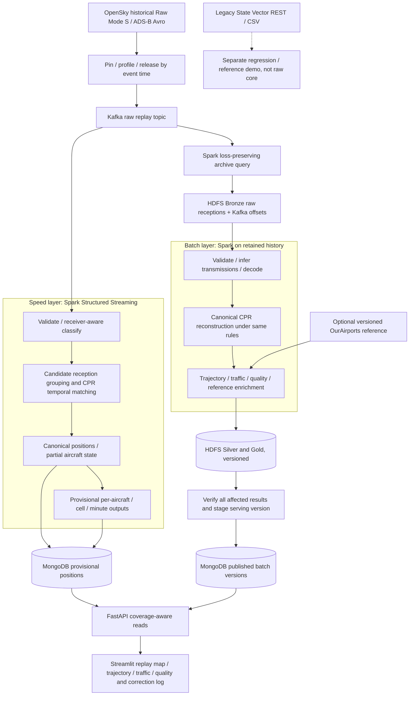

# Air-Traffic Reconstruction & Analytics — architecture

**Updated:** 4 November 2026 · **Active architecture:** Raw-first replay-based **Lambda** (target) · **Implemented checkpoint:** legacy State Vector S1–S4 (verified locally, 25–26 October 2026)

This document deliberately separates (1) components actually working, (2) independently reported exploratory Raw ADS-B experiments, and (3) the **proposed** integrated system. The single authoritative work order and acceptance checks are in [plan.md](plan.md). The first-checkpoint walkthrough, commands and Git history are preserved in [checkpoint-guide.md](checkpoint-guide.md).

**S5 integration verified, 4 November 2026:** pinned 2015 raw Avro → Kafka `airtraffic.raw.replay.v1` → the existing Spark archive job in raw mode → HDFS `/airtraffic/bronze/raw-adsb-v1`, with a dedicated checkpoint. The bounded run retained 2,100 deliveries / 1,100 source receptions and resumed after SIGKILL with no repeated Kafka offsets. All original source fields were verified against Avro. Decoding and the downstream target components remain planned. See [S5 evidence](../data/verification/s5_raw_20261104.json).

## 1. What problem the new system solves

The product will turn recorded **raw sensor receptions** into a set of **canonical reconstructed aircraft positions**, then give a user: a historical replay map, aircraft trajectories showing observation gaps, H3/minute traffic statistics, and **data-quality and correction history**. The central challenge is to offer low-latency **provisional** positions/counts from streaming and later **recomputed** versions from full retained history if valid late messages or corrected CPR matches change the result.

This is **not** a live air-traffic-control radar: current source is **historical Raw Mode S/ADS-B Avro replayed to Kafka**. OpenSky REST live State Vectors are **processed output supplied by OpenSky**, not raw live ADS-B; that earlier working collector remains optional and isolated rather than entering the new raw core. An SDR-based genuine live raw source would be a separate future extension.

## 2. Implemented local architecture — historical checkpoint (S1–S4)

**Verified baseline:** the ten-row synthetic fixture archived ten deliveries and yielded three eligible positions, two traffic rows and two trajectory rows. The 25 October bounded live run archived 16 observations. The **26 October live source run** (`live-8196ea97138b`) acknowledged/archived 19 observations, produced 12 analytically eligible positions and saved three traffic rows and seven trajectory segments. Immutable saved results were read back and restart persistence was checked in the bounded local scope. `compose.yaml` used one Kafka broker, Spark `local[2]`, one HDFS NameNode and two DataNodes on the **same host**, so there was no broker or host-failure HA. The local code and commands for this legacy slice are documented in [checkpoint-guide.md](checkpoint-guide.md) and [plan.md](plan.md#7-existing-code-checkpoint-evidence-and-document-ownership).

**Not implemented at the checkpoint:** Raw ADS-B ingestion/reconstruction integrated into Kafka/HDFS, MongoDB serving, API/dashboard, full Lambda reconciliation or multi-host Kubernetes. The term 'raw' in the **old Spark archive** means the original *Kafka envelope/state-vector payload* is preserved; it is **not raw ADS-B radio-message decoding**.

## 3. Exploratory Raw ADS-B feasibility (separate from deployed pipeline)

A supplied report dated 26 October profiles real raw Avro on Spark `3.5.7`, `local[2]`:

| Test | Reported result | Interpretation |
| --- | --- | --- |
| 2015 raw sample | 304,131 receptions, ~301 s, 17 receivers; 47,129 decoded positions from 49,622 eligible events. | Real raw reconstruction feasible on small archive. |
| 2017 archive **prefix** | 1,127,250 complete records, ~14.8 s, 211 receivers; 73,850 decoded positions from 78,503 eligible events. | Large *rate* but very short coverage; prefix is not full 3.83 GB compressed archive. |
| Receiver grouping | 9,647 (2015) and 73,076 (2017) multi-sensor **candidate** groups using 10 ms gap. | Not yet validated unique physical transmissions. |
| File-based streaming probe | 240 real selected messages; 408 candidate CPR pairs ordered, 313 with injected lateness, and 528 physical outputs for duplicate-delivery case vs 408 unique candidate pairs. | Supports a meaningful watermark/duplicate study, **not** an already-correct canonical streaming sink. |

**Known correctness gap:** batch chooses the latest *preceding* opposite CPR parity within 10 s; the streaming proof emits *all* acceptable ±10 s pairs. These have different output semantics. Consistent **canonical position selection and retry-safe effects** are a required development milestone, not existing results. The probe used file input/Parquet output and graceful restart, not Kafka/MongoDB or crash recovery. Receiver-specific SBS-3 zero-parity messages must not all be called corrupt.

## 4. Target Raw-first Lambda data flow — planned, NOT deployed

**Logical diagram only.** This does not assert one Spark query can chain all stateful operations in Spark 3.5. Each stateful query requires a supported operator sequence, distinct checkpoint and tested completion boundary. The final number of queries/topics is to be selected from a working vertical slice in S5–S7. Kafka and HDFS are durable data paths, not an atomic distributed transaction.

### Why both processing paths exist

A CPR even frame for aircraft A may arrive before its compatible odd frame. A short-window streaming query can publish available positions/traffic quickly, but if the odd frame arrives *after* the watermark allowance, a previously unresolved position may be absent. The raw HDFS archive still contains both frames. A bounded Spark batch over a pinned input snapshot can produce the missing canonical position and recompute the affected cell/minute metrics and adjacent trajectory segments. The API then serves the **validated batch version** for its declared covered keys, not a sum of streaming and batch counts.

**Illustrative correction:** streaming reported four distinct observed aircraft in cell A at minute T; after a deliberately injected late CPR message, recomputation supports five. Display **4 provisional → 5 recomputed** with reason, source IDs and rule version. This is a proposed controlled fixture, **not** a measured correction from the real 2015/2017 samples. A corrected position moving from A to B requires recomputing **both** cell keys and affected trajectory neighbors.

## 5. Canonical processing stages and contracts

| Output | What it represents | Required processing / protection |
| --- | --- | --- |
| **Raw reception** | One sensor's record of a raw hex Mode S frame with server time and optional receiver-local metadata. | Stable `dataset/file/record_index/sensor` identity; keep raw bytes, unsupported/invalid evidence, source hashes and full precision. |
| **Inferred transmission** | A **candidate** cluster of receptions judged to correspond to one broadcast. | Receiver-aware clock/time rules; never use exact payload alone as a global dropDuplicates key; keep all contributing reception IDs and confidence/ambiguity. |
| **Decoded event** | Identification, velocity, CPR-even/odd position candidate or unsupported Mode S category. | Applicable length/CRC/parity checks; decoder pin/DF/TC; explicit valid, invalid, unsupported, valid-incomplete. |
| **Canonical position** | One deterministic, selected reconstructed position **per declared target event**. | Same batch/stream pair policy, stable IDs, event times, coordinates, quality and contributing pair/reception lineage; not every possible CPR pair. |
| **Aircraft state** | Latest usable position and separately aged attributes. | Timestamp/freshness per position, velocity, callsign, altitude; old events cannot overwrite newer values. |
| **Spatial traffic representative** | One aircraft/cell/minute representative according to shared metric definition. | H3 grid/rule version and aircraft dedup; one aircraft may enter more than one cell in a minute. |
| **Publication version** | Cohesive recomputed outputs over fixed input snapshot/coverage. | Validate all old/new dependent keys and switch active version only on complete staged publication. |

**Clocks:** `source_reception_time` (server), `receiver_timestamp`/`counter` (not necessarily UTC), `replay_released_at`, Kafka processing time, canonical position event time and `displayed_at` are distinct. Historical event times from 2015/2017 **must not be subtracted from 2026 wall time** to claim low pipeline latency. Use simulation time to age replayed positions; use wall time only for collector-to-display latency. Reception count ≠ inferred transmission count ≠ unique canonical position count ≠ distinct aircraft count ≠ Kafka delivery count.

## 6. Storage, correctness, correction and failure boundaries

- **Bronze:** preserve append-only raw source/replay deliveries and rejection evidence, Kafka topic/partition/offsets, source time and acquisition manifest. No watermark-based discards here; commit/reader/checkpoint semantics matter.
- **Silver:** versioned classified/decoded events, inferred transmissions, reconstructed positions and attribute states. Source/run/rule version is part of the join/identity boundary; **never mix 2015 with 2017** or merge historical simulation clocks with live REST clocks.
- **Gold:** pinned traffic/trajectory/quality tables and exact covered range. Missing reception does **not** mean zero traffic. Reference enrichment is optional and cannot infer departure/arrival airports merely from proximity.
- **MongoDB:** queryable provisional state and window representatives; staged recomputed results; active-version metadata. Retry-safe upserts are essential. A physical duplicate from Spark's sink is not cured by reporting only distinct keys.
- **Reconciliation:** identify all dependent keys of revised/missing positions (old/new H3 cells, window, affected aircraft trajectory boundaries, quality metrics); recompute from canonical inputs; publish only after complete validation. A new batch version supersedes provisional results *within its coverage* and must not be added to them.
- **Operational limits:** one Kafka broker/NameNode/MongoDB/control-plane remains a potential single point of failure. Test checkpoints, lost offsets, partial serving writes, HDFS replicas on distinct hosts where possible, documented restore and actual distributed Spark executors before making resilience claims.

## 7. User application and verification targets

| Product screen | User-visible contract | Demonstration evidence needed |
| --- | --- | --- |
| **Historical Replay Map** | Run/dataset, simulation clock, aircraft positions, source quality/stale/unresolved and age. | One source record traced to published canonical position and visible map; measured replay-receipt-to-display latency. |
| **Trajectory Explorer** | Observed segments, distance only on justified edges, missing intervals and source lineage. | Small independent reference plus bounded real aircraft cohort; no invented path interpolation. |
| **Regional Traffic / Correction** | H3 counts, time-window coverage, streaming provisional vs batch recomputed, historical correction log. | Fixture showing a late CPR event changes canonical position and all affected cells/windows; no double counting. |
| **Observation Quality** | Supported/invalid/unresolved frames, multi-sensor candidates, decode coverage and watermark/state diagnostics. | Real-source distributions plus clearly identified seeded-fault effects and computation costs. |

**Deployment:** Compose remains the reproducible development and historical checkpoint environment; after feasibility on team hardware, run Kafka/Spark/HDFS/MongoDB/API in K3s with real distributed placement, monitoring, backup, restricted access and measured scaling. The internal workload aims (10M unique observations, p95 ≤5 s) require explicit redefinition/measurement for raw reception → canonical output; neither is an achieved or course-mandated number.

**Next integration boundary:** [plan.md S5](plan.md#s5--raw-data-and-source-contract-next) verifies raw archive coverage and schema → S6 creates canonical batch reference → S7 matches streaming semantics → S8 serves the first map → S9 adds correction/analytics/benchmarks. Do not describe these target edges as implemented until corresponding integrated tests pass.