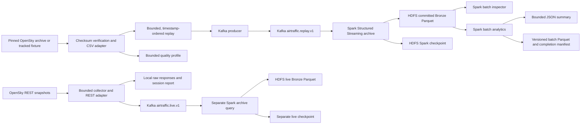
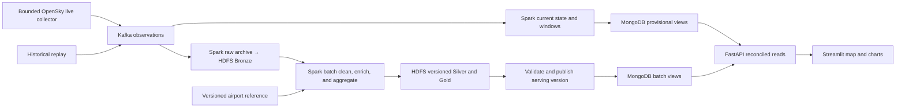

# Air-traffic platform architecture

**Checkpoint version:** October 25, 2026, for the October 26 review. This note separates implemented code from the planned Lambda system. The single project plan, [plan.md](plan.md), contains current progress and next steps, with detailed design and acceptance criteria in its [technical appendix](plan.md#technical-appendix).

## Implemented data flow

| Component | Current role and boundary |
| --- | --- |
| [Source configuration](../data/sources/opensky_sample.json), [checkpoint fixture](../data/fixtures/checkpoint_manifest.json), and [acquisition tools](../data/README.md) | Pin and verify a June 2022 OpenSky state archive or the tracked 10-row synthetic fixture. The real archive bytes and local manifest are excluded from Git; the source configuration and aggregate profile are tracked. |
| [Observation adapter and replay](../scripts/observations.py) | Keep source snapshot, position-update, last-contact, and new receipt times distinct. Stable observation IDs identify source/aircraft/snapshot; invalid rows become rejection records. Replay sorts only a bounded archive prefix. |
| [Kafka producer](../scripts/publish_replay.py) | Publishes new replay records to the three-partition `airtraffic.replay.v1` topic with broker acknowledgments. Kafka retains the topic for seven days; one broker provides no broker failover. |
| [Live collector](../scripts/collect_live.py) and [REST adapter](../scripts/live_adapter.py) | Pull bounded OpenSky snapshots, preserve source clocks/nulls/rejections, and publish to `airtraffic.live.v1` (three partitions). Raw responses, request/freshness outcomes, and acknowledged/uncertain counts remain in local session reports. |
| [Spark archive](../jobs/archive_stream.py) | Reads Kafka with two-second triggers, labels envelope status, and preserves original key/payload bytes plus topic, partition, offset, and processing time. It appends every row to Parquet, including malformed or rejected records. |
| HDFS Bronze and checkpoint | Bronze path: `/airtraffic/bronze/replay-v1`, partitioned by UTC ingestion date. Query checkpoint: `/airtraffic/checkpoints/archive-replay-v1`. The [batch inspector](../jobs/inspect_archive.py) reads committed Parquet from the root and checks row and offset counts for a run. |
| Live Bronze and checkpoint | Separate paths: `/airtraffic/bronze/live-v1` and `/airtraffic/checkpoints/archive-live-v1`. The same archive/inspector code verifies the live run's rows, offsets, mode, and topic. Raw queries use no watermark and do not mix event-time domains. |
| [Batch analytics](../jobs/batch_analytics.py) and [analytics command](../jobs/inspect_analytics.py) | Read committed Bronze for one run, select eligible positions, and print bounded one-degree-cell/minute traffic and trajectory segment summaries as JSON. This prototype does not yet write Silver/Gold tables or publish serving views. |
| [Batch writer](../jobs/materialize_analytics.py) and [saved-result reader](../jobs/inspect_batch.py) | Save traffic and trajectory Parquet to a new output directory, compare read-back schemas/counts/values, then write `_manifest.json` and root `_SUCCESS`. The full HDFS demo and restart comparison passed; seven Spark storage tests pass. |

The batch writer reads the committed input visible when its job starts. Wait for the expected run count before writing a version. `_RESERVED` is a permanent ownership marker; only root `_SUCCESS` indicates that both datasets finished verification. Existing output directories are refused, including partial failed versions. Later input needs a new version. MongoDB/API publication remains planned.

The deployed [Compose topology](../compose.yaml) has one Kafka broker, one replay archive Spark process using `local[2]`, one HDFS NameNode, and two DataNode containers on the same physical host. The `live` profile adds an independent `local[2]` archive and a live topic initializer; collection runs as a finite tools command. Inspection and analytics launch short-lived Spark jobs using `local[1]`. HDFS writes data and checkpoints with replication two across those DataNodes. Named volumes retain Kafka, HDFS, and checkpoint data when services stop. The two replicas help exercise DataNode behavior; they do not survive loss of the host. This is a local integration setup, not a multi-host Kubernetes deployment.

The archive is a loss-preserving first slice. Its `envelope_status` is a parse/type label; it does not revalidate every measurement or deduplicate source observations. Spark checkpoints and the file sink's commit metadata support restarting the same query from retained Kafka offsets. Reusing the checkpoint with a different query or losing unread offsets after Kafka retention can break recovery. A producer restart or republishing a run may add source deliveries, so unique Kafka offsets and unique observations are separate measures.

The batch prototype chooses one payload for each observation ID using the smallest source-payload fingerprint before position filtering. If conflicting payloads exist, this deterministic choice can exclude an otherwise usable position. Eligible positions need coordinates and a position-update age from zero to 30 seconds. Traffic uses one representative per aircraft, UTC minute, and one-degree grid cell. Trajectories use distinct position-update times, break at UTC-day boundaries or gaps over ten minutes, and count distance only across gaps of at most 60 seconds. These are prototype rules for the checkpoint; cell size, conflict policy, coverage, and publication will need review before final products.

## Target Lambda system

The current implementation supplies **historical replay and bounded live collection → separate Kafka topics/archives**, plus initial historical analytics saved as verified Parquet versions. MongoDB speed/serving layers, serving-version publication, API/dashboard, and Kubernetes are planned. Batch and speed results will share source identity and business rules; the API will select a published batch result for its declared coverage and otherwise use a provisional speed result. It must not add overlapping counts. Historical trajectory gaps and stale positions must remain visible instead of being filled or presented as current.

The target has three user-facing products: latest observed positions with age, recorded trajectory segments with coverage gaps, and regional traffic summaries. The planned system describes *observed* traffic, not complete flights or complete airspace coverage. See [the plan’s Lambda design](plan.md#a4-lambda-data-flow-storage-and-correctness) for state rules, publication, storage, and recovery design.

## Evidence and next integration boundary

The [data guide](../data/README.md#kafka-spark-and-hdfs) records a local 1,000-event archival read-back and a 100-event restart backlog on Linux/amd64. Both had as many unique Kafka offsets as archived rows. On October 23, an end-to-end Compose run with the tracked 10-row synthetic fixture acknowledged eight observations and two rejections. The archive inspector found ten rows and ten unique Kafka offsets; batch analytics found three eligible positions, two one-aircraft traffic groups, and two trajectory segments. The archived rows contained six distinct observation IDs because the fixture deliberately repeats source snapshot identities. These runs demonstrate the bounded archive and batch-read paths. They do not measure dashboard latency, streaming window correctness, host failure recovery, or distributed Spark executors.

On October 25, the full saved-output demo passed and both tables matched before/after restarting services. A real two-request live session acknowledged and archived 16 observations with 16 unique Kafka offsets; each snapshot contained three fresh and five stale positions at receipt. The live and replay runs remained readable in their own modes/topics after restart. See [tracked aggregate evidence](../data/verification/s3_s4_20261025.json) and the [single plan](plan.md#verified-progress--25-october-2026).

The next integration boundary is **S5: a current-state Spark query with deterministic MongoDB writes**, then **S6: a small read API/map**. Independent airport reference acquisition and complete historical products follow in S7. Each layer needs a correctness fixture and an end-to-end check before its diagram edge is described as implemented.
