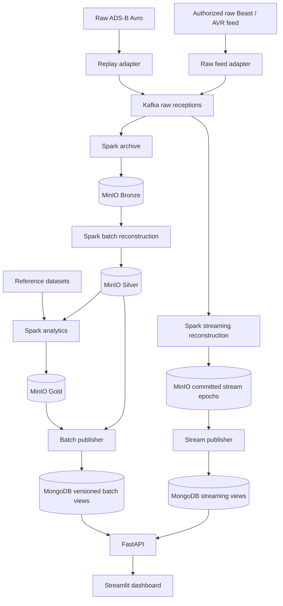

> BẢN LƯU: kế hoạch raw đã được thay bằng ../project-blueprint.md. Không dùng làm kế hoạch hiện tại. Các đường dẫn tương đối bên dưới thuộc vị trí tài liệu cũ.

# Air Traffic Analytics — Đặc tả và kế hoạch triển khai

**Ngày lập:** 22/11/2026
**Kiến trúc:** Lambda Architecture
**Công nghệ mục tiêu:** Python, Apache Kafka, Apache Spark, MinIO, MongoDB, FastAPI, Streamlit, Kubernetes.

**Quyết định cố định:** xử lý raw Mode S/ADS-B từ frame tới vị trí và trạng thái máy bay. State vectors xử lý sẵn không thay thế đầu vào chính. Deploy được làm ở nhánh riêng.

**Điều kiện nguồn hiện tại:** nhóm chưa có thiết bị hoặc quyền truy cập feed raw live. Code đang dùng raw Avro lịch sử để phát triển và kiểm tra; mục tiêu raw live chưa thể được xác nhận cho tới khi có nguồn thật.

Nguồn bổ sung dự kiến là OpenSky REST state vectors cho phân tích vùng gần thời gian thực. Collector OAuth2 và Kafka topic riêng đã có code; chưa chạy API thật. [Điều khoản OpenSky](https://opensky-network.org/about/terms-of-use) yêu cầu thỏa thuận bằng văn bản trước khi sử dụng API trong hệ thống tự động. Không trộn state vectors vào raw reception hoặc dùng chúng làm bằng chứng raw live. [Chi tiết nguồn bổ sung](opensky-state-source.md).

Tài liệu này là bản thiết kế và kế hoạch thực thi của project. Không dùng các mốc S1–S11 của kế hoạch HDFS cũ để giao việc.

MinIO được chọn làm kho lưu trữ mục tiêu theo quyết định mới. HDFS đang có trong repo là hệ thống nguồn phục vụ chuyển đổi, không phải một thành phần bắt buộc của kiến trúc cuối cùng. Việc viết tài liệu này chưa thay đổi runtime hay di chuyển dữ liệu.

## 1. Bài toán và mục tiêu

### 1.1 Bài toán cần giải quyết

Dữ liệu ADS-B thô gồm các bản tin do máy bay phát và trạm thu ghi nhận. Một bản tin thường chỉ mang một phần thông tin: định danh, độ cao, vận tốc hoặc dữ liệu mã hóa vị trí. Nhiều trạm có thể thu cùng một lần phát; dữ liệu có thể trùng, đến muộn, thiếu cặp bản tin cần thiết để giải mã vị trí hoặc nằm ngoài định dạng được hỗ trợ.

Project xây dựng hệ thống biến các bản tin đó thành thông tin có thể tra cứu và phân tích: máy bay nào được quan sát, vị trí nào dựng lại được, đường đi quan sát được ra sao và mật độ máy bay thay đổi thế nào theo khu vực, thời gian. Mỗi kết quả phải có nguồn gốc và trạng thái chất lượng đủ để giải thích khi thiếu hoặc thay đổi.

Đầu vào xử lý luôn là raw reception. Hệ thống có adapter cho file raw lịch sử và adapter cho feed raw live khi có quyền truy cập. Cả hai đưa cùng hợp đồng dữ liệu vào Kafka, rồi Spark tự giải mã, ghép bản tin, dựng vị trí và trạng thái. Hiện chỉ đường replay có nguồn dùng được; UI phải phân biệt Live với Historical Replay. Batch tính lại từ Bronze để bổ sung dữ liệu đến muộn và sửa các kết quả theo phạm vi công bố.

### 1.2 Giá trị hệ thống cung cấp

| Nhu cầu | Kết quả người dùng nhận được |
| --- | --- |
| Theo dõi các quan sát dựng lại được | Bản đồ vị trí, thời gian nguồn và độ mới; nhãn Live hoặc Replay đúng nguồn đang chạy |
| Xem lại một máy bay | Các điểm quan sát theo thời gian, đoạn hành trình và khoảng thiếu dữ liệu |
| Phân tích khu vực | Số máy bay được quan sát theo ô địa lý và cửa sổ thời gian |
| Hiểu độ tin cậy dữ liệu | Tỷ lệ bản tin hợp lệ, trùng, muộn, thiếu thông tin và không dựng được vị trí |
| Xem kết quả sau tính lại | Kết quả batch, khác biệt với streaming và phiên bản dữ liệu đang được sử dụng |
| Vận hành pipeline | Trạng thái job, backlog, độ trễ, tài nguyên và lỗi trên dashboard vận hành |

### 1.3 Phạm vi và giới hạn

- Phân tích các máy bay thực sự xuất hiện trong dữ liệu thu được. Số đếm không đại diện cho toàn bộ máy bay trong vùng trời.
- Hiển thị **Historical Replay** khi phát file, **Live** chỉ khi nhận feed đang hoạt động. Đồng hồ nguồn và thời gian xử lý thực tế được lưu riêng.
- Không giả định một bản tin là một trạng thái máy bay hoàn chỉnh; không tự điền vị trí, callsign hoặc vận tốc bị thiếu.
- Không suy luận sân bay đi/đến hay chuyến bay thương mại chỉ từ một đoạn quan sát ngắn.
- Mẫu hiện có đủ để chạy toàn bộ luồng kỹ thuật, nhưng thời lượng ngắn hạn chế các kết luận về xu hướng dài hạn. Mô tả đầu ra phải khớp khoảng thời gian thực tế của dataset.
- Hệ thống phục vụ học tập và phân tích dữ liệu; không dùng để điều hành bay.

### 1.4 Vì sao dùng Big Data

Bản tin đến liên tục từ nhiều trạm; việc dựng vị trí cần ghép dữ liệu theo máy bay và thời gian; lưu lịch sử để tính lại làm dung lượng tăng theo thời gian. Các công việc grouping, window, join và tổng hợp theo vùng có thể phân phối trên nhiều Spark executor. Kho lưu trữ phân tán giữ dữ liệu để các job độc lập cùng truy cập.

Project thể hiện kiến trúc có khả năng mở rộng bằng triển khai và xử lý phân tán. Không gọi mẫu dữ liệu vài phút là dữ liệu quy mô lớn chỉ vì nó đi qua Spark.

## 2. Quyết định kiến trúc

| Hạng mục | Lựa chọn | Vai trò |
| --- | --- | --- |
| Kiến trúc | Lambda | Streaming cung cấp kết quả sớm; batch tính lại từ dữ liệu đã lưu |
| Ngôn ngữ | Python | Dùng lại code hiện tại và PySpark |
| Message broker | Kafka | Nhận raw reception từ adapter live/replay, tách nguồn khỏi consumer |
| Xử lý | Spark Structured Streaming và Spark Batch | Archive, dựng vị trí, analytics và tính lại |
| Data lake | MinIO qua S3A | Lưu raw, Bronze, Silver, Gold và dữ liệu phục hồi |
| Định dạng bảng | Parquet | Lưu dữ liệu dạng cột; partition theo cách truy vấn |
| Database phục vụ | MongoDB | Tra cứu nhanh kết quả và metadata phiên bản |
| API | FastAPI | Cung cấp giao diện đọc dữ liệu cho dashboard |
| Dashboard | Streamlit | Bản đồ replay, hành trình, thống kê và chất lượng |
| Triển khai | Kubernetes bằng kubeadm | Chạy dịch vụ và Spark executor trên cụm |
| Phát triển local | Docker Compose | Chạy nhanh cùng bộ image để phát triển và kiểm tra |
| Quan sát hệ thống | Prometheus, Grafana, Spark event logs | Theo dõi pipeline và cụm |

Giữ Parquet và cơ chế publication có phiên bản để tái sử dụng code. Không thêm table format, orchestrator hay một framework xử lý khác vào đường triển khai ban đầu nếu chưa có nhu cầu cụ thể.

### 2.1 Luồng dữ liệu



Đường live gửi frame vào Kafka ngay khi collector nhận được; Spark archive đưa dữ liệu xuống MinIO song song với xử lý. Đường replay đọc file raw từ nguồn đã cấu hình, có thể là MinIO. Hai mode có topic/checkpoint hoặc phạm vi query tách biệt.

Archive và streaming đọc Kafka bằng query/checkpoint riêng. Archive giữ mọi delivery; quyết định bỏ dữ liệu đến muộn của streaming không được làm mất dữ liệu trong Bronze.

Batch đọc một snapshot Bronze đã xác định, dựng lại Silver, tạo Gold và công bố phiên bản kết quả. API chọn phiên bản batch đã công bố cho phần dữ liệu nó bao phủ; dùng streaming cho phần còn lại. Không cộng hai kết quả trùng phạm vi.

### 2.2 Ý nghĩa kết quả streaming và batch

Streaming hiện có chỉ xuất vị trí sau khi epoch đủ điều kiện hoàn tất theo watermark. Thiết kế giữ cách này: bản đồ cập nhật theo các quan sát đã hoàn tất trong streaming, chấp nhận độ trễ watermark. Không mô tả nó là hiển thị ngay mọi bản tin vừa nhận.

Kết quả streaming vẫn mang trạng thái `streaming` vì một lần batch sau có thể bổ sung hoặc thay đổi kết quả nhờ dữ liệu đến muộn. Kết quả batch có trạng thái `recomputed`, gắn với snapshot và phiên bản cụ thể. Nhãn này nói về nguồn và mức hoàn tất của xử lý, không khẳng định vị trí đã được xác nhận bằng dữ liệu chuẩn bên ngoài.

## 3. Dữ liệu và các quy tắc xử lý

### 3.1 Nguồn raw và điều kiện realtime

Raw trong project là frame Mode S/ADS-B 56/112 bit cùng metadata reception, không phải mẫu sóng I/Q và không phải JSON tọa độ đã được bên khác dựng sẵn.

| Nguồn | Vai trò | Tình trạng |
| --- | --- | --- |
| OpenSky raw Avro đã ghim checksum | Dữ liệu thật để phát triển, kiểm tra và replay | Code đã hỗ trợ mẫu lịch sử |
| Feed Beast/AVR từ trạm thu được phép truy cập | Raw đầu vào trực tiếp | Nhóm xác nhận chưa có thiết bị hoặc endpoint |
| Snapshot sân bay/vùng | Reference để join và phân tích | Bổ sung riêng, không thay raw telemetry |

Chọn Beast TCP làm giao thức live đầu tiên khi tiếp cận được nguồn; AVR là adapter mở rộng nếu nguồn yêu cầu. `readsb` có các đầu ra raw/Beast riêng với đầu ra vị trí JSON, nên cần lấy đúng endpoint. [Source readsb: network output options](https://github.com/wiedehopf/readsb/blob/dev/help.h).

Hai cách đáp ứng nguồn live: được chủ trạm cấp quyền dùng raw output, hoặc vận hành một trạm thu với phần cứng phù hợp. Chưa có endpoint được xác minh thì không chốt tốc độ, coverage hoặc tuyên bố đang thu raw live. Không mặc định REST API trạng thái máy bay hoặc API có chữ “raw” trả lại frame radio.

Trong lúc chưa có feed, tiếp tục xử lý raw lịch sử thật qua Kafka. Việc này xác nhận streaming logic và kết quả giải mã, nhưng không đáp ứng tiêu chí nguồn live. Nếu live là điều kiện bắt buộc khi bàn giao, quyền truy cập nguồn vẫn là đầu việc còn mở, không tự đổi phạm vi sang state vectors hoặc gọi replay là realtime.

Mỗi file nguồn có manifest gồm dataset ID, URL/URI, checksum, schema và coverage. File lớn nằm ở storage của môi trường chạy; repository chỉ giữ manifest và fixture nhỏ. Adapter file hỗ trợ URI MinIO khi tích hợp storage, không yêu cầu tải toàn bộ dataset về máy lập trình.

### 3.1.1 Hợp đồng nguồn chung

Giữ frame gốc, receiver ID, timestamp nguồn, timestamp collector nhận và metadata. Adapter làm parsing/framing và publication; policy decode/CPR nằm trong processing dùng chung batch/streaming. Ghi cả metadata về filtering/error correction của receiver nếu biết, không giả định đầu ra receiver bảo toàn mọi tín hiệu đã thu.

Beast là stream byte: parser phải xử lý frame bị chia qua nhiều lần đọc TCP, escape byte, nhiều frame trong một lần đọc và reconnect. Timestamp dạng tick của receiver không được mặc định là Unix time. Giữ tick gốc, session và clock basis; chỉ tạo event time UTC khi có cơ sở chuyển đổi. Thời gian collector nhận có thể dùng làm fallback được gắn cờ chất lượng, không gọi là thời gian RF chính xác.

Danh tính raw reception dựa trên nguồn/session và vị trí bản ghi hoặc sequence, không chỉ hash payload: cùng payload ở hai thời điểm có thể là hai lần phát khác nhau. Retry cùng reception giữ nguyên identity. Kafka acknowledgment chỉ bảo đảm ở biên publisher/broker; TCP receiver không cung cấp khả năng đọc lại thì reconnect có thể tạo khoảng mất dữ liệu và phải được báo.

Pipeline hiện cô lập nhiều thao tác theo `source_sha256`. Khi hỗ trợ nhiều file hoặc feed liên tục, cần thêm reconstruction scope rõ ràng để ghép cùng máy bay qua ranh giới file trong cùng collection, đồng thời không trộn hai lần replay. Adapter live dùng source/session identity, không bịa checksum file. Thay đổi schema và grouping phải có phiên bản cùng fixture hồi quy.

### 3.2 Danh tính và thời gian

| Trường | Ý nghĩa |
| --- | --- |
| `dataset_id` | Dataset nguồn |
| `run_id` | Một phiên xử lý live hoặc replay độc lập |
| `reception_id` | Bản ghi nguồn ổn định qua các lần replay |
| `delivery_id` | Một lần gửi reception vào pipeline |
| `topic`, `partition`, `offset` | Danh tính record đã có trong Kafka |
| `transmission_id` | Nhóm reception được xem là cùng một ứng viên phát sóng theo quy tắc |
| `position_id` | Vị trí canonical theo policy và dữ liệu đầu vào |
| `event_time` | Thời gian của dữ liệu nguồn |
| `processed_at` | Thời gian hệ thống xử lý |
| `policy_version` | Phiên bản quy tắc giải mã và dựng vị trí |
| `input_snapshot_id`, `result_version` | Nguồn và phiên bản kết quả tính lại |

Các bảng phục vụ phải phân biệt `run_id` kể cả khi `position_id` được tái sử dụng giữa hai lần replay. Hai run không được làm tiến watermark hoặc ghi đè trạng thái của nhau.

### 3.3 Quy tắc nghiệp vụ

- Bronze bảo toàn raw payload, metadata và danh tính Kafka. Hai offset khác nhau có thể chứa cùng reception và đều phải được giữ.
- Silver phân biệt dữ liệu hợp lệ, không hỗ trợ, chưa xác minh và sai định dạng. Không gộp tất cả thành dữ liệu hỏng.
- Dùng chung quy tắc dựng vị trí cho batch và streaming; giữ policy hiện có khi chuyển cấu trúc và storage.
- Callsign, vận tốc và độ cao có thời gian cập nhật riêng; trường hết hạn phải được thể hiện rõ.
- Ghép hành trình theo máy bay và run; tách đoạn khi khoảng cách thời gian vượt ngưỡng cấu hình. Không vẽ đường nối dài qua khoảng mất tín hiệu.
- Traffic theo ô và cửa sổ thời gian đếm máy bay phân biệt. Tổng của nhiều ô không phải số máy bay phân biệt của hợp vùng.
- Batch sửa kết quả của đầy đủ phạm vi bị ảnh hưởng, bao gồm ô cũ và ô mới nếu vị trí thay đổi.

## 4. Thiết kế lưu trữ

### 4.1 Phân phối MinIO và cách triển khai

Chọn MinIO Community được build từ một source commit cố định cho môi trường đồ án. Bước triển khai đầu tiên ghi commit, toolchain, cấu hình build và image digest vào repo; không dùng tag `latest` hoặc tải binary không xác định nguồn.

Tại thời điểm lập tài liệu, [repo MinIO Community chính thức](https://github.com/minio/minio) thông báo đã archived và không còn được bảo trì; README mô tả phân phối source-only. Vì vậy việc tự build không mang ý nghĩa sẽ nhận được các bản vá mới. Phạm vi triển khai là cụm lab được kiểm soát truy cập. Không mặc định dùng tài liệu hoặc tính năng của AIStor Enterprise cho Community, và không giả định bản AIStor miễn phí cung cấp cùng khả năng triển khai phân tán.

Local dùng một MinIO instance để phát triển. Cụm trình diễn dùng bốn node trên bốn máy vật lý: PC Windows, máy Ubuntu và hai MacBook chạy Linux VM ARM64. Mục tiêu là một MinIO instance và một volume riêng trên mỗi node, với bản build hỗ trợ cả `amd64` và `arm64`. Trước khi tạo dữ liệu, xác nhận topology bốn node, số drive tối thiểu, parity và quorum trên đúng bản MinIO Community đã ghim. Nếu image hoặc topology không tương thích, dùng MinIO một node cho pipeline và ghi rõ phần lưu trữ phân tán chưa hoàn thành cho tới khi khắc phục.

MinIO trải trên MacBook chỉ hoạt động đáng tin trong phiên trình diễn khi các VM, Tailscale và nguồn điện luôn sẵn sàng. Không coi đây là cụm lưu trữ luôn bật. Khi một laptop tắt, khả năng đọc/ghi phụ thuộc quorum thực tế; không hứa hệ thống tiếp tục ghi sau mất node trước khi thử trên cấu hình đã triển khai. Mỗi volume thuộc một host vật lý; nhiều pod trên cùng host không tăng khả năng chịu lỗi host.

### 4.2 Các vùng dữ liệu

```text
s3a://airtraffic-lake/
├── raw/                  # File nguồn và manifest
├── bronze/               # Delivery từ Kafka, append-only
├── silver/               # Reception, transmission, position và aircraft state
├── gold/                 # Trajectory, traffic, quality, graph và ML outputs
└── reference/            # Snapshot dữ liệu tham chiếu

s3a://airtraffic-runtime/
├── checkpoints/          # Spark checkpoint riêng cho từng query
├── streaming/            # Epoch output, retained state và manifest
├── publications/         # Manifest của các lần công bố
└── spark-events/          # Spark event logs
```

Đường dẫn gốc là cấu hình. Bronze thêm partition `dataset_id`, `run_id`, ngày event time; timestamp không hợp lệ có partition riêng. Silver và Gold nằm dưới `result_version`, rồi partition theo ngày nếu lượng dữ liệu cần. Không partition theo mỗi máy bay hoặc mỗi phút vì dễ sinh quá nhiều file nhỏ.

Giữ file nguồn bất biến. Dùng Parquet với compression được ghim trong cấu hình. Compaction tạo phiên bản mới và chỉ xóa phiên bản cũ sau khi không còn snapshot hoặc consumer tham chiếu. Chính sách dọn raw, checkpoint và kết quả không được dùng chung một thời hạn tùy tiện.

### 4.3 Ghi dữ liệu, commit và checkpoint

Spark truy cập MinIO qua Hadoop S3A. `hadoop-aws` và các dependency phải khớp Hadoop thực tế đi kèm image Spark; không suy ra phiên bản này từ image HDFS cũ.

Batch Parquet dùng S3A committer phù hợp, ưu tiên magic committer với bộ dependency đã ghim. Không dựa vào rename thư mục để công bố phiên bản. Cấu hình batch committer không tự chứng minh Spark streaming file sink hoặc checkpoint an toàn; hai đường ghi này có bài kiểm tra recovery riêng. [Tài liệu Spark về object storage](https://spark.apache.org/docs/3.5.7/cloud-integration.html) và [S3A committers](https://hadoop.apache.org/docs/current/hadoop-aws/tools/hadoop-aws/committers.html) là cơ sở triển khai, còn khóa cấu hình cụ thể phải khớp phiên bản sử dụng.

Quy trình công bố một output:

1. Cấp một version/attempt ID mới và chỉ cho một writer sở hữu run/query đó.
2. Ghi các bảng vào prefix bất biến của attempt.
3. Kiểm tra schema, danh tính, số lượng và các ràng buộc nghiệp vụ.
4. Ghi manifest đầy đủ, sau cùng mới ghi root completion marker.
5. Consumer chỉ đọc attempt được manifest công bố hoàn tất.

Marker `_RESERVED` tạo bằng filesystem API hiện tại không được xem như distributed lock trên S3. Chống writer trùng bằng quyền sở hữu job ở tầng điều phối; khi có restart phải dừng writer cũ trước khi chuyển quyền. Consumer không đọc prefix đang ghi dở.

Mỗi streaming query có checkpoint riêng trên MinIO và phải chứng minh restart được bằng đúng image, connector và checkpoint manager đã chọn. Query không được chia sẻ checkpoint. Retry epoch đã công bố là no-op; epoch dở dùng attempt mới, sau đó mới dọn phần thừa. Không xóa checkpoint đang dùng để chạy lại job.

### 4.4 Chuyển đổi HDFS sang MinIO

Tạo dataset/run đích mới trên MinIO. Copy file nguồn cùng manifest; có thể replay lại mẫu hiện có để tạo Bronze mới. Các output lịch sử cần giữ được copy theo phiên bản và kiểm tra trước khi đánh dấu dùng được.

Không tái sử dụng checkpoint HDFS bằng cách sửa chuỗi URI. Đối với run đang hoạt động, phải dừng replay, chờ archive commit, ghi lại offset theo partition rồi thực hiện chuyển đổi có kiểm soát. Với đồ án, cách mặc định là bắt đầu một replay run mới trên MinIO và giữ các run HDFS cũ làm lịch sử.

Chỉ gỡ HDFS khỏi runtime sau khi archive, batch, streaming và recovery trên MinIO đều hoàn thành tiêu chí. Việc dọn volume HDFS là thao tác riêng, không nằm trong refactor source.

## 5. Serving, API và dashboard

### 5.1 MongoDB

| Collection | Nội dung chính |
| --- | --- |
| `datasets`, `runs` | Coverage, trạng thái replay, tiến độ và lỗi |
| `positions`, `aircraft_states` | Quan sát và trạng thái theo run, source và version |
| `trajectories` | Đoạn hành trình và khoảng thiếu dữ liệu |
| `traffic_windows` | Thống kê theo ô địa lý và cửa sổ |
| `quality_windows` | Thống kê chất lượng theo thời gian, loại bản tin hoặc trạm thu |
| `publications` | Phiên bản được công bố và phạm vi bao phủ |
| `corrections` | Thay đổi giữa streaming và batch, cùng nguồn dữ liệu |

Publisher đọc epoch/phiên bản đã commit trên MinIO. Publisher có tiến độ riêng để tiếp tục sau lỗi. MongoDB dùng unique index theo khóa nghiệp vụ, run và version; upsert lặp lại không tạo thêm bản ghi logic. Cập nhật latest state phải kiểm tra event time và thứ tự xác định khi timestamp bằng nhau.

Batch ghi đủ tài liệu dưới một version mới rồi mới đổi document trỏ publication. Phạm vi publication phải thể hiện cả những key đã không còn kết quả sau tính lại; API không được quay về giá trị streaming cũ chỉ vì batch mới không chứa key đó. API đọc publication một lần cho mỗi request để tránh trộn phiên bản.

Đây là cơ chế tạo hiệu ứng idempotent tại sink. Không tuyên bố một transaction exactly-once bao phủ Kafka, Spark, MinIO và MongoDB.

### 5.2 API

Các endpoint đọc dự kiến:

```text
GET /health/live
GET /health/ready
GET /datasets
GET /runs
GET /runs/{run_id}
GET /runs/{run_id}/aircraft?at=...
GET /runs/{run_id}/aircraft/{icao24}/trajectory?start=...&end=...
GET /runs/{run_id}/traffic?start=...&end=...&resolution=...
GET /runs/{run_id}/quality?start=...&end=...
GET /runs/{run_id}/corrections
```

API truy vấn MongoDB, không mở Spark job hoặc quét Parquet mỗi lần người dùng tải trang. Mọi truy vấn lịch sử phải có khoảng thời gian, giới hạn số điểm hoặc pagination. Response trả kèm trạng thái nguồn, coverage và result version để UI hiển thị thống nhất.

### 5.3 Các màn hình cần bàn giao

1. **Observation map:** chọn run, xem vị trí tự dựng, timestamp và nhãn nguồn. Replay có đồng hồ mô phỏng; Live chỉ bật khi feed raw thực đang hoạt động.
2. **Aircraft detail:** hành trình quan sát được, độ cao/vận tốc theo thời gian, khoảng mất dữ liệu và chất lượng.
3. **Traffic analytics:** bản đồ mật độ theo H3, biểu đồ số máy bay theo cửa sổ và bảng thống kê vùng.
4. **Data quality:** phân loại bản tin, duplicate delivery, late arrival, tỷ lệ dựng được vị trí và lịch sử correction.

Nút play/pause trên dashboard điều khiển đồng hồ xem dữ liệu. Producer replay được khởi động qua CLI/job vận hành; không ngầm khởi động lại ingestion mỗi khi người dùng tua bản đồ.

## 6. Tổ chức repository

```text
BigData_20261/
├── README.md
├── pyproject.toml
├── compose.yaml
├── src/
│   └── airtraffic/
│       ├── config.py
│       ├── schemas/              # Data contract và schema output
│       ├── ingestion/            # Raw Avro/Beast adapters, replay, Kafka, reference input
│       ├── processing/           # Decode, reception, position, aircraft state
│       ├── pipelines/            # Archive, batch, streaming orchestration
│       ├── analytics/            # Trajectory, traffic, quality, graph, ML
│       ├── storage/              # Lake paths, manifests, publication
│       ├── serving/              # Mongo repositories và publishers
│       ├── api/                  # FastAPI routes, request/response models
│       └── jobs/                 # CLI và Spark entrypoints mỏng
├── dashboard/
│   ├── app.py
│   ├── pages/
│   └── components/
├── configs/
│   ├── application.yaml          # Policy và default không chứa secrets
│   └── datasets/                 # Source manifests
├── deploy/
│   ├── images/                   # Spark app, producer, API/UI, MinIO build
│   └── k8s/
│       ├── cluster/              # Host, kubeadm, inventory mẫu
│       ├── platform/             # Kafka, MinIO, MongoDB, monitoring
│       ├── apps/                 # Job templates, publishers, API, dashboard
│       ├── overlays/
│       │   ├── single-node/      # Chuẩn bị và tích hợp
│       │   └── distributed/      # Cụm đích
│       └── checks/               # DNS, PVC, connectivity, readiness
├── tests/
│   ├── fixtures/
│   ├── unit/
│   ├── integration/
│   └── e2e/
├── docs/
│   ├── project-blueprint.md      # Tài liệu này
│   ├── operations/              # Install, deploy, restart, backup, restore
│   └── report/                  # Bằng chứng và lessons learned
└── data/
    └── raw/                      # Input local, không commit
```

Chỉ tạo module/thư mục khi có phần triển khai tương ứng. Không tạo toàn bộ cây rỗng hoặc một lớp abstraction cho mỗi file.

Quy tắc phụ thuộc:

- `jobs` nhận tham số, tạo runtime và gọi `pipelines` hoặc `serving`.
- `pipelines` kết hợp `processing`, `analytics` và `storage`.
- `processing` không import `jobs`, không biết địa chỉ Kafka/MinIO/MongoDB.
- `api` gọi lớp truy vấn trong `serving`; dashboard gọi API.
- `deploy` chỉ giữ image, manifest và cấu hình vận hành; không chứa logic ADS-B.
- `scripts`, nếu cần, chỉ chứa wrapper vận hành ngắn. Logic dùng lại phải có module và entrypoint rõ ràng.

Cấu hình có thứ tự ưu tiên: CLI → biến môi trường → default đã commit. Secret chỉ đến từ môi trường/secret mount. Image chứa package đã cài cùng dependency được ghim; chạy trên cụm không phụ thuộc thư mục source trên laptop. Spark, producer và API có dependency riêng để API không phải cài toàn bộ runtime Spark.

## 7. Triển khai và vận hành cụm

### 7.1 Hai môi trường

| Môi trường | Mục đích | Phạm vi xác nhận |
| --- | --- | --- |
| Compose local | Code, debug, chạy một run hoàn chỉnh | Tích hợp chức năng; không chứng minh xử lý nhiều máy |
| Kubernetes distributed | Triển khai cuối, lưu trữ và executor phân tán | Hoạt động liên node, restart và lỗi trong phạm vi cấu hình |

**Phạm vi nhánh deploy, hiện tạm gác trên nhánh code:** dựng control plane trên VM Ubuntu của PC Windows, sau đó thêm máy Ubuntu hiện tại và hai MacBook làm worker. Các lựa chọn bên dưới giữ làm hợp đồng hạ tầng; không là điều kiện để bắt đầu viết collector với fixture.

Inventory dự kiến có một PC Windows i5-12600K/32 GiB RAM ở nhà, một máy Ubuntu đang phát triển và một số MacBook M2 trở lên/16 GiB RAM. Nên đặt VM Ubuntu 24.04 đầu tiên trên PC Windows nếu có thể truy cập máy đó sớm: PC là host ổn định hơn cho control plane và đĩa dữ liệu. Cài Tailscale bên trong VM và từng Linux worker, dùng IP Tailscale của node cho kubeadm/kubelet để các máy ở các mạng khác nhau tham gia cụm. Dự trù ban đầu 4 vCPU, 6–8 GiB RAM và ít nhất 40 GiB đĩa cho nền cụm, rồi tăng theo workload thực tế. Xác nhận dung lượng trống trên PC trước khi cấp VM. Kiểm tra kết nối direct/relay và mạng pod liên node trước khi đặt Spark/MinIO; relay ảnh hưởng throughput.

Máy Ubuntu hiện tại có thể chạy Kubernetes **trực tiếp trên host**, không cần VM: cài Tailscale, containerd và kubeadm rồi gia nhập làm worker sau khi control plane trên PC sẵn sàng. Lần kiểm tra 22/11/2026 cho thấy phân vùng gốc còn khoảng 13 GiB; cần xác nhận dung lượng cho image/container log trước khi nhận workload. Docker Compose đang chạy trên cùng host cần được tính vào ngân sách RAM/CPU/đĩa và tránh xung đột mạng.

Hai MacBook được đưa vào cụm, mỗi máy chạy một VM Ubuntu ARM64 với Tailscale và kubeadm worker. Dự trù cho mỗi VM 2–4 vCPU, 4–6 GiB RAM, 30–40 GiB đĩa; xác nhận dung lượng trống thực tế trước khi tạo VM. Laptop phải cắm nguồn, không sleep và giữ Tailscale kết nối trong phiên chạy. Image Spark, MinIO và các image workload chạy trên Mac phải có bản `arm64`. Dùng Mac làm Spark executor trước; chỉ thêm volume MinIO sau khi mạng pod, image và đĩa của cả bốn node đạt kiểm tra. Không đặt control plane trên MacBook.

Quản trị bằng `kubectl`, dùng Kustomize đi kèm `kubectl` cho manifest của project và Rancher làm giao diện quản lý. Giai đoạn lab không dùng Helm. Rancher Manager chạy trong container Docker trên **VM Ubuntu quản lý riêng**, rồi import cụm kubeadm qua IP Tailscale. Rancher không cần nằm trong cụm nó quản lý; nếu cụm lỗi, giao diện quản lý vẫn có thể truy cập. [Rancher hỗ trợ import cụm Kubernetes có sẵn](https://ranchermanager.docs.rancher.com/how-to-guides/new-user-guides/kubernetes-clusters-in-rancher-setup/register-existing-clusters). Cài Rancher bằng Docker một node được tài liệu chính thức giới hạn cho phát triển/kiểm thử; đây là mô hình lab của project, không tuyên bố Rancher HA. [Tài liệu Rancher](https://ranchermanager.docs.rancher.com/getting-started/installation-and-upgrade/other-installation-methods/rancher-on-a-single-node-with-docker).

PC Windows cần đủ tài nguyên cho hai VM: VM Kubernetes bắt đầu 4 vCPU, 8 GiB RAM, 40 GiB đĩa cho bước nền; trước khi chạy Kafka/MongoDB/Spark/MinIO, nâng ngân sách dự kiến lên 6 vCPU, 10–12 GiB RAM và 80 GiB đĩa nếu tài nguyên PC cho phép. VM Rancher dự trù 2 vCPU, 4 GiB RAM và khoảng 20 GiB đĩa. Đây là ngân sách lab phải xác nhận với dung lượng trống và phiên bản Rancher được ghim. Rancher có địa chỉ Tailscale riêng; giới hạn giao diện quản lý trong tailnet.

Chuẩn bị cụm theo inventory thực tế: hostname, IP Tailscale, CPU architecture, RAM, đĩa, đường mạng và vai trò node. Cấu hình mục tiêu có **bốn host vật lý**: một VM control plane trên PC Windows, máy Ubuntu trực tiếp và hai Linux VM trên MacBook. Một control plane vẫn là điểm lỗi đơn.

Trong lần chạy đầu, Kafka một broker và MongoDB một instance trên volume cố định; Spark executor phân bố ít nhất trên PC, Ubuntu và một Mac. Sau khi xác nhận image ARM64, mạng và volume, triển khai MinIO bốn node như mục 4.1. Ba broker Kafka và MongoDB replica set ba thành viên chỉ triển khai nếu các node giữ được uptime, tài nguyên và kết nối ổn định; không dùng chúng làm điều kiện để hoàn thành luồng sản phẩm. Ghi rõ rằng một broker, một database và một control plane là các điểm lỗi đơn.

Local PV có node affinity và chính sách giữ dữ liệu. Không để hai storage pod dùng chung một data directory. Backup nằm ở đích độc lập; replication hay erasure coding không thay thế backup khi dữ liệu bị xóa nhầm.

### 7.2 Chạy Spark

Dùng Spark native Kubernetes scheduling, image ứng dụng đã build và service account có RBAC giới hạn. Executor là pod riêng; job phân tán không dùng `--master local[...]`. Không thêm Spark standalone master hoặc YARN vào kiến trúc này. [Tài liệu Spark on Kubernetes](https://spark.apache.org/docs/3.5.7/running-on-kubernetes.html).

Entry point vận hành đóng gói `spark-submit`, cấu hình driver/executor và pod templates. Archive/streaming có tên query, checkpoint và writer owner cố định. Restart driver là submit lại có kiểm soát với checkpoint cũ sau khi xác nhận driver trước đã dừng; Kubernetes chạy pod không tự cung cấp đầy đủ cơ chế phục hồi Spark application.

Batch bắt đầu bằng lệnh explicit cho một run/snapshot. Khi đường xử lý đã ổn định, thêm CronJob nếu cần định kỳ và phải ngăn hai lần chạy cùng publication scope chồng nhau. Không cần đưa thêm Airflow vào phạm vi ban đầu.

### 7.3 Theo dõi và bảo vệ hệ thống

Thu thập các chỉ số phục vụ vận hành: tốc độ producer, backlog/offset của từng Kafka query, thời gian micro-batch, số observation/state giữ lại, độ trễ publication, dung lượng và sức khỏe MinIO, trạng thái MongoDB, tài nguyên pod và HTTP errors. Với Spark query tự quản lý offset, tính backlog từ end offsets và offset đã commit; không chỉ dựa vào consumer-group lag.

Log có `run_id`, job, epoch/version và lỗi; không ghi credentials. Spark event logs dùng cho xem execution plan và xử lý lỗi tài nguyên. Grafana hiển thị các chỉ số trên; log aggregation có thể dùng Loki khi tích hợp cụm.

API/dashboard truy cập qua ingress có kiểm soát; broker, database và storage mặc định là dịch vụ nội bộ. Tạo credentials riêng cho producer, Spark và publisher; chỉ cấp bucket/collection cần thiết. Bật TLS cho endpoint đi qua mạng không tin cậy, không commit kubeconfig/token hoặc mở public trang quản trị.

### 7.4 Lộ trình tham khảo của nhánh deploy

Các bước này được thực hiện ở nhánh hạ tầng, không chen vào thứ tự code ở mục 9.

#### A — Dựng và xác nhận nền Kubernetes một node

**Thực hiện theo thứ tự:**

1. Kiểm tra CPU/RAM/đĩa trống và tạo VM Ubuntu cho Kubernetes trên PC Windows. Cài Tailscale trong VM, ghi IP vào inventory và xác nhận máy quản trị truy cập được VM.
2. Cài containerd và kubeadm, khởi tạo control plane bằng IP Tailscale; cài Flannel trên `tailscale0`; cho phép workload trên node đầu tiên.
3. Áp dụng namespace, StorageClass, PV/PVC và Job kiểm tra bằng `kubectl apply -k`; xác nhận DNS, PVC và marker sau khi tạo lại pod/reboot VM.
4. Tạo VM Ubuntu quản lý riêng khi đã xác nhận PC đủ tài nguyên; cài Tailscale và chạy Rancher Docker với phiên bản/image được ghim. Giới hạn giao diện trong tailnet, import cụm Kubernetes đang chạy.
5. Xác nhận Rancher nhìn thấy node, namespace, pod và event; vẫn giữ kubeconfig để xử lý lỗi khi Rancher không sẵn sàng.

**Bàn giao:** cụm một node có thể quản trị từ máy phát triển và Rancher; inventory và phiên bản đã ghi; Job kiểm tra DNS/storage chạy được; runbook thêm worker sau này.

**Hoàn thành khi:** node Ready, CoreDNS/CNI hoạt động, image pull thành công, PVC Bound, dữ liệu marker tồn tại khi tạo lại pod và sau reboot VM. Kubeconfig từ máy quản trị truy cập đúng API endpoint; Rancher hiển thị cùng trạng thái của cụm. Chưa tính đây là cụm phân tán; kiểm tra pod-to-pod liên node được bổ sung ngay khi có worker đầu tiên.

#### B — Chuyển sang MinIO và đưa pipeline lên cụm

**Thực hiện theo thứ tự:**

1. Cài Tailscale/containerd/kubeadm trên máy Ubuntu hiện tại và gia nhập trực tiếp. Tạo hai VM Ubuntu ARM64 trên MacBook, cài Tailscale và gia nhập làm worker; Rancher phải thấy đủ bốn node.
2. Chạy pod kiểm tra trên từng node, kiểm tra DNS, pod-pod liên node, truyền dữ liệu lớn, image pull, volume persistence và kết nối Tailscale direct/relay.
3. Triển khai Kafka một broker và MongoDB một instance trên volume cố định. Đưa Spark image `amd64`/`arm64` lên registry, submit job có executor trên nhiều máy.
4. Ghim/build MinIO image cho hai kiến trúc; tạo volume riêng trên bốn host và xác nhận topology/quorum. Thêm bucket initialization và S3A dependencies; chuyển archive, Silver, epoch và checkpoint, sửa reservation/commit/retry; xác nhận bằng raw replay run mới.
5. Bổ sung RBAC, metrics Grafana và runbook bật/tắt VM laptop theo đúng thứ tự để không làm mất dữ liệu đang ghi.

**Bàn giao:** đường dữ liệu `Avro → Kafka → MinIO Bronze → Silver`, streaming epochs và checkpoint; manifests `platform`, `apps`, overlay cụm thực tế và runbook vận hành.

**Hoàn thành khi:** Rancher thấy bốn node Ready trong phiên chạy; Spark executor thực sự chạy trên ít nhất hai kiến trúc; MinIO có volume trên bốn host và đọc/ghi qua API từ Spark. Delivery được archive đầy đủ, không trùng offset trong snapshot; batch/streaming thống nhất policy giải mã và dựng vị trí; archive/streaming restart đúng và output dở không lộ ra consumer. Dữ liệu tồn tại khi tạo lại pod. Chỉ gỡ HDFS khỏi runtime sau khi xác nhận các đường ghi/recovery trên MinIO. Ghi rõ kết quả khi dừng từng node, kể cả trường hợp hệ thống tạm dừng vì mất quorum hoặc broker.

## 8. Repo hiện đang có gì

Đánh giá dưới đây ghi trạng thái sau khi chuẩn hóa cấu trúc source. Đây không phải một lần chạy lại toàn hệ thống.

| Thành phần | Hiện trạng | Cách đưa vào thiết kế mới |
| --- | --- | --- |
| Avro replay và Kafka producer | Có trong `src/airtraffic/ingestion/` và `jobs/producer.py` | Dataset manifest, nguồn MinIO và raw contract dùng chung |
| Raw file importer | Có `jobs/import_raw.py`: dò public S3 mỗi 300 giây, tải/kiểm tra Avro, ghi raw object và manifest MinIO | Nối manifest vào producer; kiểm tra với server MinIO thật |
| OpenSky state collector | Có `jobs/collect_states.py`: OAuth2, giới hạn lịch theo quota và phát sang topic Kafka riêng | Cần quyền sử dụng bằng văn bản, topic, archive/transform riêng và phép đối chiếu ở tầng trạng thái máy bay |
| Raw live collector | Chưa có code và chưa có feed/thiết bị | Beast adapter; cần nguồn được cấp quyền để xác nhận live |
| Kafka → Bronze | Có job Spark archive dùng HDFS | Chuyển URI, dependency và cơ chế ghi sang MinIO |
| Batch reconstruction | Có `processing/`, `pipelines/batch.py` và `storage/silver.py` | Giữ policy; chuyển lưu trữ khi thực hiện MinIO |
| Streaming reconstruction | Có `pipelines/streaming.py` dùng chung batch transform | Sửa lưu epoch/retry cho object storage |
| Compose | Kafka, HDFS và Spark chạy local | Đổi sang bộ dịch vụ mục tiêu, bổ sung Mongo/API/UI theo bước |
| Kubernetes | Có mẫu kubeadm, namespace/storage và DNS/PVC checks | Tái sử dụng cấu hình phù hợp, bổ sung platform/apps |
| MongoDB, publisher, API, dashboard | Chưa có trong source | Triển khai mới |
| Analytics Gold, graph, ML | Chưa có trong source | Triển khai theo output ở mục 10 |
| Test | Fixture và integration test nằm trong `tests/integration/` | Chạy lại với image mới và môi trường Kafka/HDFS |
| Packaging | Có `pyproject.toml`; image Spark cài package từ `src/` | Kiểm tra build và chạy image trên môi trường đích |

Đã bỏ import ngược từ streaming vào `jobs.preprocess`, gom runtime defaults vào `config.py` và sửa Docker build context để image Spark chứa package. Compose truyền cấu hình vào job và topic initialization; producer/stream hỗ trợ CLI override. Phần kiểm tra và publication của batch đã chuyển khỏi entrypoint sang pipeline.

Ngày 22/11/2026: image Spark build thành công; 3 test cấu hình/CLI và 7 fixture Spark pass qua `make test-unit test-silver`, dùng package trong image và chỉ mount thư mục test. Compose render đúng các biến override. Lần kiểm tra này chưa chạy lại Kafka/HDFS recovery hoặc kiểm tra MinIO/Kubernetes. Runtime Compose vẫn dùng HDFS. Raw source contract và tích hợp MinIO còn phải triển khai; feed live chưa được cung cấp.

Các kết quả HDFS cũ chỉ mô tả runtime trước khi chuyển sang MinIO/Kubernetes. Không dùng chúng để tuyên bố hệ thống đích đã được xác nhận.

Cập nhật nguồn file ngày 22/11/2026: đã thêm importer raw định kỳ và kiểm tra tải mẫu OpenSky 304.131 receptions với SHA-256 đúng. Bucket raw công khai của OpenSky hiện chỉ có placeholder, chưa xác minh nguồn raw mới mỗi 5 phút. Mẫu GitHub chứa 5 phút dữ liệu năm 2015. [Raw ingestion](raw-ingestion.md) ghi nguồn tham khảo, cách chạy và ranh giới hoàn thành; producer hiện có chưa đọc manifest MinIO và raw live vẫn chưa có feed.

Nguồn bổ sung đang được xem xét: OpenSky Trino có `rawmsg` trong các bảng `_data4` và dữ liệu lịch sử năm 2026, nhưng cần được duyệt tài khoản, chưa có số đo độ trễ và đã gộp nhiều raw receptions vào một hàng. Dùng nó để mở rộng dữ liệu lịch sử nếu được cấp quyền, với nhãn provenance riêng; không dùng để tuyên bố nhận bản tin trực tiếp theo từng giây. Bản snapshot 01/03/2026 là tải tĩnh. [Đánh giá và điều kiện chọn nguồn](raw-ingestion.md) được cập nhật tương ứng.

## 9. Kế hoạch thực thi trên nhánh code

### Bước 1 — Chốt raw contract và nguồn đầu vào

**Làm ngay:** tách mô tả dataset khỏi hằng số của mẫu Avro; chuẩn hóa raw envelope và identity/time basis để adapter replay và live dùng chung. Kiểm tra các giả định `source_sha256`, receiver grouping và timestamp trong processing hiện có. Dùng các raw frames thật đã có làm fixture; giữ policy hiện tại trước khi mở rộng có phiên bản.

**Bàn giao:** schema raw có version, dataset manifest, adapter Avro không gắn cứng một file và test identity/provenance. Có danh sách điều kiện nhận feed Beast: endpoint được cấp quyền, receiver identity, framing, clock basis, filtering và coverage.

**Hoàn thành khi:** phát lại cùng raw reception giữ identity nguồn; các lần phát khác nhau không bị gộp vì payload giống nhau; timestamp/replay time không bị lẫn; decoder và CPR fixtures cũ vẫn đúng. Chưa đánh dấu live sẵn sàng khi chưa có nguồn.

Chuẩn bị luôn cơ chế replay theo kịch bản ở mục 10.1: giữ payload raw, điều khiển lịch gửi và ghi nhận event time/arrival time. Nhờ đó các kỹ thuật được kiểm chứng ngay khi viết pipeline, không đợi đến lúc làm slide mới thêm dữ liệu minh họa.

### Bước 2 — Raw pipeline trên MinIO

**Thực hiện:** adapter đọc file raw qua storage được cấu hình; archive Kafka → Bronze giữ raw bytes/metadata/offset; batch dựng Silver trên MinIO; kiểm tra S3A commit, checkpoint và retry của streaming. Không thay toàn bộ output policy trong cùng lần đổi storage.

**Bàn giao:** raw dataset thật → Kafka → Bronze → decode/reconstruction → Silver, chạy bằng image và endpoint do nhánh deploy cung cấp.

**Hoàn thành khi:** broker-acknowledged deliveries được archive đầy đủ trong phạm vi kiểm tra; output giải mã/dựng vị trí tương đương policy cũ; restart không gây trùng logic và consumer không thấy output dở. Có thể viết code/test fixture trước, nhưng integration cần MinIO/Kafka thật.

### Bước 3 — Raw live adapter và phục hồi nguồn

**Thực hiện:** Beast stream parser, reconnect/backoff, metadata receiver/session, clock policy và publisher có backpressure. Kiểm tra parser bằng capture/fixture, sau đó nối feed được cấp quyền khi có. Không gửi output JSON vị trí của receiver vào chỗ raw frame.

**Bàn giao:** feed raw đang hoạt động → Kafka → cùng pipeline reconstruction, cùng khả năng lưu và xem lại lịch sử.

**Hoàn thành khi:** frame thật truy được từ receiver tới Bronze và vị trí tự dựng; restart/reconnect được ghi nhận đúng, timestamp không bị diễn giải sai, nguồn mất kết nối hiện thành khoảng thiếu dữ liệu. **Đầu việc này chưa thể nghiệm thu live vì nhóm chưa có nguồn.** Không cần đợi nó mới làm serving/analytics bằng raw replay thật.

### Bước 4 — Serving và bản đồ kết quả tự dựng

**Thực hiện:** MongoDB publisher idempotent cho output đã commit, API và dashboard vị trí/hành trình/chất lượng. Giữ lineage tới reception và CPR pair. Live và replay tách run/namespace, hiển thị trạng thái nguồn và độ mới đúng.

**Hoàn thành khi:** mỗi điểm hiển thị truy ngược được tới frame nguồn và policy; không dùng state vectors bên ngoài để lấp vị trí thiếu hoặc đáp ứng tiêu chí end-to-end.

### Bước 5 — Analytics, Lambda correction và bàn giao

Dựng trajectory segments, H3/time traffic, quality, graph và ML theo mục 10. Batch đọc snapshot Bronze cố định, áp dụng cùng reconstruction policy, tính lại đầy đủ vùng bị ảnh hưởng rồi publish version. Correction chỉ dùng dữ liệu đã thu/lưu; không khôi phục được frame đã mất trước ingestion.

Nghiệm thu tính đúng, late data, state bounds, idempotent publication và resource/latency trong workload đã xác định. Ghi rõ trạng thái nguồn live và coverage. Không mở thêm lộ trình thử công nghệ không gắn với output sản phẩm.

Bàn giao cả bộ kịch bản demo ở mục 10.1, chạy qua job thực tế và có kết quả đối chiếu. Bổ sung query native watermark/window aggregation cho quality metrics; không dùng riêng watermark tự quản lý của reconstruction để tuyên bố đã triển khai native Spark state store.

### Hợp đồng với nhánh deploy

Deploy cung cấp Kafka, MinIO, MongoDB, registry, credentials và runtime Spark. Nhánh code cung cấp image, entrypoint, schema và cấu hình. Thu nhận raw live còn cần endpoint receiver/feed riêng; dựng Kubernetes không tự tạo ra nguồn raw.

Thứ tự ứng dụng: **raw contract/adapters → MinIO archive và reconstruction → serving/analytics**. Live adapter tiến hành khi có source contract; nghiệm thu live phụ thuộc quyền truy cập nguồn thật. Deploy được làm độc lập, không thay đổi host/cụm trong công việc nhánh code.

## 10. Đáp ứng yêu cầu môn học bằng phần triển khai

Theo guideline, lưu trữ là “HDFS or equivalent”; MinIO distributed đóng vai trò kho lưu trữ tương đương về mục đích trong pipeline. MongoDB vẫn là thành phần NoSQL riêng. Yêu cầu Kubernetes/Cloud được đáp ứng ở môi trường cụm, Compose chỉ phục vụ phát triển.

| Yêu cầu Spark | Phần triển khai cụ thể | Bằng chứng bàn giao |
| --- | --- | --- |
| Window functions, advanced aggregation | CPR partner selection, latest aircraft attributes, H3/time traffic | Code, schema, output và physical plan |
| Pivot/unpivot | Ma trận số bản tin theo loại × trạm/cửa sổ; chuyển về dạng dài cho API | Quality job và bảng kết quả |
| Custom aggregation | Aggregate Pandas UDF tính chỉ số khoảng gián đoạn quan sát trên nhóm máy bay/cửa sổ hữu hạn | Hàm aggregate, fixture và output |
| Transform nhiều bước, UDF | Raw → classified → transmission → position → state; decode và H3 UDF | Pipeline dùng chung batch/stream |
| Broadcast join | Gắn reference nhỏ vào kết quả đã xác định khóa vùng/sân bay gần nhất bằng quy tắc riêng | Plan xác nhận broadcast, không gọi join khoảng cách là equi-join |
| Sort-merge join, multiple joins | Ghép positions với lineage và metadata snapshot trên các tập lớn | Plan thực thi và kiểm soát cardinality |
| Partition pruning | API offline/batch đọc đúng run, ngày và version | Scan plan hiển thị partition filters |
| Bucketing | Bảng batch phục vụ join theo aircraft/run được bucket theo cùng khóa | Catalog DDL, bucket files và executed plan; không đồng nhất bucketing với partition directory |
| Caching/persistence | Tái dùng classified receptions/transmissions trong một job | Persist/unpersist có phạm vi rõ, metric job |
| Query optimization | Giới hạn cột, lọc sớm, kiểm soát shuffle và số file | Explain plan và số liệu lần chạy nghiệm thu |
| Structured Streaming/output modes | Archive append; window aggregates update cho provisional hoặc append khi cửa sổ hoàn tất | Query cấu hình rõ mode và sink idempotent tương ứng |
| Watermark, late data, state | Giữ reconstruction state hiện có; bổ sung native event-time window state cho quality/traffic | Query progress, late classification và checkpoint recovery |
| Exactly-once effects | Kafka offset identity, epoch commit, Mongo unique keys/upsert | Duplicate/retry/partial-write checks tại từng sink |
| Spark MLlib | Pipeline chuẩn hóa đặc trưng và KMeans nhóm các đoạn hành trình quan sát được | Model artifact, feature definition và cluster labels |
| GraphFrames | Đồ thị chuyển tiếp giữa ô H3 của các đoạn hành trình liền nhau; degree và connected components | Vertex/edge tables, graph job và output |
| Statistics/time series | Phân bố tốc độ/độ cao, inter-arrival gaps, rolling traffic statistics | Gold tables và biểu đồ dashboard |

Các nhóm tính năng trên là đầu việc trong sản phẩm, không mở thành đề tài thực nghiệm riêng. ML dùng để mô tả nhóm chuyển động, không dự báo giao thông; chỉ train khi có đủ số đoạn hợp lệ và số mẫu cho cấu hình model, nếu thiếu thì báo thiếu dữ liệu và bổ sung dataset thực. Đồ thị biểu diễn chuyển tiếp vùng quan sát được, không phải mạng đường bay thương mại.

Phần bucketing dùng bảng Spark SQL với metadata catalog được lưu bền hoặc có DDL tái tạo trỏ về đúng vị trí bảng. Không mặc định đọc một thư mục Parquet sẽ giữ metadata bucketing. Ghim artifact GraphFrames đúng phiên bản Spark/Scala trong image trước khi triển khai job.

### 10.1 Kịch bản demo bắt buộc

Mỗi kỹ thuật phải gắn với một tình huống dữ liệu, cách pipeline giải quyết và output có thể kiểm tra. Các kịch bản là kiểm thử và phần trình diễn của sản phẩm, không phải một chương trình thử công nghệ độc lập. Thực hiện trên cùng pipeline raw ADS-B, giữ dataset/policy cố định để giải thích được nguyên nhân kết quả thay đổi.

| ID | Tình huống đầu vào | Xử lý/kỹ thuật cần thể hiện | Kết quả cần nhìn thấy |
| --- | --- | --- | --- |
| D0 | Raw reception theo thứ tự thời gian, đủ CPR pair | Decode UDF, validation, nhiều bước transform, lineage | Các vị trí kỳ vọng và raw frames đã tạo ra từng vị trí; làm baseline |
| D1 | Cùng tập frame như D0 nhưng gửi đảo thứ tự, còn trong allowance | Event time khác arrival time; state giữ partner; temporal window chọn theo event time | Sau finalization, vị trí tương đương D0; không ghép chỉ theo thứ tự Kafka |
| D2 | CPR partner đến sau khi reconstruction cutoff đã vượt thời gian của nó | Late classification, raw archive độc lập watermark, batch correction | Bronze vẫn đủ frame; streaming ghi late/unresolved; batch dùng frame muộn để dựng lại vị trí nếu pair hợp lệ |
| D3 | Phát lại cùng reception ở delivery mới; riêng biệt có payload giống nhau ở thời điểm khác | Identity, `row_number` với thứ tự xác định, dedup đúng cấp | Bronze giữ mọi delivery; Silver không nhân đôi reception; hai lần phát khác thời điểm vẫn được giữ |
| D4 | Nhiều receiver thu cùng payload sát nhau; có nhóm receiver lặp hoặc nằm hai bên ranh giới bin | `groupBy`, aggregation, window ranking và grouping bảo thủ | Candidate transmission có đầy đủ member lineage; nhóm mơ hồ được gắn cờ, không gộp chỉ vì payload bằng nhau |
| D5 | Có một parity CPR, partner quá cũ hoặc không phù hợp vùng; callsign/velocity hết hạn | Temporal matching, time horizon, window functions và per-field freshness | `no_prior_opposite`, `expired_pair`, `zone_mismatch`; giá trị hết hạn thành null cùng timestamp/provenance |
| D6 | Raw reception đến lệch thứ tự trong cửa sổ; sau đó đến khi cửa sổ đã đóng | **Native** `withWatermark` + `groupBy(window(...), receiver_id)` cho quality/reception counts | Update còn mở, final append khi đóng; watermark tiến và state được dọn trong progress metrics |
| D7 | Dừng job khi còn state, hoặc gây lỗi sau khi ghi một phần output, rồi restart | Checkpoint, epoch commit, idempotent sink | Không lộ output dở; phần đã commit không được publish lại thành kết quả trùng; raw đã archive vẫn đọc được |
| D8 | Run khác có timestamp rất lớn hoặc record sai clock basis | Lọc scope trước event-time progress, validation và cô lập query | Run đang demo không mất dữ liệu vì watermark của run khác; record sai timestamp được giải thích |
| D9 | Trajectory có khoảng trống; dữ liệu reference nhỏ và lịch sử lớn | `lag`/`lead`, cumulative window để tạo segment, broadcast/sort-merge joins, pruning/bucketing | Đường đi được tách đoạn; join không nhân bản rows ngoài dự kiến; executed plan chứng minh operator cần trình bày |

D2 chỉ kỳ vọng batch bổ sung vị trí khi raw pair đã được kiểm tra là hợp lệ và nằm trong CPR horizon theo **event time**. Làm một frame đến muộn không tự bảo đảm số máy bay hoặc số vị trí sẽ tăng. Chọn fixture và oracle trước, không dựng một con số correction tùy ý cho dashboard.

### 10.2 Phân biệt ba khái niệm khi trình bày

1. **SQL analytic window:** `Window.partitionBy(...).orderBy(...)`, `row_number`, `lag`, `lead`, chọn partner hoặc thuộc tính theo thời gian. Trong code hiện tại chúng chạy trên DataFrame batch hoặc tập hữu hạn trong `foreachBatch`.
2. **Event-time window aggregation:** tumbling/sliding windows để tổng hợp các reception theo khoảng thời gian; triển khai trong query streaming riêng cho quality metrics trước.
3. **Watermark/state cleanup:** xác định mức tiến triển event time để đóng cửa sổ và giới hạn state. Watermark không sắp xếp lại bản tin và không phải một bộ đếm chờ theo đồng hồ thực.

Reconstruction hiện tại tự lưu retained state và tính `cutoff` trong `pipelines/streaming.py`. Kết quả của nó lấy từ manifest epoch (`cutoff`, `late_deliveries`, `state_rows`). Query native mới phải lấy bằng chứng từ `query.lastProgress`, gồm `eventTime.watermark` và `stateOperators`; không gắn nhãn các metric tự quản lý thành metric native.

Với Spark native, dữ liệu trễ hơn allowance không được bảo đảm luôn bị loại ở đúng một trigger; cách xử lý phụ thuộc operator và state/window đã đóng hay chưa. Demo phải điều khiển ranh giới micro-batch và quan sát watermark/state thực, không chỉ dùng `sleep`. [Spark 3.5.7: watermark semantics](https://spark.apache.org/docs/3.5.7/structured-streaming-programming-guide.html#semantic-guarantees-of-aggregation-with-watermarking).

### 10.3 Ví dụ demo native window/watermark

Chọn quality query đếm raw reception theo receiver, cửa sổ một phút và allowance 10 giây. Mốc giờ dưới đây minh họa lịch phát; manifest demo phải liên kết tới raw records cụ thể.

| Pha phát | Event time của reception | Điều kiện và kết quả cần kiểm tra |
| --- | --- | --- |
| A | `10:00:09`, sau đó `10:00:05` | Pha A bắt đầu từ checkpoint mới; cả hai đóng góp vào cửa sổ `[10:00, 10:01)` dù đến lệch thứ tự |
| B | Các record tiếp theo tới `10:01:20` | Chờ progress xác nhận watermark đã vượt `10:01:00` và cửa sổ A được final/evict; ghi output và state metrics |
| C | Đưa reception có event time `10:00:08` vào **sau barrier pha B** | Cửa sổ cũ không được mở lại; chứng minh hành vi operator bằng output/progress; archive vẫn giữ record |
| D | Batch đọc toàn bộ Bronze của run | Kết quả đầy đủ bao gồm reception ở pha C; so sánh cùng receiver/window và publish correction theo version |

Chạy append và update với checkpoint/output riêng để giải thích hai cách xuất kết quả. Update chứa các giá trị thay thế theo window key, không được cộng tất cả update rows thành final count. Ví dụ này đếm reception; không giả sử `countDistinct` aircraft tùy ý dùng được trong mọi native streaming query.

Tiến watermark bằng raw records có event time tiếp theo trong bộ dữ liệu. Không đưa timestamp giả như một máy bay mới vào dữ liệu sản phẩm để ép đóng cửa sổ. Với finite replay, cơ chế completion/tail flush riêng của reconstruction phải được ghi rõ; không coi `availableNow` tự động đóng mọi event-time window còn pending.

### 10.4 Cách đóng gói và trình diễn

Replay runner đọc cấu hình kịch bản gồm dataset checksum, record IDs, seed nếu có shuffle, lịch phát theo pha, duplicate policy, allowance, window size, expected outputs và điều kiện barrier. Runner chỉ điều khiển đầu vào, không chứa một bản implementation decoder/pipeline riêng.

- Giữ nguyên raw payload và timestamp nguồn khi mô phỏng network delay/reordering. Arrival order và arrival time là phần thay đổi. Nếu phải sửa metadata hoặc bytes để kiểm tra lỗi, đánh dấu rõ đây là fixture có can thiệp và giữ liên kết tới bản gốc.
- Mỗi case có run/topic hoặc query scope, checkpoint và output riêng; không cho dữ liệu demo đẩy watermark của live query.
- Log lịch gửi phải có event time, arrival sequence, reception/delivery identity và Kafka offset đã xác nhận. Kafka chỉ có thứ tự trong từng partition; barrier phải dựa trên offset/progress thực tế, không giả định một thứ tự toàn topic.
- Khi restart để kiểm tra recovery, dùng lại checkpoint của **chính case đó**; khi chạy lại một case từ đầu thì dùng run/checkpoint mới.
- Với cohort máy bay cố định và thời gian chạy tăng, quan sát state tăng rồi được dọn theo policy. Ghi rõ population máy bay mới có thể làm retained summaries tăng; không tuyên bố state luôn cố định bất kể cardinality.

Mỗi case tạo một gói bằng chứng nhỏ: cấu hình + input manifest, output thực, expected/assertion result, execution plan hoặc progress liên quan và mô tả ngắn cách đọc. Lưu kết quả theo run; dashboard demo hiển thị event time/arrival order, cutoff/watermark, trạng thái accepted/late, stream output và batch output. Các metric nặng có thể xem trong Spark UI/Grafana thay vì đưa toàn bộ lên màn hình sản phẩm.

Thứ tự trình diễn đề xuất: D0 baseline → D1 đảo thứ tự → D6 native watermark → D2 batch correction → D7 restart. D3–D5, D8–D9 dùng để giải thích thêm các quyết định dữ liệu và physical plan. Các chức năng này vẫn demo được bằng raw replay thật khi chưa có live feed.

### 10.5 Hiện trạng và thứ tự bổ sung

Code đã có fixture cho delivery deduplication, timestamp ties, receiver grouping, attribute freshness và publication trong `tests/integration/test_silver.py`. `test_streaming.py` có case retained state, partial write/retry và Kafka restart/reordering/lateness/isolation. Đây là tài sản để mở rộng thành scenario runner, không đồng nghĩa toàn bộ bảng demo đã hoàn thành.

Các fixture Silver từng được chạy thành công trong lần kiểm tra refactor; bài tích hợp Kafka/HDFS và các case MinIO/native watermark phải được chạy trên runtime tương ứng trước khi báo đạt. Hiện chưa có query native `withWatermark` hoặc scenario runner trong source.

Thứ tự làm: bổ sung lịch phát/manifest trong bước raw contract → nối vào archive/reconstruction và recovery trên MinIO → thêm native quality-window query → hiển thị và lưu bằng chứng cùng serving/batch correction. Bộ kịch bản là một phần tiêu chí hoàn thành pipeline, không để thành công việc cuối cùng trước buổi trình bày.

### Báo cáo và lessons learned

Báo cáo theo bốn phần: bài toán; kiến trúc; triển khai; lessons learned. Mỗi lesson ghi vấn đề thực sự gặp, cách đã xử lý, kết quả đo và điều rút ra. Chỉ ghi “approaches tried” nếu thực tế đã thử; không bịa lịch sử lựa chọn để khớp mẫu.

Ghi chú ngay trong quá trình làm cho các nhóm mà guideline yêu cầu: ingestion, Spark processing, streaming, storage, integration, performance, monitoring/debugging, scaling, data quality/testing, security/governance và fault tolerance. Nội dung báo cáo lấy từ việc triển khai và nghiệm thu, không trì hoãn sản phẩm để tạo thêm một chương trình benchmark.

## 11. Tiêu chí hoàn thành toàn project

- [ ] Repo có package trong `src`, dependencies rõ và image chạy độc lập với máy lập trình.
- [ ] Raw ADS-B thật đi qua Kafka, Spark, MinIO, MongoDB, API và dashboard; vị trí được dựng trong pipeline của project.
- [ ] Với chế độ Live: đã có feed raw được cấp quyền và đã xác nhận luồng trên với frame đang thu trực tiếp. Nếu mới có file replay, tiêu chí Live còn mở.
- [ ] Archive giữ đầy đủ delivery trong phạm vi run; batch và streaming dùng cùng policy dựng vị trí.
- [ ] Bản đồ, hành trình, traffic và quality hoạt động với thời gian nguồn, coverage và version rõ ràng.
- [ ] Batch publication thay thế đúng phạm vi kết quả streaming; correction truy nguyên được.
- [ ] Rancher thấy bốn node trên bốn host; Spark executor chạy trên cả `amd64` và `arm64`; MinIO chạy với volume trên bốn host theo topology/quorum đã xác minh. Nếu MinIO chỉ có một instance, báo rõ phần lưu trữ phân tán chưa đạt.
- [ ] Các job và dịch vụ mục tiêu được triển khai bằng manifest/config đã commit, dùng secrets ngoài Git.
- [ ] Restart, retry, ghi dở và backup/restore được kiểm tra ở phạm vi triển khai đã công bố.
- [ ] Yêu cầu Spark ở mục 10 có implementation và output thực tế.
- [ ] Các case mục 10.1 có lịch phát tái lập, assertion và bằng chứng; phân biệt SQL windows, application cutoff và native Spark watermark/state metrics.
- [ ] Có metric, logs, hướng dẫn vận hành và báo cáo theo guideline.

## 12. Quy tắc cập nhật tài liệu

Tài liệu này giữ bài toán, kiến trúc và lộ trình chuẩn. Tiến độ chi tiết được theo dõi bằng checklist hoặc issue liên kết với từng bước; không viết lại mục tiêu project sau mỗi lỗi triển khai.

Một thay đổi kiến trúc phải ghi ngắn gọn: quyết định mới, lý do, phần bị ảnh hưởng và dữ liệu cần chuyển đổi. Kết quả cũ vẫn được ghi là kết quả của runtime cũ. README phân biệt nguồn raw replay đang có và raw live chưa được kết nối. Yêu cầu xử lý raw là cố định; không thay bằng state vectors vì nguồn đó dễ truy cập hơn.
