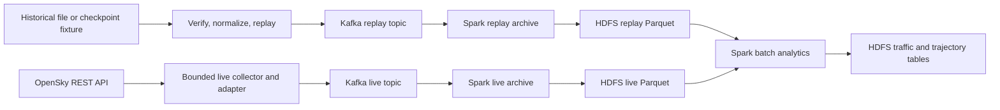

# First checkpoint guide — air-traffic data platform

**Checkpoint:** 26 October 2026

**Purpose:** explain the project to a teacher who has not seen the code.

**Scope verified:** local Linux/amd64 prototype through stages S1–S4.

**Active work plan:** [plan.md](plan.md). This guide explains the checkpoint; it is not a second plan.

Quick links: [what works](#2-what-is-working-now) · [system diagram](#4-how-the-running-system-is-connected) · [run the demo](#8-how-to-run-the-checkpoint-demonstration) · [every commit](#12-how-the-project-reached-this-checkpoint-every-commit).

## 1. The project in plain language

We want to turn aircraft observations into three useful views: a map of recently observed aircraft, a recorded movement history for an aircraft, and regional traffic charts. Each observation is a report from a source at a particular time. It does not prove a complete flight or complete coverage of the sky.

Our checkpoint result is the **working data pipeline behind those views**. We can replay historical observations or request current observations from OpenSky, publish them to Kafka, and archive them with Spark in HDFS. Spark also computes and saves initial traffic and trajectory summaries from the replay archive. We can run and inspect this pipeline from the terminal. MongoDB, the API, and the map are the next stages.

### A short opening statement

> “Our goal is to build an aircraft map, movement history, and traffic charts. For this checkpoint, we have implemented and verified the data pipeline. Historical replay and a bounded live OpenSky collector send observations to separate Kafka topics. Spark archives them in HDFS and saves initial traffic and trajectory results. We have a repeatable demo, a real live-ingestion result, and a detailed plan for the remaining application.”

## 2. What is working now

| Part | Current result | Meaning |
| --- | --- | --- |
| Data preparation | Verified OpenSky historical source configuration, checksum check, profiler, and a ten-row checkpoint fixture. | We can identify and validate the input used by the pipeline. |
| Replay ingestion | The fixture publishes eight observations and two rejected rows to Kafka. | The source time is retained; bad rows remain visible with reasons. |
| Live ingestion | A short real OpenSky session published 16 observations with Kafka acknowledgments. | The collector actually pulls data from OpenSky, with request and freshness limits. |
| Archive | Separate Spark queries store replay and live Kafka deliveries as HDFS Parquet. | We can inspect original payloads and Kafka offsets after ingestion. |
| Initial analytics | Spark selects usable positions from a replay or live archive run and calculates minute/cell traffic and trajectory segments. | We have analytical output that can later support charts and history. |
| Saved results | Traffic and trajectory tables are written to HDFS and read back to check their contents. | Later application stages can use a completed result version. |
| Repeatable demo | A single command runs the fixture pipeline and produces a passing report. | The checkpoint does not depend on live API availability. |
| Live presentation | A single command requests OpenSky, verifies Kafka/HDFS delivery, saves Spark calculations, and generates `report.md`. | Show the actual request times and results calculated from that live run. |

This is a **local prototype on one computer**. The planned MongoDB latest-state store, FastAPI interface, Streamlit map, full traffic reconciliation, and distributed Kubernetes deployment are not implemented yet.

### How this satisfies the first checkpoint

| Checkpoint request | What we can show |
| --- | --- |
| Git with executable code | The Docker Compose setup and Python/Spark jobs are in the repository. Commit `38db434` contains the S3/S4 implementation. The commands in section 8 run the code. |
| Data prepared | The tracked fixture and checksum manifest, pinned real OpenSky source configuration, bounded source profile, and synthetic live-response fixture. |
| System architecture prepared | The implemented diagram in section 4 and the separate target-system diagram in [architecture.md](architecture.md). |
| Visible progress | Passing fixture and real live sessions, saved batch tables, restart evidence, and completed S1–S4 checks in [plan.md](plan.md). |

## 3. Inputs: where the data comes from

| Input | File or source | How we use it |
| --- | --- | --- |
| Synthetic checkpoint fixture | [checkpoint_states.csv](../data/fixtures/checkpoint_states.csv) and its [integrity manifest](../data/fixtures/checkpoint_manifest.json) | The repeatable ten-row demonstration. It includes valid, duplicate/conflicting, missing-position, stale-position, and invalid rows. **This fixture is synthetic, not a real flight dataset.** |
| Real historical OpenSky archive | [Pinned source configuration](../data/sources/opensky_sample.json) | A published CSV archive for 27 June 2022, 04:00–05:00 UTC. The downloaded file is about 100.5 MiB and is kept outside Git. Its checksum was verified; the [reference profile](../data/reference_profile.json) covers the first 100,000 rows and found 4,472 aircraft identifiers in that prefix. This is not a full-file profile. |
| Current OpenSky states | OpenSky `/api/states/all` | The bounded live collector requests observations in a chosen geographic box. The October 25 run used latitude 8–24 and longitude 102–110. Results vary with source coverage and request time. |
| Synthetic live-response fixture | [live_states.json](../data/fixtures/live_states.json) | Offline checks of live field mapping, missing values, stale positions, and rejected vectors. |

The OpenSky REST response gives a **snapshot time** and, for each aircraft, its most recent **position-update** and **last-contact** times. We also record our **receipt time**. A newly received response may still contain old positions. The [data guide](../data/README.md) documents these fields and the source limits; the provider's [REST documentation](https://openskynetwork.github.io/opensky-api/rest.html) describes the endpoint.

## 4. How the running system is connected



The services are configured in [compose.yaml](../compose.yaml):

| Service | Job in this project | Current configuration |
| --- | --- | --- |
| Kafka broker | Holds records until Spark reads them. | One broker/controller with persistent storage. Two explicitly created topics: `airtraffic.replay.v1` and `airtraffic.live.v1`. Each has **three partitions**, **replication factor one**, and configured **seven-day retention**. Three partitions are not three brokers. |
| Replay producer | Converts historical rows to the shared record format and publishes them. | Waits for broker acknowledgments and gives each aircraft/run a stable Kafka key. |
| Live collector | Requests, checks, and publishes real OpenSky snapshots. | A finite session with geographic bounds, an attempt budget, polling interval, timeouts, and a report. Anonymous access works without credentials; an optional bearer token comes from the environment. |
| Spark archive queries | Read Kafka and append records to HDFS. | Separate replay and live queries, outputs, and checkpoints. The raw archive keeps rejected deliveries and original payload bytes. |
| HDFS | Keeps Parquet history and batch results. | One NameNode and two DataNode containers with data replication two. Both DataNodes are on the same physical computer. |
| Spark batch job | Calculates and saves initial traffic and trajectory metrics. | Reads one selected replay or live run from its committed archive and writes immutable result tables. |

Spark's **checkpoint** stores the archive query's progress through Kafka. This allows the tested restart case to continue from retained offsets. Kafka has one broker, and both HDFS replicas share one host, so this setup does not demonstrate recovery from losing the computer.

## 5. What the code does, and where to open it

| Code | What to explain while showing it |
| --- | --- |
| [observations.py](../airtraffic/observations.py) | Defines the common observation and rejected-record fields, including mode, run ID, aircraft ID, times, measurements, quality flags, and provenance. |
| [historical.py](../airtraffic/historical.py), [replay_source.py](../airtraffic/replay_source.py), [publish_replay.py](../scripts/publish_replay.py) | Verify and normalize historical CSV rows, replay a bounded ordered prefix, and send records to Kafka. |
| [opensky_http.py](../airtraffic/opensky_http.py), [live_adapter.py](../airtraffic/live_adapter.py), [live_collector.py](../airtraffic/live_collector.py), [collect_live.py](../scripts/collect_live.py) | Fetch OpenSky responses; map state-vector fields to the common record; enforce session limits; report source freshness, errors, and broker acknowledgments. |
| [kafka_sink.py](../airtraffic/kafka_sink.py) | Shared Kafka publishing logic. A record counts as acknowledged only after its producer future succeeds. |
| [archive_stream.py](../jobs/archive_stream.py), [archive_schema.py](../jobs/archive_schema.py) | Spark reads the chosen Kafka topic, preserves its payload and offset, labels the record status, and writes HDFS Parquet. |
| [inspect_archive.py](../jobs/inspect_archive.py) | Counts archived rows, unique Kafka offsets, observation IDs, modes, topics, and quality flags for a run. |
| [batch_analytics.py](../jobs/batch_analytics.py), [inspect_analytics.py](../jobs/inspect_analytics.py) | Select eligible archived positions and print traffic and trajectory summaries. |
| [materialize_analytics.py](../jobs/materialize_analytics.py), [batch_storage.py](../jobs/batch_storage.py), [inspect_batch.py](../jobs/inspect_batch.py) | Write new Parquet result versions, compare saved values with computed values, mark complete versions, and read them back. |
| [checkpoint_demo.py](../scripts/checkpoint_demo.py), [live_demo.py](../scripts/live_demo.py) | Run the two demonstrations and create readable evidence. |
| [live_demo_report.py](../airtraffic/live_demo_report.py) | Explain source requests, delivery counts, and saved live result rows in a generated Markdown report. |

The full repository [README](../README.md) contains the command reference. The [architecture document](architecture.md) distinguishes the implemented local pipeline from the final target system.

### One observation's meaning

`observation_id` identifies a source/aircraft/snapshot. `run_id` identifies this particular replay or live collection session. Kafka `topic` + `partition` + `offset` identify a **delivery**. The same source observation can be delivered more than once, so a delivery count is not an aircraft count.

An observation can have missing coordinates or a stale position and still be worth archiving. Invalid source rows become explicit rejected records. The raw archive preserves deliveries; later analytics apply stricter position rules.

## 6. What the output means

The fixture's numbers have a clear sequence:

| Report field | Verified value | Why |
| --- | ---: | --- |
| Kafka acknowledged | 8 observations + 2 rejections | All ten fixture rows were delivered. |
| `archived_rows` | 10 | Spark retained every delivery, including rejected rows. |
| `unique_kafka_offsets` | 10 | Each retained delivery has a distinct Kafka location. |
| `unique_observations` | 6 | Some valid fixture rows repeat or conflict with the same source/aircraft/snapshot identity. |
| `eligible_positions` | 3 | After choosing one record per observation ID, Spark requires valid coordinates and position age from 0 to 30 seconds. |
| `traffic_group_count` | 2 | Two combinations of UTC minute and one-degree latitude/longitude cell contain an observed aircraft. The job also reports aircraft counts and mean speed where speed is present. |
| `trajectory_segment_count` | 2 | Spark groups recorded position updates by aircraft and segment, without filling long gaps with invented movement. |

The batch writer saves `traffic/` and `trajectory_segments/` beneath:

```text
hdfs://namenode:9000/airtraffic/batch/replay-v1/<run-id>/v1/
```

The writer reads the files back and compares **schema, row counts, and values**. The result root gets `_manifest.json` and `_SUCCESS` only after both tables pass. `batch-inspect` refuses a version without the root `_SUCCESS`. A new calculation needs a new version directory; an existing one cannot be silently overwritten. Saved rows were unchanged after stopping and restarting the local services.

The live run on 25 October made two HTTP requests. Each returned eight observations. All **16** were acknowledged by Kafka and found in the live HDFS archive with **16 unique offsets** and no uncertain deliveries. Each response contained **three positions at most 30 seconds old at receipt and five stale positions**. The report keeps those ages so we do not describe all 16 deliveries as fresh aircraft positions. A future live run may return different counts or an empty response.

### Evidence to show

The repository contains [tracked aggregate evidence](../data/verification/s3_s4_20261025.json) with the verified counts and restart outcome. On the machine where the runs were performed, detailed local evidence is under:

```text
data/reports/checkpoint/checkpoint-s3-20261025-final/
  producer.json  archive.json  analytics.json  batch.json  summary.json  demo.log
data/reports/live-demo/live-s4-20261025-final/
  session.json  archive.json  summary.json  demo.log
data/reports/live/live-s4-20261025-final/
  session.json  response-0001.body  response-0002.body
```

The `data/reports/` directory and raw live responses are local and ignored by Git. A fresh clone has the tracked aggregate evidence and can generate its own detailed reports by running the demos.

Recorded checks also include 64 passing host tests; 13 Spark tests were skipped on the host because PySpark is not installed there. Seven storage and three archive tests passed separately in the Spark container. An earlier bounded archive check retained 1,000 events, and a restart check processed a 100-event backlog. These are local, declared workloads; they do not demonstrate a large production load.

### Latest real-source demonstration — 26 October

Run `live-8196ea97138b` requested OpenSky directly twice: HTTP 200 responses contained 9 and 10 observations. Kafka acknowledged **19**, and Spark archived **19** with **19 unique offsets** in the live topic/mode. Spark batch then selected **12 eligible positions**, saved **3 traffic rows and 7 trajectory segments**, and read both tables back successfully.

Open `data/reports/live-demo/live-8196ea97138b/report.md` to show the measured run. It contains source/receipt timestamps, counts, actual saved table previews, and speaking notes. The [aggregate evidence](../data/verification/live_demo_20261026.json) is included for Git review; raw responses and aircraft rows remain in ignored local reports. A fresh demo uses current source responses, so its counts will differ.

This completes the live demo through saved analytics. It does not change the next stage: S5 latest state in MongoDB, followed by the S6 map. The 26 October host suite passed 69 tests and skipped 13 Spark tests; the real Docker demo separately exercised Spark archival, calculation, and result read-back.

## 7. Exactly where we are in the plan

Follow **[docs/plan.md](plan.md) only** for the active project plan. This guide is a checkpoint explanation. The old M0–M7 labels in the plan's appendix describe course requirement groups; S1–S11 are the work order.

| Stage | Status on 25 October | Visible result or next purpose |
| --- | --- | --- |
| S1 — data and shared format | Complete for the historical baseline | Verified source configuration, fixture, profiler, normalization. |
| S2 — Kafka → Spark → HDFS | Verified locally | The replay topic reaches its retained archive; S4 adds the separate live path. |
| S3 — saved batch results and demo | Verified locally | Two result tables, completion manifest, restart check, passing fixture demo. |
| S4 — live OpenSky pull | Verified locally | Bounded real session with 16 acknowledged and 16 archived records. |
| S5 — latest state in MongoDB | **Next; not started** | Keep the latest observation for each aircraft, mode, and run. |
| S6 — API and map | Not started | Display latest aircraft positions with ages and missing/stale status. |
| S7 — complete historical products/reference data | Initial analytics only | More complete trajectories and traffic, plus independent reference enrichment. |
| S8 — streaming traffic and batch correction | Not started | Show fast provisional metrics and later validated corrections. |
| S9 — advanced Spark analysis | Not started beyond initial calculations | Course-required transformations, experiments, and measured comparisons. |
| S10 — distributed deployment | Not started | Run and measure the stack across hosts. |
| S11 — final delivery | Not started | Reproducible report, full demonstration, and rehearsal. |

The logical next sequence is **S5 → S6 → S7 → S8**, while advanced experiments and deployment can proceed when their prerequisites are ready. S1–S4 mean the ingestion and initial batch backend works locally; they do not mean the final application is complete.

The longer-term targets in the plan include ten million unique observations and a five-second display latency. We have not measured or achieved those targets at this checkpoint. We also have not yet profiled every row in the historical archive, run Spark executors across multiple hosts, or shown a user-facing map.

## 8. How to run the checkpoint demonstration

Run commands from the repository root with Python 3.10+, Docker Engine, and Docker Compose v2. The documented small setup calls for about 8 GB available to Docker and 10 GB free disk for initial images and builds. Images are already built on the development machine; omit `--no-build` if setting up a new machine for the first time. Give the first build time to download dependencies before the teacher arrives.

### A. Real OpenSky ingestion and calculations — present this first

```bash
RUN_ID="live-checkpoint-$(date +%s)"
python3 -m scripts.live_demo --no-build --run-id "$RUN_ID"
```

This command requests **real OpenSky responses during the run**. It prints the endpoint, HTTP statuses, source snapshot times, receipt times, and fresh/stale counts. It sends the normalized responses to `airtraffic.live.v1`, waits for Spark to archive the same number of acknowledged deliveries in HDFS, and checks the unique offsets and live mode/topic. A separate Spark batch job then reads **this live run**, calculates traffic and trajectory tables, saves them, and reads them back. This path does not load the checkpoint CSV or synthetic live-response fixture.

Open `data/reports/live-demo/$RUN_ID/report.md` in your editor. It contains the request table, verified delivery counts, and saved traffic/trajectory rows in a format the teacher can read. The default session makes at most two requests, with ten seconds between polls. To observe more updates, use a new run ID and add `--max-attempts 6 --duration-seconds 120 --interval-seconds 10`. The collector ends after its bounded session; the archive services stay running.

To show an original API response and the actual saved result files:

```bash
python3 -m json.tool "data/reports/live/$RUN_ID/response-0001.body"
docker compose run --rm batch-inspect \
  --output "hdfs://namenode:9000/airtraffic/batch/live-v1/$RUN_ID/v1"
docker compose exec -T namenode hdfs dfs -ls \
  "/airtraffic/batch/live-v1/$RUN_ID/v1"
```

The raw response has a snapshot `time` and aircraft `states`. Show its source timestamps alongside receipt times in the report. The HDFS listing has `traffic/`, `trajectory_segments/`, `_manifest.json`, and a root `_SUCCESS` marker. The report previews up to twenty rows from each saved table; full Parquet output remains in HDFS.

**What to say:** “We are pulling observations directly from OpenSky. This report shows when the source observed the aircraft and when we received the response. Kafka acknowledged these messages, and Spark streamed the same number into HDFS. We then ran Spark calculations on the collected live data and saved these result tables.”

Live counts vary. A short run may show one position update per aircraft and zero measured distance. If every position is stale or missing, ingestion can succeed while analytical tables are empty; the report says so. Freshness at receipt and eligibility at source snapshot time are distinct checks. This is a working backend demonstration; the map is planned in S6, and streaming traffic aggregations are planned in S8.

If the provider fails, inspect `demo.log` and `data/reports/live/$RUN_ID/session.json`. HTTP authentication/quota errors stop the collector. There is no automatic substitution of synthetic data. Show a retained report as a **previous recorded run**, then use the explicitly labeled fixture check below if needed.

### B. Repeatable fixture demo — correctness check or offline fallback

```bash
python3 -m scripts.checkpoint_demo --no-build
```

The command starts services, publishes the ten-row fixture under a fresh run ID, waits for ten committed HDFS rows, computes analytics, saves both batch tables, and prints a final JSON object with `"status": "passed"`. It prints the evidence directory for that run. Open `summary.json`, `analytics.json`, and `batch.json` there. The script prints a passing summary only after all checks succeed. If a run fails, inspect its `demo.log` and start another run with a fresh ID; partial output versions remain for diagnosis.

**What to say while it runs:** “This input is synthetic and deliberately includes invalid and repeated reports. The archive should retain all ten deliveries. Analytics should use only three positions and create two traffic rows and two trajectory rows.”

To choose a run ID yourself and show the actual saved tables after the demo, use this sequence in place of the single command above:

```bash
RUN_ID="checkpoint-$(date +%s)"
python3 -m scripts.checkpoint_demo --no-build --run-id "$RUN_ID"
docker compose run --rm batch-inspect \
  --output "hdfs://namenode:9000/airtraffic/batch/replay-v1/$RUN_ID/v1"
docker compose exec -T namenode hdfs dfs -ls \
  "/airtraffic/batch/replay-v1/$RUN_ID/v1"
```

The reader previews both validated tables. The HDFS listing shows `traffic/`, `trajectory_segments/`, `_manifest.json`, and the root `_SUCCESS` marker.

### C. Point out the running services and finish

- Replay Spark UI: `http://localhost:4040`
- Live Spark UI: `http://localhost:4041` when the live profile is running
- HDFS UI: `http://localhost:9870`
- To stop services while keeping named-volume data: `docker compose --profile live stop`

Do not use `docker compose down -v` for normal cleanup: `-v` removes the named volumes holding Kafka and HDFS data. Detailed manual commands and troubleshooting are in the [README](../README.md#run-the-pipeline).

## 9. Suggested presentation order and words

1. **Goal (about 30 seconds):** Open section 1. Explain the planned map, aircraft history, and traffic charts.
2. **Architecture (about one minute):** Open the diagram in section 4 or [architecture.md](architecture.md). Trace one replay record and one live record through Kafka, Spark, and HDFS. Identify the two topics.
3. **Real source (allow a few minutes for collection and Spark):** Run section 8A. Show the OpenSky endpoint, HTTP requests, source/receipt times, and the raw response. Explain that each state is an observation, not a complete flight.
4. **Executable result (about two minutes after the run):** Open the generated `report.md`. Trace acknowledged deliveries → HDFS rows → eligible positions → saved traffic and trajectory tables. Explain that streaming archives the records and the separate batch job calculates these results.
5. **Correctness (optional, about one minute):** Show the synthetic fixture's recorded evidence or run section 8B to demonstrate duplicate, missing, and invalid-data handling. Label fixture input and previous evidence clearly.
6. **Plan (about one minute):** Show the completed S1–S4 rows and say S5 MongoDB latest state and S6 API/map are next. State the single-host and current UI limits.

The teacher can inspect real code in [compose.yaml](../compose.yaml), [archive_stream.py](../jobs/archive_stream.py), [batch_analytics.py](../jobs/batch_analytics.py), and [live_collector.py](../airtraffic/live_collector.py). The work is recorded in Git commit `38db434` (`Complete S3 and S4`).

## 10. Likely teacher questions

**“Is this real OpenSky data?”**

The primary demo in section 8A requests OpenSky directly and calculates results from those collected observations. Its report shows the source URL, request timestamps, delivery counts, and saved tables. The separate fixed ten-row check uses a synthetic fixture for predictable error cases. We also downloaded and checksum-verified a real historical archive. We state which source produced each result.

**“Why are there ten archived rows but only three positions in the analytics?”**

The raw archive retains every delivery, including two rejected rows and repeated snapshots. Analytics chooses one record per source observation and requires valid coordinates and a position update no older than 30 seconds at the source snapshot time. Three fixture positions pass those rules.

**“Why six unique observations but ten Kafka offsets?”**

An offset identifies one Kafka delivery. An observation ID identifies an aircraft in a source snapshot. Repeated/conflicting source observations produce more deliveries than unique IDs. Rejected rows do not supply a valid observation ID.

**“Does three Kafka partitions mean three brokers?”**

No. We have one broker and two topics with three partitions each. Topic replication factor one means losing that broker would interrupt Kafka availability.

**“Does HDFS replication two protect the system from losing this laptop?”**

No. The two DataNodes are containers on the same computer. They demonstrate HDFS placement and read-back, not host-failure tolerance.

**“Do we have a live map yet?”**

No. Live collection and archival work, but S5 must maintain latest aircraft state in MongoDB and S6 must expose it through an API and draw the map.

**“Does a newly collected snapshot mean every position is current?”**

No. In each measured live response, three positions were at most 30 seconds old at receipt and five were stale. We preserve source timestamps and report position age separately from collection time.

**“How do you know the saved analytics are usable?”**

Spark reads both result tables back and compares schema, row count, and values. It writes the root `_SUCCESS` marker only after both pass. Saved values survived a service restart; an existing or incomplete version was rejected. The small fixture demo passed end to end.

**“What remains after this checkpoint?”**

MongoDB latest state and the API/map are next, followed by complete historical products, live traffic correction, advanced Spark work, distributed deployment, and final reporting. The detailed acceptance criteria are in [plan.md](plan.md).

## 11. Terms to use accurately

| Term | Plain meaning here |
| --- | --- |
| Ingest | Obtain a source report, convert it to the common record format, and publish it to Kafka. |
| Observation | A report about an aircraft at a source snapshot time; not a whole flight. |
| Delivery | One Kafka message with a topic, partition, and offset; repeats still count as deliveries. |
| Fresh position | A valid position whose update time passes the stated age rule. A fresh Kafka delivery can contain a stale position. |
| Parquet | Column-oriented files used for the retained archive and saved analytical results. |
| Checkpoint | Spark's saved processing progress for one archive query; replay and live use separate checkpoints. |
| Completed batch version | A new result directory with both validated tables, a manifest, and the root `_SUCCESS` marker. |
| Lambda architecture | The final design combines fast provisional results with later batch results. Our checkpoint implements the common ingestion/archive and initial batch path; the serving and reconciliation parts are later stages. |

## 12. How the project reached this checkpoint: every commit

The current `main` history has **six commits**, listed below from oldest to newest. Each commit built on the earlier ones. The dates describe when the code was committed; they do not imply that every final-system requirement was finished on that date.

### 1. `ef73330` — Initial commit (5 October)

**What changed:** Created the repository with a short README and a Python-oriented `.gitignore`. The ignore rules keep generated files and local environment artifacts out of version control.

**What it gave us:** A clean Git starting point. This commit did not yet contain an aircraft data pipeline, dataset, Kafka setup, or Spark job.

### 2. `6789613` — OpenSky acquisition and quality profiling (7 October)

**What changed:** Added the pinned [historical source description](../data/sources/opensky_sample.json), [downloader](../scripts/download_sample.py), archive reading and checksum helpers, [profiler](../scripts/profile_sample.py), [data guide](../data/README.md), a tracked [reference profile](../data/reference_profile.json), and acquisition checks. The download tool validates source size/checksum and records provenance; downloaded archive bytes stay outside Git. The profiler reports such things as missing/invalid fields, coordinates, identities, duplicates, source-time order, and position freshness for a bounded prefix.

**What it gave us:** The **S1 data foundation**: a reproducible way to obtain and inspect real historical OpenSky data. The recorded profile covers the first 100,000 rows, not the whole archive. There was no Kafka or HDFS pipeline in this commit.

### 3. `f11fa1f` — Replay through Kafka, Spark, and HDFS (10 October)

**What changed:** Added the shared [observation contract](../airtraffic/observations.py), historical [normalizer](../airtraffic/historical.py), bounded replay, broker-acknowledged [Kafka publication](../airtraffic/kafka_sink.py), [Docker Compose services](../compose.yaml), Spark [archive query](../jobs/archive_stream.py), [archive inspector](../jobs/inspect_archive.py), Docker images/configuration for Spark and HDFS, and checks for normalization, replay, publication, and archive parsing. Invalid source rows became explicit rejected records. The archive preserved Kafka payloads and offsets in Parquet.

**What it gave us:** The **local S2 path**: historical observations could move through Kafka and Spark into retained HDFS history. A documented bounded run archived 1,000 events, and a later restart check processed a 100-event backlog. Those checks established a working local data path, not multi-host fault tolerance or a user interface.

### 4. `479ae01` — Traffic analytics and the checkpoint fixture (23 October)

**What changed:** Added [batch_analytics.py](../jobs/batch_analytics.py) and its [inspector](../jobs/inspect_analytics.py). The Spark job chooses one payload per observation identity, keeps positions with valid coordinates and acceptable position age, counts observed aircraft by UTC minute and one-degree cell, and summarizes recorded trajectory segments without bridging long gaps. This commit also added the ten-row [fixture](../data/fixtures/checkpoint_states.csv), its checksum manifest, fixture/analytics checks, an architecture document, and an initial project plan.

**What it gave us:** A **repeatable small demonstration** with ten archived rows, three usable positions, two traffic groups, and two trajectory segments. The analytics were printed as JSON; this commit did not yet save the two result tables as completed HDFS versions. The commit message was kept feature-focused; the fixture still supports the checkpoint.

### 5. `adb5048` — Saved analytical tables and automated demo code (25 October)

**What changed:** Added the [batch writer](../jobs/materialize_analytics.py), [storage and read-back checks](../jobs/batch_storage.py), and [one-command fixture runner](../scripts/checkpoint_demo.py). The writer reserved a new output directory, wrote `traffic` and `trajectory_segments` Parquet, checked schema/counts/values, and added a manifest and root `_SUCCESS` only for a completed version. The runner collected producer, archive, analytics, and batch evidence. This commit also expanded technical design notes in `docs/design.md` and added related checks.

**What it gave us:** The **S3 implementation**, but full HDFS integration was still pending: the first complete run reached analytics and then timed out while validating saved batch output. Five storage checks passed in the Spark container, but that alone did not prove the complete demo. The failed run had no passing summary. We carried this issue into the next commit instead of marking S3 finished early.

### 6. `38db434` — Finish S3 and add live S4 ingestion (25 October)

**What changed for S3:** Diagnosed the stalled Spark `EXCEPT ALL` comparison and replaced it with a null-safe full-row frequency comparison that checks values and duplicate multiplicity. Added progress logs, a saved-result [reader](../jobs/inspect_batch.py), safer cleanup for timed-out demo containers, and further storage checks. The full fixture demo passed; saved results matched after stopping/restarting services. Existing and incomplete result versions were refused.

**What changed for S4:** Added an [OpenSky REST adapter](../airtraffic/live_adapter.py), bounded [collector](../airtraffic/live_collector.py), live [demo](../scripts/live_demo.py), HTTP/request configuration, synthetic response fixture, and checks for bad responses and partial publication. Compose now creates `airtraffic.live.v1` and runs a separate Spark live archive with its own HDFS output and checkpoint. A real two-request session acknowledged and archived all 16 observations and reported their position ages.

**What changed in documentation:** Merged the temporary `docs/design.md` detail into the technical appendix of the single active [plan.md](plan.md), updated the architecture/data/README instructions, and committed [aggregate verification evidence](../data/verification/s3_s4_20261025.json). `docs/design.md` was then removed so there is one active plan.

**What it gave us:** **S3 and S4 verified for the local prototype**. The next work is S5 MongoDB latest state, followed by S6 API/map. This commit does not claim a finished dashboard, full Lambda reconciliation, ten-million-observation processing, or multi-host deployment.

You can show the sequence directly in Git:

```bash
git log --oneline --reverse
git show --stat 38db434
```
