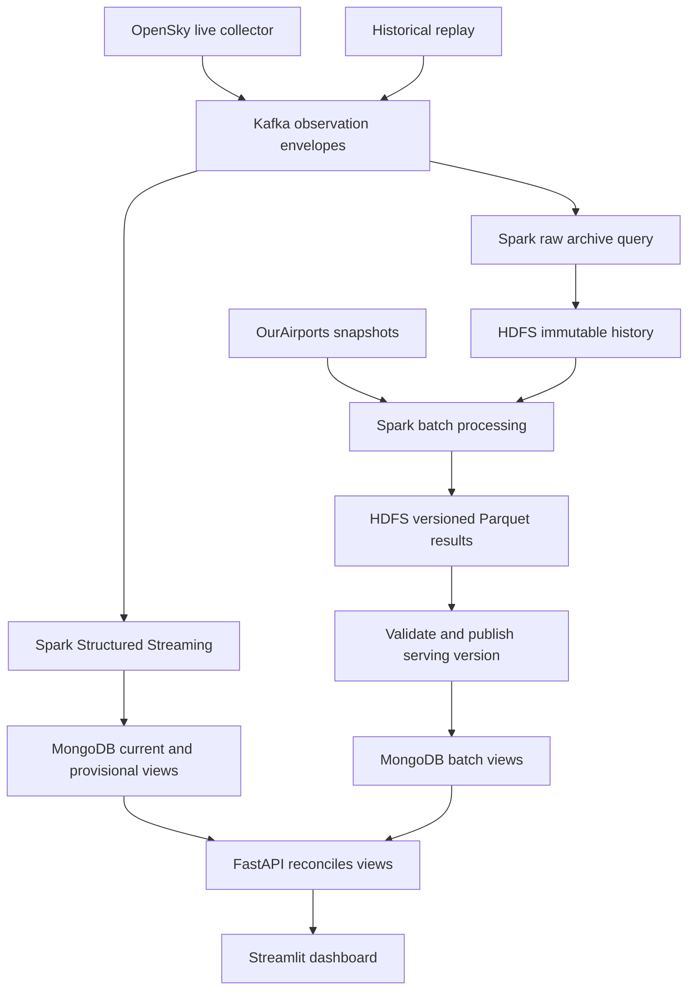

# Technical Design and Course Requirements: Air-Traffic Platform

**Project title:** Big Data Storage and Real-Time Processing Platform for Air-Traffic Telemetry
**Baseline:** October 10, 2026, aligned with the supplied local `Guideline.md`.
**Checkpoint update:** October 23, 2026, for the first review on October 26.

This is the detailed design and course-requirements reference, preserved from the original plan. Start with [plan.md](plan.md) for current progress, recent verification, and the next three tasks. The checkpoint narrative below records the earlier October 23 baseline; later implementation results are maintained in the tracker and [architecture note](architecture.md). The [repository README](../README.md) gives the working quick start and the [data guide](../data/README.md) explains acquisition. Proposed final behavior is not a claim that it has been implemented.

## First checkpoint — October 26, 2026

The checkpoint asks for a Git repository with executable progress, prepared data, and a system architecture. The evidence below is for work present in the repository by October 23. Later work must be added only after it is implemented and checked.

| Checkpoint item | Available evidence | What to show |
| --- | --- | --- |
| Executable code | `scripts/` contains archive acquisition, quality profiling, normalized replay, and Kafka publication; `jobs/` contains the Spark streaming archive, batch inspector, and first batch traffic/trajectory analytics command; `compose.yaml` starts Kafka, Spark, and HDFS. | Run offline tests, then replay the tracked fixture through Compose, inspect committed Parquet, and read batch summaries. |
| Data | The tracked [10-row synthetic fixture](../data/fixtures/checkpoint_states.csv) and [manifest](../data/fixtures/checkpoint_manifest.json) run fully offline. `data/sources/opensky_sample.json` pins a real historical OpenSky archive by URL, byte count, and SHA-256; `data/reference_profile.json` records its bounded first 100,000-row profile. Downloaded raw telemetry and its manifest stay outside Git. | Show fixture profiling and replay, then explain real source provenance, missingness, and why the 100,000-row profile does not describe the full hour. |
| Architecture | The implemented replay → Kafka → Spark Structured Streaming → HDFS → batch-read path is defined in [architecture.md](architecture.md), with planned Lambda speed, published batch, and serving layers labeled separately. | Trace one observation from source through Kafka to committed HDFS Parquet and a batch summary; identify the next layers. |

The October 10 Linux/amd64 local run published and archived 1,000 events with 1,000 distinct Kafka offsets. After Spark was stopped, a separate 100-event backlog was archived on restart. These are recorded in the [data guide](../data/README.md#kafka-spark-and-hdfs). The batch inspector's receipt-to-batch-start measure is not dashboard visibility latency. The stack has not yet produced a live map, MongoDB serving view, Kubernetes deployment, or a measured collector-to-display result.

On October 23, the tracked fixture completed an end-to-end Compose run (`checkpoint-20261023-01`): the producer acknowledged eight observations and two rejections; the archive inspector read ten rows, ten unique Kafka offsets, and six unique observation IDs; the Spark batch command found three eligible positions, two one-aircraft minute/cell traffic groups, and two trajectory segments. Three Spark transformation tests passed in the container. These are small correctness and integration checks, not scale or full Lambda serving evidence. The batch command prints bounded JSON and does not yet publish Silver/Gold or MongoDB views.

On October 23, the locally downloaded real archive was rechecked at 105,400,320 bytes with SHA-256 `c85c5609320291d6cf668200ace0641f305c096d53c251ac498c54052b202d59`; a fresh first-100,000-row profile matched the tracked reference report. The source archive itself remains outside Git. The synthetic fixture is the reproducible in-Git input for the checkpoint, not a sample of real aircraft traffic.

### Checkpoint demonstration

From a fresh clone, run `python3 -m unittest discover -s tests -v` and the [fixture profile/replay commands](../data/README.md#offline-checkpoint-fixture). The 10 synthetic rows yield eight observations and two explicit rejections; the full fixture profile reports two missing positions, one stale position update, and two repeated aircraft/time keys. For the container demonstration, use the [README run commands](../README.md#run-the-pipeline) with the fixture manifest and a new run ID:

```bash
docker compose up -d --build
export LOCAL_UID="$(id -u)" LOCAL_GID="$(id -g)"
AIRTRAFFIC_RUN_ID="checkpoint-$(date +%Y%m%d%H%M%S)"
docker compose run --rm producer --manifest /workspace/data/fixtures/checkpoint_manifest.json \
  --run-id "$AIRTRAFFIC_RUN_ID" --max-rows 10 --events-per-second 100
docker compose run --rm inspect --run-id "$AIRTRAFFIC_RUN_ID" --expect-rows 10
docker compose run --rm analytics --run-id "$AIRTRAFFIC_RUN_ID" --limit 20
```

Use a fresh run ID for each demonstration and allow the Spark archive to finish a micro-batch before inspection. This avoids the 100 MB real-archive download; the first container build still downloads public images and Spark dependencies. Keep the run ID and inspector output for the presentation.

### Next work after the checkpoint

1. Add current-state processing with deterministic writes and a bounded API/map, then measure actual receipt-to-display latency.
2. Build the bounded live collector and independently validated airport reference acquisition.
3. Add reconciled batch products, larger replay coverage, late-data fixtures, and controlled Spark comparisons.
4. Test ARM64/K3s feasibility before treating the local Compose deployment as evidence of distributed execution across hosts.

## 1. Goal, deliverables, and current status

Build a platform that collects aircraft observations, processes arrivals continuously, stores their history, and answers three questions: which aircraft have we recently observed, where did they move in our recorded data, and how does observed traffic vary across regions and time?

| Product | Finished behavior |
| --- | --- |
| Current aircraft map | Latest usable aircraft positions, observation/position ages, and stale or missing-data status. |
| Historical trajectory segments | Ordered recorded movement, duration, observed distance, and explicit coverage gaps. |
| Regional traffic analytics | Aircraft counts and movement statistics by cell/time window, with provisional and batch-reconciled results distinguished. |

Delivery includes source code, reproducible local/Kubernetes configuration, the dashboard, dataset provenance, correctness/recovery tests, measured comparisons, and the course report. The platform describes observed traffic; it does not infer complete flights, complete airspace coverage, or operational air-traffic guidance.

**Working now:** a pinned historical OpenSky download, checksum/provenance manifest, bounded quality profiler, tracked synthetic checkpoint fixture, version-one observation contract, historical adapter, bounded JSONL replay, and offline acquisition/normalization/replay tests. Replay retains source times, nullable measurements, stable IDs, original record references, and rejected-row evidence. The first 100,000 profiled real rows contain 4,472 aircraft and 90,790 usable coordinate pairs; full-file counts and larger coverage remain unverified. See the [reference profile](../data/reference_profile.json). A manual live check returned changing snapshots; a reusable collector has not been built.

**First pipeline implemented:** local Compose runs historical replay → Kafka → Spark Structured Streaming → HDFS Parquet, with two DataNodes, replication two, persistent raw/checkpoint storage, and batch read-back. A 1,000-event run and a 100-event backlog after Spark interruption were exercised; the tracked fixture also completed a ten-row end-to-end run with bounded batch traffic/trajectory summaries. Spark currently uses `local[2]` on Linux/amd64; this is not distributed executor or ARM64 evidence. The archive preserves Kafka offsets and original bytes before any filtering. Commands and precise test scope are in the [data guide](../data/README.md#kafka-spark-and-hdfs).

**Still planned:** live collection, large-scale replay/fault injection, reference ingestion, MongoDB serving, current-state/window processing, distributed Spark executors, dashboard, Kubernetes deployment, advanced analytics, and controlled benchmarks. There are no measured Spark comparison results yet; the raw archival slice does not complete the course's Spark requirements.

## 2. Course alignment and final choices

The guideline requires Lambda or Kappa, Spark skills, distributed storage, a message queue, NoSQL, and Kubernetes or cloud deployment. Our choices are:

| Component | Choice | Role |
| --- | --- | --- |
| Architecture | **Lambda** | Retained raw history, a speed layer, batch recomputation, and reconciled serving views. |
| Processing | **PySpark / Spark SQL / Structured Streaming** | Both streaming and batch jobs; shared validation/product rules. |
| Queue | **Kafka** | Partitioned buffering, retained offsets, and replay. |
| Storage | **HDFS + Parquet** | Distributed history, processed datasets, checkpoints, and versioned outputs. |
| NoSQL | **MongoDB** | Current state, window representatives, published historical views, and publication metadata. |
| Application | **FastAPI + Streamlit** | Bounded read-only queries, map, trajectories, charts, and source/run status. |
| Deployment | **Docker Compose → K3s/Kubernetes** | Small local prototype, then ARM64 Linux VMs on team MacBooks. |
| Observability | **Prometheus/Grafana + Spark/application logs** | Metrics, alerts, diagnosis, and benchmark evidence. |

Lambda fits historical reprocessing and late-data correction. Kappa would center processing on log replay; the substantial bounded analysis required here favors a separate batch layer. Share business rules and test both paths against an independent reference to control their consistency cost.

Spark replaces the previously proposed Flink runtime; MongoDB satisfies the NoSQL requirement. PostgreSQL, Iceberg, Trino, and a Flink comparison are outside the core. Extra tools, full high availability, and 50 million observations are extensions after course requirements work.

The guideline does **not** state a dataset minimum, numerical latency target, push-only source requirement, final deadline, or fixed number of comparisons. The first checkpoint is October 26. Our targets are **10 million unique real observations** and **p95 collector-to-display latency ≤5 seconds** at a declared workload. Fourteen weeks is provisional. Conservatively cover statistics/time series, MLlib, and GraphFrames until the instructor clarifies whether they are alternatives.

## 3. Data sources and ingestion contract

| Source | Purpose | Constraint |
| --- | --- | --- |
| OpenSky historical CSV archives | Development, deterministic replay, scale tests, and batch analytics. | Validate full files and consecutive coverage; sampled-day gaps remain gaps. |
| OpenSky live REST snapshots | Newly collected observations during bounded demonstrations. | Polling, quotas, source delays, and stale/missing positions. |
| OurAirports airport/country/region CSV snapshots | Independent enrichment source and meaningful reference joins. | Pin acquisition date/version; modern reference data is not automatically accurate for 2022 observations. |

Keep source URLs, checksums, byte/row counts, schemas, time ranges, coverage, filtering, and provider terms in manifests. Preserve original archives. Reference acquisition needs its own validation: current scripts expect OpenSky telemetry columns. Airport proximity supplies context and does not prove a flight origin or destination.

One live collector serves the team, with region, interval, session/request budget, timeout, bounded retries/backoff, and quota/error status. The October 10 check of latitude 8–24/longitude 102–110 returned 18 aircraft in each of two snapshots, with ten changed rows. This proves availability at that time only.

At the documented October 10 limits, anonymous access has ten-second snapshot resolution/400 daily credits and standard authenticated access five-second resolution/4,000 credits. The checked region costs three credits per request: sixty requests about ten seconds apart cost 180 credits. Verify current limits and remaining-credit/retry headers before implementation/runs; use OAuth2 for authenticated requests and keep credentials outside Git. Historical archives supply benchmark volume rather than all-day high-frequency API collection. [OpenSky REST documentation](https://openskynetwork.github.io/opensky-api/rest.html)

Replay uses a pinned manifest, timestamp-ordered observations, a configurable release rate, run identity, simulation clock, and seeded duplicates/delays/invalid records. Replaying the same million observations ten times is ten million deliveries, not ten million unique observations.

The implemented replay selects at most 100,000 source rows in archive order, sorts that prefix in memory, and releases JSONL or publishes directly to Kafka at a configurable constant rate. Original timestamps provide the simulation clock; receipt time is captured at release. This does not yet provide global file ordering or seeded fault injection. Commands and contract fields are in the [data guide](../data/README.md).

### Shared observation envelope

| Fields | Definition |
| --- | --- |
| Identity | Schema version, provider/source/dataset, mode, run ID, aircraft `icao24`, stable observation ID. |
| `observed_at` | Source snapshot time: historical CSV `time` or live response `time`. |
| `position_updated_at` | Historical `lastposupdate` or live `time_position`. |
| `last_contact_at` | Historical `lastcontact` or live `last_contact`. |
| `received_at` | Wall-clock receipt of the live response body, or replay release, before normalization and Kafka publication. |
| Measurements | Nullable coordinates, altitude types, speed, track, vertical rate, callsign, on-ground and source-specific fields. |
| Provenance/quality | Original payload/reference, record location, adapter version, quality reasons; reference version when enriched. |

Use UTC and SI units, preserve textual identifiers/leading zeros, and keep missing values distinct from zero. Negative altitude or vertical speed can be valid. Source/aircraft/snapshot identity survives retries; resolve conflicting payloads deterministically. Replay retains source identity and introduces a separate run identity. Keep malformed records archivable even without a valid aircraft key.

## 4. Real-time target and measurement

Polling/push describes delivery from the source; stream/batch describes processing. Live snapshots and historical replay can both feed streaming processing. Our target is **near-real-time processing after collector receipt**, not guaranteed aircraft-to-screen freshness or hard real-time deadlines.

| Metric | Boundary |
| --- | --- |
| Pipeline latency | `displayed_at - received_at`; includes producer work, Kafka, Spark, MongoDB, API, and browser refresh/rendering. |
| Live position age | Current wall time minus `position_updated_at`. |
| Replay position age | Simulation time minus original `position_updated_at`. |
| Analytical finalization | Separate delay for event-time windows and completed batch publication. |

Example: position recorded at 10:00:00, received at 10:00:08, displayed at 10:00:10 means two seconds pipeline latency and ten seconds position age. Historical timestamps remain unchanged during replay; never calculate replay processing latency by subtracting a 2022 timestamp from today's clock.

Start the small current-state query with a one-to-two-second micro-batch trigger and measure actual p95 visibility against the five-second target. Declare input rate, region/aircraft cohort, duration, refresh policy, and resource allocation. Trace sink readiness and actual display, synchronize clocks/account for client offset, and report missing updates, superseded versions, exclusions, and queue growth. A rendered same-or-newer aircraft version can satisfy current-state visibility; count superseded intermediate versions separately. Window completion does not delay the current-state branch.

## 5. Lambda data flow, storage, and correctness



This is the target Lambda flow. The checkpoint implementation covers historical replay, Kafka, the raw HDFS archive, and a bounded batch read that prints traffic and trajectory summaries. It does not yet have the live, hot-state, versioned publication, API, or dashboard edges; the implemented topology is shown separately in [architecture.md](architecture.md).

### Streaming queries

| Query | Status | Work | Sink |
| --- | --- | --- | --- |
| Raw archive | Implemented | Preserve all envelopes, quality failures, late records, and Kafka topic/partition/offsets before filtering. | Append-only Parquet on HDFS with dedicated checkpoint/commit metadata. |
| Current state | Planned | Validate each micro-batch and select latest aircraft/run observations. | Deterministic, version-guarded MongoDB writes via `foreachBatch`. |
| Window representatives | Planned | Group eligible positions by run/minute/H3 cell/aircraft and retain the latest observation per group. | Update-mode MongoDB representative rows with stable keys. |

Use separate checkpoints so current-state visibility does not wait for archive commits or windows. Keep live and historical replay in separate event-time queries/topics or run one mode at a time: adding run ID to a group key does not isolate a query-wide watermark. Partition valid telemetry by run/aircraft and never reuse a checkpoint for a different input/run definition.

Begin with H3 resolution 5, one-minute event-time windows, and a provisional thirty-second watermark allowance. Validate the chosen API/version with a single stateful aggregation; do not assume streaming `countDistinct` or arbitrary stateful operator chains are supported. MongoDB aggregates bounded representative rows into counts/means, while Spark batch independently computes the same products. Distinct counts across cells/windows cannot be added to obtain a distinct union count.

Watermarks follow event-time progress. Measure state growth and late drops; retain all observations in raw storage for reconciliation. At finite replay end, label incomplete windows and finalize the remainder through batch processing instead of inventing telemetry to move the watermark. Mark/filter stale aircraft on API reads even if no events arrive. Preserve position-update time so repeated old coordinates do not appear fresh.

### Batch products and publication

The checkpoint batch prototype reads committed Bronze Parquet for one run and returns bounded JSON summaries. It selects a deterministic payload for each observation ID by smallest source-payload fingerprint before requiring coordinates and a position-update age of zero to 30 seconds. A conflicting valid-position payload can be excluded if that winner lacks a usable position. Traffic counts one representative per aircraft/minute/one-degree cell. Trajectories use distinct position-update times, break at UTC-day boundaries or gaps over ten minutes, and count distance only across edges at most 60 seconds apart. The prototype has no reference enrichment, versioned output, or serving publication.

Planned final batch jobs will read pinned committed-file/offset manifests and reference snapshots, deduplicate the full range, validate/enrich observations, and record input/rule/reference/output versions. Airport enrichment uses spatial candidates including neighboring cells and a distance check, avoiding an unrestricted observation-to-airport cross join.

Trajectory jobs order distinct eligible position updates, derive gaps and segments, and save points separately from summaries. Initially split at UTC-day boundaries or gaps above ten minutes; exclude distance edges spanning more than one minute. Keep thresholds configurable, validate them, and show coverage gaps without interpolation.

Traffic jobs choose one latest eligible observation per aircraft/cell/minute, then calculate aircraft counts, speed/altitude means over present fields, missing counts, and climbing/descending counts. Batch reconciliation includes valid late input omitted by streaming windows.

Write a new Parquet/output version and complete MongoDB serving views before changing a small active-version pointer. Keep partial versions hidden. For each compatible run/dataset/rule/reference/result key, the API prefers a published batch result within its declared coverage and otherwise uses the provisional speed result. **Never add overlapping speed and batch counts.** Batch results are complete for their declared input snapshot; later arrivals can create a revised version.

### Storage and recovery rules

- **HDFS source/Bronze:** original archives, reference snapshots, immutable raw envelopes and provenance; raw partitions by ingestion date/run.
- **HDFS Silver/Gold:** versioned clean/enriched observations, rejections, trajectories, metrics, statistics, model/graph results; historical observations partitioned by event day.
- **HDFS operational data:** separate persistent query checkpoints and Spark event logs.
- **MongoDB:** hot state, representatives, bounded trajectory chunks, published metrics, coverage and publication metadata. Full analytical history stays in HDFS; expose which ranges are materialized for the API.
- Start with roughly 128 MiB compacted analytical files and HDFS replication two. Compare alternatives on disposable copies. Account for source copies, Kafka retention, replicas, checkpoints, and rewrite space.
- Compact into new analytical versions; never rewrite active raw file-sink directories. Preserve committed-reader metadata and recovery checkpoints. Parquet-only publication needs explicit manifests/version handling.
- Apply independent retention to hot state, representative rows, and published versions. Spark state eviction does not remove MongoDB rows; retire provisional rows only after replacement coverage is published or documented retention expires.
- MongoDB keys/version guards must prevent old updates, retry duplicates, and unsafe increments. `foreachBatch` can repeat; a batch marker alone cannot repair earlier partial writes. Test ties and concurrent attempts.
- Prove exactly-once **effects at a stated boundary** by interrupting partial writes and comparing recovered results against an uninterrupted reference. Raw source duplicates differ from duplicated sink effects. Kafka/HDFS/MongoDB do not share one atomic transaction.
- Keep Kafka retention longer than planned recovery delays and monitor each query's lag. Lost offsets/checkpoints/volumes require explicit restoration or retained-input replay; never silently skip to the newest data.

## 6. Required Spark work and evidence

Each skill needs executable code, a small correctness reference, and relevant results/plans. The fact that Spark runs in the architecture is not sufficient evidence.

| Guideline skill | Project implementation | Evidence |
| --- | --- | --- |
| Window functions | `lag`, ranking, cumulative segment IDs, rolling regional trends. | Expected ordered points, gaps, segments and trends. |
| Advanced aggregations | Counts, percentiles, movement summaries and missingness. | Independent values, null rules, executed plans. |
| Pivot/unpivot | Counts by region/hour, converted into chart-ready rows. | Equivalent values with explicit hour list and coverage. |
| Custom aggregation | Bounded grouped Pandas time-weighted speed over valid capped position intervals. | Independent weighted-sum reference, null/zero-weight cases, group memory limits. |
| Multi-stage transformations | Parse → validate → deduplicate → derive cells/segments → enrich → aggregate → publish. | Stage counts, quality reports and shared rules. |
| Business UDF | H3 cell assignment for valid coordinates. | Boundary/null tests and UDF overhead; use built-ins where sufficient. |
| Broadcast joins | Measured small spatial/reference lookups. | Correct matches, actual broadcast plan/size, runtime and memory. |
| Sort-merge joins | Large point-to-segment membership joins and controlled reference-join comparison. | Actual sort-merge plan, shuffle, spill and result equality. |
| Multi-join optimization | Filter/project before airport/region/country enrichment. | Same results, cardinalities, join order and before/after cost. |
| Partition pruning/bucketing | Event-day pruning and reproducible Spark bucketed catalog tables. | Scan files/bytes, bucket metadata, executed join plans; repartitioning alone is not bucketing. |
| Caching/persistence | Reuse cleaned data across downstream calculations, then unpersist. | Total workload time including fill, memory, eviction and spill. |
| Query optimization | Statistics, cost-based settings, justified hints and adaptive execution. | Estimated versus executed plans and measured outcomes. |
| Streaming/output modes | Append raw files and update representative views; optional bounded complete-mode demonstration. | Working queries, outputs and dedicated checkpoints. |
| Watermarking/late data | Minute windows with measured lateness allowance and batch correction. | Within/beyond-watermark fixtures, state/dropped-row metrics, reconciliation. |
| State management | Bounded per-window/aircraft state with live/replay isolation. | Growth, cleanup, stalled-time and restart tests. |
| Exactly-once guarantees | File commits and idempotent MongoDB publication under partial failure. | Defined boundary, replay/restart result equality and limitations. |
| Statistics/time series | Rolling counts, distributions and variability across contiguous coverage. | Reference calculations and gap-aware charts. |
| MLlib | Next-window observed-count regression with lagged counts/time features. | Chronological train/test split, train-only preprocessing, baseline versus model MAE/RMSE. |
| GraphFrames | Directed spatial-cell transitions from valid consecutive trajectory points. | Known graph fixture, deduplicated edge counts, degrees/components for a bounded real region. |

Keep UDF/custom aggregation demonstrations bounded and measure group size. ML needs sufficient consecutive coverage; missing coverage is not zero traffic, and disconnected sample days cannot form one continuous time series. The graph describes observed transitions, not inferred airport routes. Scope all three analytics areas conservatively until the instructor clarifies alternatives.

## 7. Different approaches and measured results

For selected problems, implement both a baseline and an alternative, measure them, explain trade-offs, and choose from the results. The comparison count below is our plan, not a number imposed by the guideline. No results or improvements are assumed in advance.

| ID / problem | Approach A | Approach B | Results |
| --- | --- | --- | --- |
| E01 — Trajectories | Bounded grouped Python/Pandas per run/aircraft/day. | SQL windows, gap flags and cumulative segment IDs. | Same points/boundaries and distance tolerance; runtime, shuffle, spill, peak memory. |
| E02 — Enrichment | Sort-merge join. | Broadcast join on the same measured reference lookup. | Same matched/unmatched rows; executed plans, runtime, shuffle, broadcast size, memory. |
| E03 — Storage | Baseline format/layout for each phase. | Independently vary format, codec, partitions, bucketing or compaction. | Same logical answers; scan bytes/files, physical storage, read/write/rewrite costs. |
| E04 — Reuse | Recompute clean data for each action. | Persist the reusable dataset, then unpersist. | Same outputs; total time including cache fill, action times, memory/eviction/spill. |
| E05 — Late data | Short watermark allowance, initially ten seconds. | Longer allowance, initially thirty seconds. | Completeness against full batch reference, dropped rows, state size, throughput and finalization delay. |
| E06 — Recovery | Full retained-input replay into an isolated test run. | Resume the equivalent failed query from its checkpoint. | Reference equality, time to recover, reprocessed records, missing/duplicate effects and unavailable time. |
| E07 — Scaling | One executor at stated resources. | Two/three executors at the same per-executor resources. | Same results; time, throughput, speedup, total resource cost and bottlenecks. |
| E08 — Replication | HDFS replication one on a disposable copy. | Replication two; three if capacity permits. | Physical disk, write cost, unavailable/under-replicated blocks and DataNode failure recovery. |
| E09 — Forecasting | Last-observed-count or fixed rolling-mean baseline. | One small MLlib regression pipeline. | Same chronological test rows; MAE/RMSE, regional errors, training/inference cost and coverage. |

**Storage phases:** compare CSV/Parquet with stated compression; two codecs on the same Parquet layout; unpartitioned/day-partitioned data for the same date-filtered query; bucketed/unbucketed catalog tables for a declared join; and pre/post compaction on a completed analytical version. Change one dimension per comparison or label a combined configuration honestly. Record file sizes, replication, cache state and rewrite costs.

**Controls:** E01 uses identical boundaries/null/tie/distance rules and measured group-size limits; retain failures if the baseline exhausts memory. E02 uses the same inputs and a lookup that safely fits the broadcast budget, with actual executed plans and adaptive-execution settings recorded. A different hint alone does not prove a different join ran. E05 fixes the arrival sequence/rate/end procedure and records real watermark progress. E06 uses isolated checkpoints/sinks, deterministic writes, a repeatable failure milestone including partial MongoDB publication, and an uninterrupted reference. E09 fits preprocessing/model on training data only.

Bounded operational comparisons provide additional lesson evidence:

| ID | Approaches | Measurements |
| --- | --- | --- |
| O01 — Input quality | Stop on an invalid record versus quarantine and continue. | Valid/invalid accounting, retained evidence, availability and debugging effort. |
| O02 — Dependency outage | Bounded timeouts/retries versus the same policy plus circuit breaker. | Same outage/load; errors, dependency calls, latency and recovery. |
| O03 — Diagnosis | Application logs versus correlated logs plus metrics/alerts on a replayed fault. | Failure timeline, available evidence and diagnosis steps; human timing is descriptive, not an unbiased benchmark. |
| O04 — API scaling | Fixed stateless replicas versus bounded horizontal pod autoscaling. | Errors, latency, scaling delay, replicas and resource cost under repeated load. |

### Fair comparison and artifacts

1. Define question, alternatives, expected trade-off and acceptance rule before execution; preserve baseline code/configuration during development.
2. Pin source/reference manifests, eligible coverage, code/rule versions, seed, query/input rate, hardware and network conditions. Use an independently calculated small correctness fixture.
3. For equivalent-result optimizations, verify matching answers within a declared tolerance first. For watermark/ML trade-offs, measure completeness/error as well as resources. A faster wrong answer fails the optimization.
4. Repeat each selected configuration at least three times, alternate/randomize order, retain failures and raw results, and report median/spread. State cache preparation; restarting Spark alone does not establish an OS cold-cache test.
5. Measure display p95 over a declared, sufficiently large event cohort plus run-to-run variation; three job durations do not establish a reliable tail-latency guarantee.
6. Record executed plans, query progress, state size, shuffle/spill, CPU/memory/disk/network, physical storage, and recovery evidence. E07 increases total resources; report that increase and separate any vertical-scaling comparison.
7. Choose using correctness, quality, resources, maintainability and performance. Slower, failed or inconclusive alternatives are valid results, not findings to hide.

Future benchmark records include experiment/approach/run IDs, status/failure, manifest and configuration IDs, row counts/coverage, resource/cache conditions, correctness/quality, timing, metrics, and links to plans/logs/report sections. Keep aggregate results and reproducible instructions in Git; bulk data/secrets stay outside it. Each lesson uses a comparison table:

| Approach | Correctness / quality | Time / latency | Resource cost | Evidence | Decision |
| --- | --- | --- | --- | --- | --- |
| A — baseline | Pending | Pending | Pending | Pending | Pending |
| B — alternative | Pending | Pending | Pending | Pending | Pending |

These cells remain pending until runs exist. Label unimplemented alternatives as considered, not tried. Charts must come from recorded results. GraphFrames needs a sound correctness/coverage study; comparing unrelated graph algorithms just to create a table is unnecessary.

## 8. Hardware, deployment, and operations

The team has five members and four estimated M2/M3 MacBooks with 16 GB RAM each. Verify exact specifications, free disk, simultaneous availability and same-network/remote setup. The earlier disk budget of 50–100 GB free per host is unconfirmed; no paid cloud or paid feed is assumed.

Begin with small Compose profiles. For final K3s deployment, provision one ARM64 Linux VM per host, initially near four vCPUs/eight GB RAM, then measure host/guest headroom. If remote, investigate Tailscale inside the VMs and test node/pod routing, DNS, direct/relayed paths, sustained throughput, latency and loss.

| Placement | Initial proposal, subject to measurement |
| --- | --- |
| A | K3s control plane, HDFS NameNode/checkpoint service, one persistent Kafka broker. |
| B–D | One HDFS DataNode each; resource-limited Spark driver/executor pods. |
| Across B–D | Place MongoDB, API/dashboard and monitoring according to available memory. |

Run heavy batch/analytics experiments separately from latency demonstrations. Keep machines awake for scheduled sessions and account for JVM overhead, operating systems, storage services and temporary files. Pin Spark/Scala/Java/Python, Kafka connector, MongoDB client, H3/Pandas, GraphFrames Python/JVM artifacts and ARM64 images only after an integration smoke test.

Operational work and evidence:

- Service discovery/readiness, bounded retries, dependency timeouts/circuit breaker, and two API replicas behind a Kubernetes Service; bounded API HPA comparison. Scale Spark manually for controlled experiments.
- Prometheus/Grafana alerts for Kafka lag, slow/stalled batches, state/checkpoint failures, source gaps, HDFS block/capacity health, MongoDB/API latency and node resources.
- Centralized structured logs keyed by run/query/batch, retained Spark event logs and one documented root-cause investigation; select a lightweight log backend after memory checks.
- Secrets outside Git, scoped MongoDB users, HDFS permissions, Kubernetes RBAC, private service exposure and encrypted remote transport. Document actual service-TLS versus tunnel coverage; test allowed/denied actions.
- Audit acquisitions, rule/reference versions, job runs and publications; preserve source attribution/terms.
- Back up manifests, NameNode metadata, MongoDB serving/publication data and configuration; exercise restoration and measure recovery time/data loss.

Single control-plane, NameNode, Kafka and MongoDB instances remain availability limits. A checkpoint service is not a standby NameNode, persistent volumes are not cross-host failover, and replication is not backup. Demonstrate worker/DataNode recovery and documented restoration; full HA is an extension.

### Setup and deployment path

The current Compose deployment is the local development environment: one NameNode and two DataNode containers on one host, with Spark running `local[2]`. It proves the first archive path, but it is not the final Kubernetes deployment or a test of host failure. The proposed four-host layout above is a target to validate, not an existing cluster or a requirement for four physical machines.

| Stage | When | Concrete work | Exit check |
| --- | --- | --- | --- |
| Local setup — done | Current baseline | Build and run Compose, persist Kafka/HDFS/checkpoints in named volumes, publish replay data, and read committed Parquet. | The documented 1,000-event run and 100-event restart backlog are reproduced. |
| Deployment feasibility — next, alongside application work | M1/early M2 | Confirm available hosts, RAM, disk and network; boot ARM64 Linux VMs; form a small K3s test cluster; check image compatibility, pod routing/DNS, persistent storage, and a tiny Kafka → distributed Spark → HDFS run. | Record which machines can join, where data can persist, and whether a Spark executor can run on a different node. Revise placement before building the full cluster if checks fail. |
| Application build — local first | M2–M5 | Add MongoDB, current-state processing, live collection, API/map, batch products, windows, and analytics to the working local pipeline. | Each component has a small end-to-end correctness check in the local environment. |
| Multi-node deployment — after feasibility and working components | M6 | Package services for K3s; place the NameNode/control plane and DataNodes on separate nodes as resources allow; run Spark with distributed executors; configure persistent volumes, readiness, secrets, monitoring and backups. | Replay and live paths work through the deployed stack; HDFS reports expected healthy replicas and Spark tasks run on worker nodes. |
| Deployment validation and delivery | M6–M7 | Exercise worker/DataNode failure, restart and restore; measure throughput, latency and resources; document limits and reproducible setup. | A teammate can redeploy and recover the system from the instructions and reproduce the reported results. |

The feasibility and application tracks start in parallel. The final cluster rollout waits for both a viable node/storage design and working application components. Multiple containers on one physical host do not provide host-level fault tolerance; VMs on separate hosts allow that failure mode to be tested.

## 9. Implementation milestones and schedule

The fourteen-week allocation below is provisional until the final deadline is known. Start infrastructure checks and evidence collection early; reduce optional tools or experiment combinations before dropping course requirements if time is shorter.

| Milestone / period | Work | Acceptance |
| --- | --- | --- |
| M0 — Planning | This consolidated design and requirement/evidence mapping. | Documented plan only; no implementation compliance claimed. |
| M1 — Weeks 1–2 | Shared contract/fixtures, live and historical adapters, replay, reference manifests, full-file sizing; ARM64/network smoke tests. | Compatible envelopes, preserved provenance/times, reproducible replay, bounded requests; tiny Kafka→Spark→HDFS/MongoDB and MLlib/GraphFrames examples run. |
| M2 — Weeks 3–4 | First Lambda slice: ingestion, raw archive, current state, map, one batch metric and serving reconciliation. | Trace observation to display; reproduce a metric from raw input; batch overrides matching provisional result without addition. |
| M3 — Weeks 5–6 | Windows, watermark/state behavior, deterministic writes, stale-state handling, checkpoints and partial-failure recovery. | Independent fixture matches counts/state; old arrivals cannot overwrite new state; recovered output matches uninterrupted reference. |
| M4 — Weeks 7–8 | Clean/enrich, trajectories, reconciled metrics, bounded historical publication and required Spark transformations/joins. | Correct products, repeatable outputs, no partial publications; E01–E04 baseline/alternative evidence retained. |
| M5 — Weeks 9–10 | Bounded statistics, MLlib and GraphFrames studies. | Coverage/leakage checks, known-fixture results, real-data analysis and baseline comparison. |
| M6 — Weeks 9–12 | Final K3s integration, monitoring/logs, access controls, API failure/scaling and backup/restore. | Another member can deploy, diagnose and restore a run; measured capacity supports placement. |
| M7 — Weeks 11–14 | Large-scale comparisons, completed dashboard, report, evidence index and demonstration rehearsal. | Required skills/lessons have actual evidence; report achieved/missed targets and remaining limits. |

M1 connectivity/Kubernetes feasibility tests precede the final cluster build; the concrete setup and deployment gates are above. Collect O01/E05/E06 during ingestion/streaming, E01–E04 during batch work, E09 during analytics, and E07/E08/O02–O04 during distributed deployment. Do not wait until report week to implement baselines.

### Immediate next implementation

The versioned contract, historical adapter, bounded replay, Kafka publication, Spark raw archive, HDFS batch inspection, and first batch traffic/trajectory summaries now work. Synthetic tests cover nulls, duplicate/conflicting observations, stale/missing/future times, malformed records, source ordering, replay clocks, slow consumers, acknowledgment failures, raw archival, and the first batch transformations. A local Spark interruption/backlog recovery was exercised; stateful late-arrival/gap behavior belongs to later processing fixtures.

Start the deployment-feasibility track now: verify hosts and storage, boot ARM64 VMs, test K3s networking, and run a tiny distributed Spark/HDFS smoke test. Keep the working Compose setup for application development while this runs.

1. Add the independent Spark current-state query and version-guarded MongoDB writes; expose results through a small API/map with actual visibility timing.
2. Add the live JSON adapter and bounded collector to the shared contract, with request budgets and a separate live topic/checkpoint.
3. Add OurAirports acquisition/validation and the first enriched batch metric with serving reconciliation; verify full-file counts and coverage.
4. Extend replay beyond an in-memory prefix, add seeded fault injection, and perform controlled advanced Spark comparisons.
5. Once the feasibility checks and local components work, deploy them together on K3s and run the failure, recovery and performance checks in the deployment path above.

## 10. Team ownership and code structure

| Member | Primary responsibility |
| --- | --- |
| 1 | Linux VMs, K3s, HDFS, network, monitoring/logs, deployment security and backups. |
| 2 | Source contract/adapters, live/replay, Kafka and Spark streaming. |
| 3 | Spark cleaning/enrichment, trajectories, joins, historical metrics and batch publication. |
| 4 | Spark optimization/comparisons, statistics, MLlib/GraphFrames and evidence index. |
| 5 | MongoDB serving, API/dashboard, integration/reconciliation tests and demonstration coordination. |

These are proposed ownership areas. Review every subsystem with another member; share batch/stream definitions, sink recovery and resource decisions. Each member writes lessons from work actually performed.

Keep existing `scripts/` and `tests/` working. Add modules only when implemented; do not create empty scaffolding or additional planning documents:

```text
docs/plan.md                # Current progress, evidence and next steps
docs/design.md              # Detailed design and course requirements
docs/architecture.md        # Checkpoint architecture and implementation boundary
README.md                   # Repository overview and working quick start
data/README.md              # Acquisition commands, field/report reference
src/airtraffic/
  contracts/                # Observation and reference schemas
  ingestion/                # Source adapters, collector and replay
  processing/               # Shared Spark expressions and product rules
  storage/                  # MongoDB writers, manifests and publication
  api/                      # Bounded serving endpoints
jobs/{streaming,batch,analytics}/
dashboard/                  # Streamlit, when implemented
configs/                    # Environment and experiment configuration
deploy/                     # Compose and Kubernetes configurations
benchmarks/                 # Working comparisons and aggregate results
tests/                      # Unit, integration and performance checks
```

Separate responsibilities, keep entry points small, reuse utilities, and introduce meaningful tests with each component. Do not move the existing acquisition code merely to fill the proposed layout.

Current prototype modules remain in `scripts/`: `observations.py` defines the shared envelope, `historical.py` normalizes CSV cells, `replay.py` orders/releases rows, and `replay_sample.py` provides the CLI. `sample_io.py` and `sample_values.py` are shared by acquisition/profiling/replay. The `src/airtraffic/` tree above is a future packaging layout, not existing scaffolding.

The implemented service slice adds `compose.yaml`, HDFS/Spark builds under `deploy/`, `scripts/publish_replay.py` and `kafka_sink.py`, and `jobs/archive_stream.py`, `archive_schema.py`, `inspect_archive.py`, `batch_analytics.py`, and `inspect_analytics.py`. The shared `replay_source.py` keeps JSONL and Kafka input loading consistent. Update these modules before creating parallel implementations in the future package tree.

## 11. Report and lessons learned

The final report must contain:

1. **Problem definition:** users, suitability for big data with measured rows/bytes/rates, scope, source coverage and limits.
2. **Architecture/design:** Lambda justification and Kappa comparison, component/data-flow/interaction diagrams, schemas, serving reconciliation, storage and correctness boundaries.
3. **Implementation:** actual code/commands, environment-specific configuration, pinned dependencies, Kubernetes deployment, monitoring and required Spark evidence.
4. **Evaluation:** fixed workloads, approaches tried, correctness/quality, repeated measurements, resource/network conditions, trade-offs and selected solutions. Explain failed hypotheses and missed targets.
5. **Lessons learned:** the required structure below, covering every category in the following table.
6. **Reproducibility:** evidence index mapping requirement → experiment/approach → code/test → input/configuration → result → report section; setup/demo/recovery instructions, team contributions and source attribution.

Use the guideline's structure for each lesson:

```markdown
### Lesson X: [Lesson Title]
#### Problem Description
- Context/background, challenges and system impact.
#### Approaches Tried
- Implemented approaches, configurations, measured comparison and trade-offs.
- Label alternatives only analyzed as considered, not tried.
#### Final Solution
- Selected implementation, code/configuration references, metrics/results and limits.
#### Key Takeaways
- Technical insights, supported practices and recommendations.
```

| Required lesson category | Planned evidence |
| --- | --- |
| Data Ingestion | Source diversity/provenance, schema/version changes, duplicates, retries, late data and O01. |
| Data Processing with Spark | E01/E02/E04, plans/statistics, memory/spill, partition and cost-based tuning. |
| Stream Processing | E05/E06, state/window behavior and precisely bounded exactly-once effects. |
| Data Storage | E03/E08, formats/codecs/layouts, replicas, hot/cold retention and compaction. |
| System Integration | DNS, service discovery/load balancing, bounded errors and O02 circuit breaker. |
| Performance Optimization | Before/after caching/query/resource results and measured bottlenecks. |
| Monitoring & Debugging | Metrics/alerts, correlated logs and O03 root-cause investigation. |
| Scaling | E07, separate vertical-resource comparison, O04 HPA, network and resource cost. |
| Data Quality & Testing | Independent fixtures, unit/integration/performance tests, batch/stream equality. |
| Security & Governance | Scoped access, actual encrypted links, secret handling, audit records and source terms. |
| Fault Tolerance | E06/E08, service/query failures, replication, backup/restore and recovery limits. |

One experiment may support several lessons, but every category needs real evidence. Do not invent measurements or weaken a live service just to create a comparison. Leave results pending until executed.

## 12. Completion checklist

- [ ] Both OpenSky modes and an independent reference source have validated provenance and isolated run state.
- [ ] Lambda batch/speed/serving layers work, including an observable late-data correction without double-counting.
- [ ] All three products work with mode, age, gaps, reference version and serving-coverage labels.
- [ ] Every agreed Spark skill has implemented code, a correctness check and relevant measured evidence.
- [ ] Statistics, MLlib and GraphFrames are demonstrated, or instructor-approved scope changes are recorded here.
- [ ] Selected alternative approaches have controlled results, trade-offs and justified final choices.
- [ ] HDFS storage/replication, NoSQL serving and final Kubernetes deployment are reproducible.
- [ ] Monitoring, logs, access controls, partial-write recovery and backup/restore have been exercised.
- [ ] Actual unique observations, replay deliveries and physical storage are reported separately; evaluate the ten-million target.
- [ ] Evaluate five-second display p95 at a declared workload with adequate samples, missing updates and source age disclosed.
- [ ] The report covers all required lesson categories and links to code, configurations, raw measurements and reproducible commands.
- [ ] Final demo includes live/replay, map, history/statistics, a batch correction and a failure/recovery example.

Keep the unresolved final deadline, hardware/network capacity, dataset coverage and analytics-scope questions explicit. Measured limits or a baseline outperforming an alternative are valid findings; unfinished course requirements remain unfinished.

## References

- Supplied local `Guideline.md`: assignment requirements; retain unchanged.
- [OpenSky scientific datasets](https://opensky-network.org/data/scientific) and [REST API](https://openskynetwork.github.io/opensky-api/rest.html).
- [OurAirports reference data](https://ourairports.com/data/).
- [Spark Structured Streaming](https://spark.apache.org/docs/latest/streaming/apis-on-dataframes-and-datasets.html) and [sink guarantees](https://spark.apache.org/docs/latest/streaming/apis-on-dataframes-and-datasets.html#using-foreach-and-foreachbatch).
- [Spark SQL performance tuning](https://spark.apache.org/docs/latest/sql-performance-tuning.html) and [MLlib regression](https://spark.apache.org/docs/latest/ml-classification-regression.html).
- [GraphFrames installation/compatibility](https://graphframes.io/02-quick-start/01-installation.html).
- [MongoDB atomicity](https://www.mongodb.com/docs/manual/core/write-operations-atomicity/).
- [HDFS guide](https://hadoop.apache.org/docs/current/hadoop-project-dist/hadoop-hdfs/HdfsUserGuide.html), [K3s requirements](https://docs.k3s.io/installation/requirements), and [Tailscale connection types](https://tailscale.com/docs/reference/connection-types).
