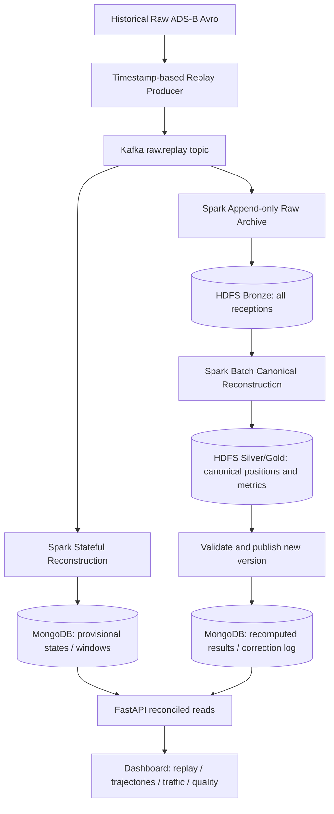

# Project Plan — Raw ADS-B Air Traffic Reconstruction & Analytics

**Updated:** 5 November 2026

**Active direction:** **Raw-first Lambda Architecture** using historical Raw Mode S/ADS-B messages for **both Spark Streaming (Kafka replay) and Spark Batch (HDFS reprocessing)**.

**Implementation status:** S5 raw ingestion and S6 Bronze → Spark Batch → Silver are verified locally, including the complete 304,131-reception OpenSky 2015 sample (5 November 2026). S7 is locally verified with application-managed streaming state; S8–S11 remain planned. The former S1–S4 State Vector prototype is preserved in Git history but removed from the active working tree.

> **One-sentence project goal:** Build a replay-based air-traffic analytics platform that reconstructs observed aircraft positions from raw ADS-B receptions, delivers fast *provisional* traffic information, and recomputes/republishes affected history when late or conflicting input changes the result.

**Next milestone: S8 — serving the verified canonical outputs.** S5 evidence is recorded in [s5_raw_20261104.json](../data/verification/s5_raw_20261104.json); runnable ingestion commands are in the [README](../README.md#run-s5).

## 1. What the system will actually deliver

This is a **historical replay and data-quality analytics platform**, not a global live radar or operational air-traffic-control service. A user selects a recorded dataset/run and a simulation time. The platform shows what can be reconstructed from the captured raw messages, and explains the limits of those observations.

| Product | Question answered | Visible output and value |
| --- | --- | --- |
| **Aircraft Replay Map** | Which aircraft positions can our raw-message pipeline reconstruct at this simulation time? | Aircraft markers, timestamp, decoded location, altitude/velocity when available, position age, validity and source lineage; explicit **Historical Replay** label. |
| **Trajectory Explorer** | What portions of an aircraft's observed movement are supported, and where are the gaps? | Ordered reconstructed positions, segments, coverage gaps, altitude/speed timeline, unresolved points and provenance; **no invented continuous path**. |
| **Regional Traffic Analytics** | How many distinct aircraft were observed in each region/time window, and how do provisional and recomputed results differ? | H3-cell and minute counts, time-series/heatmap, coverage, *provisional* vs *recomputed* values and correction magnitude. |
| **Data Quality & Correction History** | Why was a position missing or changed, and what data/processing rule caused a correction? | Raw reception/message-type counts, potential duplicate receptions, CPR success/failure, late arrivals, state size, affected aircraft/cells/windows and published version. |

**Concrete user story:** During a raw Kafka replay, the dashboard may initially display **4 observed aircraft** in one cell/minute. A CPR message with an older event time arrives after the streaming watermark, so streaming cannot reconstruct an additional position. HDFS still retains the raw reception. A bounded batch recomputation later reconstructs the position and republishes that cell/minute as **5**. The dashboard shows **4 provisional → 5 recomputed**, a correction reason, and the input/rule version. **4 and 5 are illustrative fixture values, not a claim about measured real-world traffic.**

### What success means

1. Real raw ADS-B messages are the **primary input** for the end-to-end demonstration, not merely an optional decoder study.
2. Spark batch and streaming agree on the **same canonical position definition** for equivalent in-order, sufficiently complete input; any late-data difference is measured and explainable.
3. Regional counts are correct for the **observed cohort and declared coverage**, not advertised as total aircraft in the sky.
4. A correction is observable, reproducible, idempotent and does not double-count old/new results.
5. The final pipeline runs through Kafka, Spark, HDFS, MongoDB, API/dashboard and a distributed Kubernetes/K3s deployment, with required Spark techniques and real measured comparisons.

## 2. Data choice, scope and semantics

### 2.1 One primary data family, two processing paths

**Primary source:** pinned **historical Raw Mode S/ADS-B receptions**, initially OpenSky public Avro samples/archives. A raw reception is a sensor's captured frame and associated metadata. It is **not** a complete aircraft state; multiple sensors may receive one transmission, and distinct transmissions may arrive close together.

- **Streaming path:** timestamp-controlled **historical replay → Kafka → Spark Structured Streaming** for stateful decoding/reconstruction and provisional serving.
- **Batch path:** **all retained raw receptions in HDFS Bronze → Spark batch** for canonical reconstruction, historical analytics and correction of a fixed, versioned input snapshot.
- **Reference data, not a second production feed:** OpenSky historical **State Vectors** when an **overlapping aircraft/time/region** reference exists; optional OurAirports snapshots for contextual spatial joins.
- **Processed State Vectors:** optional external reference when coverage overlaps. The earlier REST collector is preserved in Git history and is not part of the current runtime.
- **True live raw ADS-B:** optional extension requiring a suitable receiver/feed. **Not required** for the project to demonstrate Spark streaming; a historical replay must be clearly labeled as such.

### 2.2 Data availability and feasibility gate

| Data / experiment | What has been reported | What it does **not** prove |
| --- | --- | --- |
| **2015 public raw Avro sample** | 304,131 sensor receptions, 27,876,685 bytes, ~301 seconds, 17 receivers; reported 47,129 decoded-position outputs under a bounded CPR rule. | Not an hour/day of continuous trajectories; decoded outputs do not prove geographic ground truth. |
| **2017 raw archive prefix** | 16 MiB of a larger ~3.83 GB compressed object; 1,127,250 complete receptions recovered from the prefix, covering ~14.8 seconds; reported 73,850 decoded-position outputs. | **Not** the full archive, a random sample, or proof that the full hour can be downloaded/processed on available hardware. |
| **Exploratory streaming test** | 240 selected real events, 408 unique valid **CPR candidate pairs** in an ordered scenario; late-arrival injection yielded 313; duplicate delivery yielded 528 physical outputs but 408 unique pairs. | File source + local Spark/Parquet probe, **not** Kafka-to-MongoDB exactly-once effects; candidate pairs are not canonical positions. |

These are **team-provided feasibility findings** from the earlier work preserved in Git commit `3896a53`, not completed reconstruction milestones. The 2017 prefix was intentionally incomplete. Reproduce selected calculations and record decoder/code versions before using these findings as final report benchmarks.

**S5 go/no-go gate:** obtain an interval of real raw data long and continuous enough for the agreed products; record bytes, event-time span, receiver count, aircraft count, eligible messages, reconstructable positions, trajectory gaps, download/storage cost and true replay rate. Choose the coverage requirement **before** claiming multi-hour trajectories, sustained traffic trends or large-scale processing. If coverage is insufficient, narrow the **historical analytics claim** and explicitly revise scope; do not silently switch the core back to State Vectors.

### 2.3 Data identities that must never be conflated

| Logical level | Identity / required attributes | Why it matters |
| --- | --- | --- |
| **Raw reception** | `dataset_id`, source file/record index, sensor ID, captured bytes, reception/server timestamps, run/replay metadata | One message may be received by multiple receivers; keep all original deliveries. |
| **Transmission candidate** | Stable grouping identifier, aircraft/DF/TC/payload evidence, receiver-member references, grouping rule version | A close-in-time payload match is a **candidate**, not proven ground truth; sensor clock semantics differ. |
| **Decoded message** | Aircraft ICAO24 when known, message category, decoded attributes, event time, validation outcomes | Callsign, speed, barometric altitude and CPR positions can have different clocks and availability. |
| **Canonical position observation** | Stable output ID, aircraft, event/position timestamp, coordinates, quality, chosen CPR pair or other documented method, lineage, rule version | **One canonical output per declared rule**; do not equate every accepted even/odd pair with a distinct position. |
| **Aircraft state / trajectory point** | Aircraft and simulation time, latest attribute values with per-field timestamps, gaps and freshness | A state can combine attributes sent at different times; don't make them look simultaneous. |
| **Regional metric** | Dataset/run, H3 cell, event-time window, metric rule version, input snapshot, status/version | A distinct aircraft may appear in two cells in one minute; never sum cell counts as union distinct. |

**Critical parity-policy issue from feasibility:** the batch prototype selected the latest **preceding** opposite-parity CPR message within 10 seconds, while the streaming probe emitted **all** valid pairs within ±10 seconds. Those outputs are **not equivalent**. Select one deterministic, tested canonicalization policy and implement the same interpretation in both layers. State lifetime/watermark limits can cause explicit streaming omissions; batch then explains/recomputes them. Keep unsupported/valid-but-incomplete/corrupt frames in separate quality categories; sensor-dependent CRC/parity handling must not blindly reject legitimate receiver formats.

## 3. Target architecture — why both batch and streaming exist

| Path | Purpose | What must be proven |
| --- | --- | --- |
| **Stream** | Respond quickly to raw messages and reconstruct positions/windows while a replay is running. | Bounded state, determinism for accepted inputs, watermark behavior, checkpoint restart, idempotent serving writes. |
| **Archive** | Retain **every raw delivery**, including late, invalid and unresolved records. | Input completeness against acknowledged offsets, immutable provenance, restart behavior; **no watermark deletion in Bronze**. |
| **Batch** | Reconstruct against a fixed committed raw input snapshot and recompute full affected windows/trajectories. | Independent reference and correct canonicalization; versioned immutable outputs; affected old/new cells updated. |
| **Serving** | Show provisional results until a validated batch version covers the key; then show the published result. | **Replace, never add** overlapping stream/batch counts; no partial-version visibility; corrections show source and reason. |

**Why Lambda instead of batch-only?** Batch-only cannot continuously update the replay dashboard without waiting for a recomputation. **Why not streaming-only?** Correctness under arbitrarily late arrivals would require a separate reprocessing/replay-and-repair mechanism anyway. A Kappa architecture with retained log replay is a valid alternative; the report should compare it conceptually and avoid claiming Lambda is universally superior.

**Important constraints:** Kafka partitions do not create a global order; partition by an aircraft/run-aware key where suitable and make deterministic tie rules explicit. Spark streaming query-wide watermark behavior may require isolation of dataset/run/time domains. Spark 3.5.x has restrictions on chaining stateful operators: use tested query boundaries and dedicated checkpoints. `foreachBatch`/MongoDB writes require application-level idempotency; Kafka + HDFS + MongoDB are not one atomic transaction.

## 4. One active execution roadmap

**S1–S4 are historical State Vector work preserved in Git history.** The active repository contains verified S5 ingestion and S6 batch preprocessing. Development continues through **S7 → S8 → S9 → S10 → S11**.

| Stage | Outcome / acceptance gate | Status |
| --- | --- | --- |
| **S1–S4 — historical State Vector work** | Earlier source adapters, demos, and batch tables. | Archived in Git history; removed from active runtime |
| **S5 — Raw acquisition, contracts and replay/archive** | Pinned 2015 sample; stable reception IDs; Kafka replay and HDFS raw archival; source-field verification and crash/restart accounting. | **Verified locally; bounded recovery and complete sample ingestion** |
| **S6 — Spark batch reference reconstruction** | Validated/gap-aware raw decoding, reception handling, deterministic CPR pairing, canonical positions and immutable, checked Silver outputs. | **Verified locally — 5 November 2026** |
| **S7 — Spark streaming raw reconstruction** | Same canonical rules under replay; bounded state, late/duplicate/reorder tests, restart; measurable differences against S6. | **Verified locally — 5 November 2026; Kafka and HDFS integration** |
| **S8 — Serving and first replay map** | Idempotent MongoDB state, FastAPI and a map driven solely by **our raw-derived canonical output**; visible simulation clock and quality. | Planned |
| **S9 — Analytics, Lambda corrections and advanced Spark** | Trajectories, H3 traffic/coverage, quality dashboard, provisional-vs-recomputed correction demo; required Spark experiments. | Planned |
| **S10 — Kubernetes, distributed performance and operations** | K3s multi-host distributed Spark/HDFS deployment, resource/scale/recovery/monitoring/security evidence. | Planned; feasibility work starts with S5 |
| **S11 — Final integration and report** | Reproducible raw-to-dashboard demo, measured correctness/performance, report and lesson evidence. | Planned |

### S5 — Raw data and source contract **(verified locally)**

Run `s5-20261104`: 1,000 initial deliveries, SIGKILL archive, 1,000 duplicate receptions plus 100 new receptions, then resume the same checkpoint. Result: **2,100 acknowledged = 2,100 archived = 2,100 unique Kafka offsets**, representing **1,100 unique receptions**. All archived source fields were compared to Avro. The 82 tests and legacy fixture run passed at that checkpoint; their code is now in Git history. This verifies bounded ingestion and process recovery. Coverage for sustained trajectories and distributed host failure remains unverified.

- Acquire and pin raw Avro files/chunks; document URL, SHA-256, format/schema, licensing/usage constraints, compressed/decompressed size, time range and holes. Do not assume a partial HTTP range equals the whole file.
- Preserve source fields, receiver metadata, timestamp bases, nulls and repeated payloads; verify source-to-archive equality. DF/type-code classification, parity validation and CPR opportunity profiling belong to S6. Receiver-local timestamp fields are retained without assuming a global clock.
- Define stable `dataset_id`, `reception_id`, `run_id`, delivery ID, event-time selection and invalid/unresolved categories. Decide how a replay's simulation clock and seeded late/duplicate delivery faults are recorded.
- Implement a **new raw replay topic** and append-only Spark/HDFS Bronze writer, using the dedicated raw topic, schema, storage path, and checkpoint.
- **Exit:** a repeatable command ingests **real raw messages** from a known interval, archives all acknowledged deliveries, validates offsets/counts and resumes after restart. Source coverage supports the next chosen experiments.

### S6 — Batch reconstruction as the correctness reference **(verified locally)**

The production job reads one Bronze replay run, validates source identities and fields, separates repeated deliveries from receiver candidates, reconstructs positions using distributed Spark windows and pyModeS 2.21.1, and publishes immutable Silver versions. [README policy and commands](../README.md#batch-preprocessing-s6) define `raw-silver-v1`, temporal ties, lineage, attribute freshness, and the root completion-marker contract.

Full run `s6-full-2015`: **304,131 broker acknowledgments = 304,131 Bronze deliveries = 304,131 unique receptions**. The existing pinned Avro covers approximately 301 seconds. Successful HDFS versions `/airtraffic/silver/full-2015-v2` and `/airtraffic/silver/full-2015-v3` have identical rows in all eight tables:

| Silver dataset | Rows |
| --- | ---: |
| `deliveries` | 304,131 |
| `receptions` | 304,131 |
| `rejected` | 200,012 |
| `transmissions` | 102,283 |
| `transmission_lineage` | 104,119 |
| `positions` | 46,244 |
| `states` | 46,244 |
| `reconstruction_quality` | 48,729 |

Reception accounting: **104,119 valid + 24,996 unsupported + 175,016 unverified = 304,131**; this sample produced no `invalid` receptions. The unverified records are SBS-3 messages with zero parity; they remain available with their original payloads. `rejected` means excluded from this reconstruction baseline, not that every such source record is corrupt.

Reconstruction accounting: **46,244 decoded + 1,680 expired pairs + 733 without a prior opposite + 72 zone mismatches = 48,729 eligible candidates**. Canonical positions cover 254 aircraft. States contain 44,897 callsigns, 46,149 ground speeds, 46,149 tracks and 46,147 vertical rates; missing or stale values remain null with explicit freshness metadata.

Verification passed:

- Bounded run `s5-20261104`: 2,100 deliveries → 1,100 unique receptions → 407 valid receptions → 395 candidates → 39 canonical positions. The 1,000 duplicate deliveries remain linked in `deliveries`.
- Every published table passed schema, count and full-row multiplicity read-back checks. The two complete runs produced identical tables and canonical identities, with zero orphaned reception references.
- All 304,131 Silver source JSON records, payloads and timestamps matched the original Avro by record index; stored source-content hashes matched.
- Seven deterministic tests cover known CPR coordinates, malformed inputs, nullable metadata, duplicate deliveries, lineage, temporal ties and reordered input, expired/missing/zone-mismatched pairs, conservative receiver grouping, attribute freshness, and publication failure.
- An initial full-run JVM memory failure left no root `_SUCCESS`. Disk-backed caches, smaller Parquet row groups and the documented batch memory allocation resolved it; both subsequent full runs completed.

Scope: this is a local correctness baseline, not a distributed performance result or independently surveyed position ground truth. The decoder supports CRC-valid DF17 airborne barometric CPR, identification and ground velocity; other types remain classified and preserved. Fixed 10 ms grouping is a conservative candidate policy, and matching stays within each source file. Surface positions, GNSS-height CPR, receiver-clock correction, trajectory analytics, and streaming reconstruction are not implemented in S6. No new datasets were downloaded.

### S7 — Streaming reconstruction on the *same raw data* (verified locally)

Implemented `jobs/stream.py` and `airtraffic/preprocessing/streaming.py`. Structured Streaming consumes one isolated run from Kafka; `foreachBatch` applies shared S6 transforms to incoming records and durable bounded reception state. This implementation uses an explicit application watermark and HDFS state snapshots, not Spark native state-store operators. See the README for the exact finalization and retention contract.

Verified HDFS version `/airtraffic/streaming/s7-full-v3`: 304,131 deliveries across four epochs, zero late rejections, 46,244 canonical positions and states. Full-row comparisons against S6 passed for positions, states, transmissions (102,283), lineage (104,119) and quality outcomes (48,729). State rows were 33,578 → 33,812 → 34,187 → 0. Observed epoch processing times were 103.0, 58.2, 54.4 and 20.0 seconds on the local stack; these include publication/read-back work and are not end-to-end visibility latency or throughput benchmarks.

The bounded real replay crossed three epochs and a process restart with 798 pending receptions. It recovered and produced 39 positions identical to S6, retaining all 407 candidate lineage links. Kafka integration fixtures verified normal cross-batch CPR, reordering, duplicates, receiver grouping, missing/expired partners, one rejected late reception, pending-state restart and unrelated-run isolation. Streaming emitted one position versus two in full batch when the deliberately late reception was included. A partial table-write fault and committed-epoch replay produced no duplicate position effects. Four S7 tests and seven S6 tests passed (the grouping retention regression was run separately).

Limits: state is bounded per aircraft and event-time horizon, with fixed historical summaries retained to preserve stale timestamps and expired-partner reasons. Total summaries grow with distinct aircraft; historical checkpoint/output versions are retained. A finite replay must declare its exact delivery count to flush the tail. One writer owns each version. Recovery was checked at query/process restart and partial-write boundaries, not host-cluster failure. No S8 work has started.

- Replay S5 receptions via Kafka in controlled event-time order/rate, plus separately seeded duplicates, rearrangements and late arrivals. Use aircraft/run isolation and proper event-time state limits.
- Reproduce S6 canonical policy for inputs still within the configured watermark/state retention. Deduplicate output effects using stable canonical IDs, not counts of matching pairs.
- Record watermark progress, state growth, decode success, unresolved rate, Kafka lag, processing latency and output cardinality. Test restart, reprocessing and deterministic tie behavior; use dedicated checkpoints and exact source/run isolation.
- Compare **canonical positions and downstream metric representatives**, not only the streaming probe's 408 candidate pairs. Explain and quantify every allowed late-data omission against bounded S6 batch recomputation.
- **Exit:** ordered and within-allowance replay agree with batch for defined eligible cases; deliberately late input produces a controlled, documented completeness difference that batch can repair. A file-source prototype is **not** sufficient acceptance.

### S8 — MongoDB + API + first usable Historical Replay Map

- Publish latest **raw-derived reconstructed aircraft states** from S7 into MongoDB using stable keys, version guards, idempotent upserts and partial-failure retry tests. Never update a new state with a stale event solely because it arrived later.
- Add bounded FastAPI endpoints for available dataset/run/time, aircraft details/positions, coverage and health; Streamlit map uses the API rather than querying HDFS directly.
- Show **Historical Replay**, simulation time, location timestamp, quality/lineage, missing/stale/unresolved states; handle idle/failed replay transparently.
- Measure `displayed_at - replay_received_at` rather than subtracting 2015/2017 event times from today's wall clock.
- **Exit:** a real raw message can be traced through decoder → canonical position → MongoDB → visible map. No State Vector bypass is used to satisfy this gate.

### S9 — Business analytics, Lambda corrections and Spark evidence

- Build canonical trajectory points/segments and honest gap metrics. Build distinct aircraft **observed per H3 cell/minute**, time series and explicit coverage statistics. Missing coverage is **not** proof of zero traffic.
- Implement streaming provisional metrics and a correct **full batch recomputation** for chosen committed input snapshots. Then add targeted recomputation for late/revised positions, including both **old and new** affected cells/windows and nearby trajectory segments. Require equal outputs for the same snapshot and rules before comparing cost.
- Validate full output versions before switching the active serving pointer; API prefers batch within published coverage, otherwise provisional. Never add both versions. Store a correction reason, affected keys and version/lineage.
- Deliver the four dashboard views in section 1. Demonstrate one reproducible seeded lateness case (e.g. **4 → 5**) and a replay where no correction is needed. Separate injected faults from naturally observed receiver effects.
- Execute the Spark course evidence matrix in section 6 with real code, independent fixtures and measured plans/results. **Exit:** corrections are end-to-end correct and transparent, and advanced Spark claims are backed by actual measurements.

### S10 — Distributed infrastructure and evaluation

- Test resource and compatibility feasibility of available team machines early (ARM64, Java/Scala/Python, Avro/pyModeS, Kafka connectors, MongoDB, GraphFrames); keep a small local fallback.
- Deploy Kafka, Spark executors, HDFS, MongoDB, API/dashboard and jobs with persistent storage to K3s. Validate **executors/data replicas on different physical hosts** where feasible; multiple containers on one laptop do not demonstrate host failure tolerance.
- Instrument input/decoded/canonical throughput, processing and display latency, watermark/state behavior, shuffle/spill, storage, Kafka backlog, HDFS health, MongoDB latency and failures.
- Test one declared executor/worker/DataNode interruption, checkpoint restart, partial MongoDB write and restore; report remaining single points of failure. Compare alternatives on equal logical workloads.
- **Exit:** a teammate can reproduce a **distributed** raw replay-to-dashboard/correction run and its recorded resource/correctness metrics.

### S11 — Final project evidence and delivery

- Reproduce the source-to-dashboard demo from pinned real raw input, plus a clearly labeled injected late/duplicate case and a restart/recovery case.
- Report receptions, inferred transmissions, canonical positions, aircraft, Kafka deliveries and physical replicated bytes as **different quantities**. Show actual coverage, achieved/missed targets and limitations.
- Link requirement → runnable command/test → exact input/seed/config → measured result/executed plan → lesson/report section. Include security, provenance, privacy and source-access constraints.
- Label the former State Vector checkpoint as historical Git evidence, not part of the active raw pipeline.

## 5. Product contracts and metrics

| Metric / UI status | Exact meaning / rule |
| --- | --- |
| `observed_aircraft_count` | Distinct `icao24` from **eligible canonical positions** within a specified H3 cell and event-time window; a given aircraft can count in multiple cells, never infer union distinct by summing cell counts. |
| `provisional` | Streaming result at a stated watermark/processing version. It can be incomplete for late inputs. |
| `recomputed` | Batch result for a **fixed, declared raw-input snapshot** and rules; not a claim that no future data can exist. |
| `correction_delta` | The published recomputed value minus the provisional value for the **same dataset/run/rule/cell/window**; version selection replaces, does not add. |
| `position_quality` | Validation and decode outcome plus provenance, receiver/time limitations and canonical CPR rule. Distinguish invalid, unsupported, incomplete and stale. |
| `replay_visibility_latency` | Time from replay release/receipt to visible result for a specified cohort; not the historical aircraft observation age. |
| `trajectory_coverage` | Valid observed points, time span and justified gaps/segments; unsupported intervals are not interpolated or assumed flown. |

**Dashboard layout:** (1) Historical Replay Map; (2) Aircraft Trajectory Explorer; (3) Regional Traffic + provisional/recomputed switch/comparison; (4) Data Quality & Correction Log. No separate OpenSky live State Vector map is needed for raw-first acceptance. Real-time raw reception and optional airport context remain extensions.

## 6. Academic Spark coverage and experiments

Every claim below needs **runnable code + independent correctness fixture + executed plan/metrics + comparison/lesson**; a technology appearing in an architecture diagram does not satisfy the course requirement.

| Spark requirement / technique | Concrete Raw ADS-B application |
| --- | --- |
| Window functions, ranking, lag/lead | Canonical CPR candidate selection, per-aircraft ordered positions, gap/trajectory segmentation. |
| Advanced aggregation, pivot/unpivot | Message types by receiver/hour, decode failures, H3 traffic counts and coverage distributions. |
| Custom/Pandas aggregation; UDF | Bounded reception/trajectory statistics; measured CPR/H3 parsing/assignment choices against built-ins/reference implementation. |
| Broadcast and sort-merge joins; multi-join optimization | Receiver/reference enrichment and large canonical/reception or trajectory memberships; verify actual join strategy and input cardinality. |
| Partition pruning/bucketing/caching/query optimization | Event-day raw/position layout, repeated analytics workloads, explain plans, shuffle/spill/memory comparisons. |
| Structured Streaming/watermark/state/output modes | Pairing within event-time tolerance, state eviction, provisional representatives and drop measurements. |
| Exactly-once **effects** | Checkpoint/file commits plus stable IDs and idempotent MongoDB upserts under duplicate micro-batches and partial retries; explicitly state transaction boundary. |
| Statistics/time series | Gap-aware traffic/decode distributions and regional observed-count trends over continuous coverage only. |
| MLlib | Optional small next-window observed-count study **only if** sustained data coverage exists; chronological split and baseline. |
| GraphFrames | Bounded H3-cell movement graph from supported consecutive canonical positions; not inferred airline routes. |

**Priority comparisons:** (E1) canonical CPR candidate-selection methods / correctness; (E2) raw reception grouping sensitivity; (E3) streaming 10 s vs 30 s lateness allowance, completeness versus state/latency; (E4) recovery by checkpoint versus isolated raw replay; (E5) Spark join/partition/cache alternatives; (E6) 1 versus multiple executors; (E7) storage format/layout/replication. Freeze logical inputs/rules, record resources and actual executed plans, compare output equality before claiming speedups, repeat meaningful benchmarks and report failures. The exact experiment count is a project choice, not a stated fixed course minimum.

**Engineering priority:** correctness of raw-to-canonical reconstruction and Lambda correction **before** ML or GraphFrames. If source coverage is too short for time-series forecasting, do not fabricate long continuous observations; seek instructor-approved scope interpretation and record it.

## 7. Current repository and evidence

- `airtraffic/ingestion/` contains the source reader, identities, Kafka publisher and Bronze mapping; `airtraffic/preprocessing/` contains validation, grouping, reconstruction and Silver publication.
- `jobs/` contains the three runnable Spark entrypoints for Bronze archival, inspection and Silver batch processing; `compose.yaml` and `deploy/` provide Kafka, Spark, and HDFS services.
- [README.md](../README.md) gives runnable S5 and S6 commands. [S5 evidence](../data/verification/s5_raw_20261104.json) records the bounded 2,100-delivery verification. The original Avro sample remains ignored under `data/raw/`.
- S8–S11 stay planned until implemented and measured. The former S1–S4 code and supporting documents remain available in Git commit `3896a53`; they are not active dependencies.
