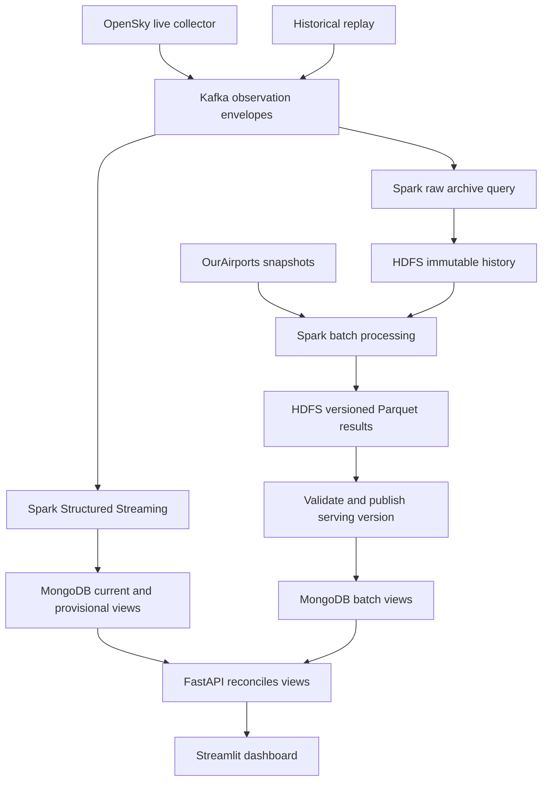

# Project Plan: Air-Traffic Platform

**Updated:** 25 October 2026 · **First checkpoint:** 26 October 2026

**Follow this file only.** Sections 1–7 describe the goal, current implementation, ordered work, and completion checks. The [technical appendix](#technical-appendix) retains detailed course requirements and design rules. Commands live in the [README](../README.md); diagrams live in [architecture.md](architecture.md).

Quick links: [what works today](#2-what-we-already-have) · [stage order](#3-the-logical-build-order) · [detailed tasks](#4-detailed-work-and-completion-checks) · [checkpoint demonstration](#5-what-we-show-on-26-october).

**Where we are:** S1–S4 are verified for the local prototype. **Next: S5 — store the latest aircraft state in MongoDB, then S6 — display it on a map.** We can now demonstrate both historical replay and real live collection through Kafka/Spark/HDFS, plus saved historical analytics. We do not have a dashboard yet.

## 1. What we want to deliver

Build an application that turns aircraft observations into three useful views:

| Final view | What a user can do | What makes the result trustworthy |
| --- | --- | --- |
| Aircraft map | See the latest observed positions, speed, and altitude in a selected area. | Show live/replay mode and position age; missing or stale positions stay visible as a status. |
| Aircraft history | Select an aircraft and time interval to inspect recorded movement. | Show observation gaps, covered time ranges, and measured distance; do not invent missing movement. |
| Regional traffic charts | Compare observed aircraft counts and movement statistics across regions and time. | Show source coverage and whether a result is provisional or recomputed from stored history. |

Example: select a region around Hanoi, inspect aircraft we observed there, select one aircraft's recorded path, and view the region's traffic chart. The available observations determine the coverage. One row is a snapshot of an aircraft, not a complete flight.

The course deliverable also includes executable source code, reproducible data acquisition, Kafka/Spark/HDFS/NoSQL integration, Kubernetes or cloud deployment, required Spark examples, measured comparisons, a report, and a demonstration. Ten million unique observations and five-second display latency are project targets to evaluate, not results already achieved or stated course minimums.

## 2. What we already have

**Today we have two working input paths, retained history, and saved analytical results. The user-facing application is the next major build.**

| Area | Actual implementation | Verification and remaining limits |
| --- | --- | --- |
| Source data and common schema | Pinned OpenSky historical download, integrity manifest, quality profiler, shared observation format, and ten-row synthetic fixture. | Real archive checksum verified; first 100,000 rows profiled. Full-file coverage and independent reference data remain. |
| Historical ingestion | Bounded CSV replay with original event times, new receipt times, rejection records, and Kafka publication. | Fixture produces eight observations and two rejections. Replay sorts a prefix of at most 100,000 rows; large replay and seeded fault injection remain. |
| Kafka | One broker/controller; separate `airtraffic.replay.v1` and `airtraffic.live.v1` topics, each with three partitions, replication one, seven-day configured retention. | Both input paths verified. Partitions share one broker; broker failover is not provided. |
| Streaming archive | Spark Structured Streaming reads Kafka and preserves payloads, status, topic/partition/offset, and processing time. | Raw records reach HDFS Parquet; persistent checkpoints support the tested restart case. |
| Historical storage | One HDFS NameNode and two DataNode containers with replication two. | Local persistence/read-back worked. All containers share one physical machine. |
| Initial analytics | Spark calculates minute/cell aircraft counts and trajectory segment summaries. | Your run `demo-1792921080` read ten rows and returned three eligible positions, two traffic groups, and two segments. |
| Saved analytical tables | Immutable traffic and trajectory Parquet, full read-back checks, manifest, completion marker, saved-result inspector, automated demo. | Full demo passed; two rows in each table. Values survive service restart. Overwrites and incomplete versions are refused. |
| Live ingestion | Bounded REST collector, live adapter, raw response evidence, delivery/freshness report, separate Kafka topic and Spark/HDFS archive. | Two real requests returned eight observations each: 16 acknowledged, 16 archived, 16 unique Kafka offsets, zero uncertain deliveries. |
| Application and final deployment | Designed but not implemented. | MongoDB latest-state/serving, API/map, full Lambda reconciliation, and distributed Spark/K3s deployment remain. |

**Evidence to retain:** the real archive is 100.5 MiB; its first 100,000 profiled rows contain 4,472 aircraft identifiers. The fixture archives ten deliveries with six distinct observation IDs. Earlier 1,000-record archival and 100-record restart-backlog checks remain useful. Today's S3/S4 runs and tests are recorded below; these are bounded checks, not full-file, scale, or final-system evidence.

### Verified progress — 25 October 2026

| Check | Measured result | Evidence / reproduction |
| --- | --- | --- |
| Full S3 demonstration | 10 archived records → 3 eligible positions → 2 traffic rows + 2 trajectory rows; saved values match computed values. | `python3 -m scripts.checkpoint_demo --no-build`; verified run `checkpoint-s3-20261025-final`. |
| Persistence and publication safety | Saved rows match before/after stopping and restarting services. Existing output is refused; a partial version without root `_SUCCESS` is refused by the reader. | `data/reports/s3-diagnosis/restart-verification.json` and `restart.log`. |
| Full S4 demonstration | 2 anonymous HTTP 200 responses → 16 acknowledged observations → 16 HDFS rows and unique offsets in live mode/topic. | `python3 -m scripts.live_demo --no-build`; verified run `live-s4-20261025-final`. |
| Source freshness and quota | Each snapshot: 3 positions ≤30 seconds old, 5 stale. Position ages approximately 11–239 seconds. Remaining API credits: 397 then 394. | `data/reports/live/live-s4-20261025-final/session.json`. Live collection does not guarantee fresh positions. |
| Regression checks | 64 host tests passed; 13 Spark tests skipped on the host. Separately executed: 7 storage tests and 3 archive tests passed in Spark. | Commands in the [README](../README.md#verification); logs under `data/reports/s3-diagnosis/`. |

The [tracked aggregate evidence](../data/verification/s3_s4_20261025.json) preserves results for Git review. Local reports retain full logs and responses outside Git. The live request count and aircraft count can differ on the next run; replay fixture counts should remain fixed.

## 3. The logical build order

The practical order is **prepare data → connect the pipeline → make its outputs reliable → collect live input → maintain current state → show a map → add historical views → reconcile live and historical charts → complete analysis/deployment → deliver**.

Use the numbered stages below to decide what to build. The old M0–M7 labels in the appendix group course requirements; they are not a second work schedule.

| Stage | What we build | Must be ready first | Current status | Visible result |
| --- | --- | --- | --- | --- |
| S1 | Shared observation format and reproducible input | Defined product/source scope | Done for the historical baseline | A verified file can be normalized and replayed. |
| S2 | Kafka → Spark → HDFS archive | S1 | Done locally | Published messages can be read from stored history. |
| S3 | Reliable saved batch results and repeatable demo | S2 | Verified locally, 25 October | Calculated tables are saved, verified, and reusable. |
| S4 | Live ingestion that pulls OpenSky snapshots | S1–S2; follows S3 in our execution order | Verified locally, 25 October | A bounded live session reaches its own Kafka topic and HDFS archive. |
| S5 | Latest aircraft state in MongoDB | S2–S3; S4 supplies live input | Next task — not started | One correct latest observation per aircraft/run can be queried. |
| S6 | API and first map | S5; S4 for live-mode acceptance | Not started | A user can view replay and then live positions with age/status. |
| S7 | Complete historical products and reference enrichment | S3; S6 for UI integration | Early analytics code only | Users can inspect recorded movement and historical traffic. |
| S8 | Streaming traffic windows and Lambda reconciliation | S4–S7 | Not started | Fast provisional charts are corrected by published historical results. |
| S9 | Required advanced Spark work and controlled comparisons | S7 and sufficient validated data | Not started beyond initial SQL transformations | Reproducible correctness, analytical, and performance evidence. |
| S10 | Distributed deployment and operational checks | S6, viable hardware, and stable service contracts | Not started | Services run across hosts; final stack includes S7–S9 results. |
| S11 | Final acceptance, report, and rehearsal | S8–S10 | Not started | Another teammate can deploy, run, explain, and recover the project. |

**Next execution order:** S5 → S6 → S7 → S8. S1–S4 now supply the shared contract, replay fixtures, live input, and retained history. Historical/reference preparation in S7 can proceed alongside S5/S6; its application integration follows S6. S9 and S10 can run in parallel once their own prerequisites hold. Final delivery waits for both.

Check hardware and deployment feasibility during S3–S5. Record logs, correctness checks, and lessons during every stage; do not postpone them until the report stage. Do not invent dates for the remaining stages until the final deadline and team availability are confirmed.

## 4. Detailed work and completion checks

### S1 — Prepare input and the common observation format

**Purpose:** make historical and future live data understandable by the same processing code. **Status:** historical baseline complete.

- Keep the existing downloader, checksum/provenance manifest, historical adapter, and replay working. Define snapshot time, position-update time, last-contact time, and receipt time separately.
- Keep nullable measurements, stable observation identity, run identity, source references, and explicit rejected-row reasons. A repeated snapshot is a repeated delivery, not another unique observation.
- Retain a small fixture containing valid rows, duplicate/conflicting identities, missing positions, stale positions, and invalid values. Keep real downloaded telemetry outside Git.
- Document source coverage, units, known quality limits, and the bounded replay behavior. Full-file profiling and larger historical coverage are completed in S7.

**Output:** verified source manifest, shared observation contract, fixture, profile, and reproducible JSONL/Kafka replay. **Completion check:** the ten-row fixture consistently produces eight observations and two rejections with preserved source times; corruption is rejected before publication. Existing baseline checks satisfy this scope.

### S2 — Connect Kafka, Spark, and HDFS

**Purpose:** reliably move observations into retained history. **Depends on:** S1. **Status:** complete for the local prototype.

- Keep explicit topic creation, three replay partitions, persistent broker storage, producer acknowledgments, and keys that group an aircraft's records within a run.
- Run the Spark archive with separate output and checkpoint locations. Preserve every delivery, including malformed/rejected records, with its Kafka offset.
- Read committed Parquet from the archive root. Keep the two HDFS DataNodes and document that they currently share one host.
- Retain repeatable start, inspection, stop, and restart instructions. Treat Kafka retention and lost checkpoints as explicit recovery constraints.

**Output:** a runnable local streaming archive and an inspector. **Completion check:** a fresh fixture run has ten archived rows and ten unique Kafka offsets; restart recovers a bounded backlog without repeating the original run's offsets. These bounded cases have been exercised.

### S3 — Finish saved batch results and the automated demo

**Purpose:** make calculated results available for later application queries. **Depends on:** S2. **Status:** verified for the local fixture pipeline on 25 October.

- [x] Reproduced the hang and retained a JVM thread dump, Spark stage state, and partial HDFS versions. Writes and counts completed; Spark's `EXCEPT ALL` comparison had a stage waiting with no active tasks.
- [x] Replaced that comparison with a null-safe join of complete-row frequencies. It checks values, nulls, and duplicate multiplicity without collecting full tables into Python. The corrected HDFS batch completed in about 13 seconds without increasing the 180-second limit.
- [x] Saved `traffic` and `trajectory_segments` to a new version; checked schemas, counts, and values before writing the manifest and root `_SUCCESS`. Batch writes now explicitly request HDFS replication two.
- [x] Preserved `_RESERVED` ownership and refused existing/partial output directories. Added `batch-inspect`, which refuses an incomplete version and checks saved schema/counts against its manifest.
- [x] Made timed-out/interrupted demo commands stop their own temporary container and retain captured logs. A passing summary still requires every stage.
- [x] Passed the complete demo with 10 archived records, 3 eligible positions, and 2 rows in each table. Verified unchanged saved rows after service restart and refused output reuse.

**Output you can show:** `analytics.json`, `batch.json`, and `summary.json` under `data/reports/checkpoint/checkpoint-s3-20261025-final/`, plus actual HDFS Parquet. Later arrivals still require a new output version; MongoDB publication belongs to later stages.

### S4 — Build live ingestion to pull new data

**Purpose:** collect newly observed aircraft data as a second input mode. **Depends on:** S1–S2; we completed S3 first to secure the checkpoint demonstration. **Status:** verified locally with a real bounded session on 25 October.

- [x] Checked current [OpenSky API documentation](https://openskynetwork.github.io/opensky-api/rest.html). Default region: latitude 8–24, longitude 102–110. Collector defaults: 3 total attempts, at least 10 seconds between polls, 60-second scheduling window, 10-second HTTP timeout. The demo uses only 2 attempts.
- [x] Added a REST adapter using the shared observation contract and validation rules. Snapshot, position, contact, and receipt times remain distinct; missing values and rejection evidence survive publication.
- [x] Added raw response files and `session.json`, containing source hashes, request outcomes, freshness, quota headers, known acknowledgments, and uncertain deliveries. Optional bearer tokens come from the environment and are absent from reports.
- [x] Added the three-partition `airtraffic.live.v1` topic and `live-archive` service. Live Bronze and checkpoint paths end in `live-v1`; replay retains its separate paths. No watermark is applied to either raw archive.
- [x] Tested empty/invalid responses, strict field types, timeouts, bounded retries, quota/auth failures, interruption, response size limits, and partial Kafka publication. Authentication/quota failures stop; transient network/server failures consume the same attempt budget.
- [x] Ran the real collector through Kafka and Spark into HDFS: 16 acknowledged observations, 16 archived rows, zero uncertain deliveries. Archive checks confirm the live topic/mode; replay remains independently readable after restart.

**Output you can show:** `data/reports/live-demo/live-s4-20261025-final/summary.json` and `archive.json`; `data/reports/live/live-s4-20261025-final/session.json` explains freshness and API use. S4 is a finite collection session; continuous operation, token refresh, and a displayed live map are outside this stage. An empty API result is recorded honestly and cannot produce a passing end-to-end demo.

### S5 — Maintain the latest aircraft state in MongoDB

**Purpose:** provide a small queryable current-state table instead of scanning history for every map refresh. **Depends on:** S2–S3; S4 now supplies live input. **Status:** next task, not started.

1. Add MongoDB with persistent local storage and indexes for mode/run/aircraft and bounded region queries. Keep connection settings separate from processing rules.
2. Add an independent Spark current-state query with its own checkpoint. Reuse validation and source identity; process replay and live separately.
3. Store one latest observation per mode/run/aircraft, comparing source observation time and a deterministic tie-break consistent with batch processing. Receipt time must not allow an old source observation to replace a new one.
4. Use atomic version-guarded writes that remain correct when a micro-batch repeats or only part of a write succeeds. Update through supported operations rather than collecting an unbounded batch in the driver.
5. Keep source timestamps, mode, run, quality, and position availability. A latest observation without coordinates must be shown as missing; any separately retained old position must carry its original age.

**Output:** queryable latest-aircraft records and restart-safe update behavior. **Completion checks:** ordered, out-of-order, duplicate, conflicting, and partial-retry fixtures produce the same final state as an independent reference; older observations cannot overwrite newer ones; two runs cannot contaminate each other. Age uses replay simulation time for replay and current time for live.

### S6 — Build the API and first usable map

**Purpose:** turn terminal data into the first user-facing product. **Depends on:** S5; live acceptance also needs S4. **Status:** not started.

1. Build a small FastAPI read interface for health, available runs, and bounded current-aircraft queries. Require explicit mode/run selection; allow geographic bounds and enforce a response limit with a visible truncation indicator.
2. Build a Streamlit page with a mode/run selector, map, aircraft details, and collection/processing status. Read through the API so display code does not own database queries.
3. Show observation and position ages, missing/stale status, and replay labels. An idle or failed collector must not leave an apparently fresh map.
4. Handle empty results, unavailable dependencies, and refresh errors with bounded timeouts and a visible last-success time. Keep local services bound to the documented local interfaces.
5. Add receipt-to-visible timing instrumentation. Keep source age separate from pipeline latency; do not claim the five-second target from the raw archive's batch-start metric.

**Output:** the first working aircraft map. **Completion checks:** a replay updates the displayed latest state; a short live session updates live mode; wrong/unknown runs return a clear empty/not-found result; stale and missing positions are identified. Measure actual display latency at a declared small workload.

### S7 — Finish historical products and reference enrichment

**Purpose:** support useful aircraft-history and regional-history views. **Depends on:** S3; UI integration follows S6. **Status:** initial algorithms exist; complete products are pending.

1. Profile the full real archive with Spark and measure actual rows, unique observations, bytes, time coverage, and gaps. Acquire additional pinned historical coverage only as needed. Extend replay beyond the current in-memory prefix before claiming a large ordered replay.
2. Add an independent OurAirports acquisition path with its own schema validation, provenance, and snapshot version. Preserve the date mismatch between modern references and historical observations.
3. Build versioned clean/enriched observations. Share conflict, null, freshness, and spatial-cell rules with later streaming calculations. Keep the current one-degree grid labelled as prototype version 1; introduce the planned H3 grid as a new tested rule version.
4. Calculate trajectory points and segment summaries, including time range, observed distance, and coverage gaps. Calculate traffic metrics with explicit coverage and missing-value counts. Airport proximity supplies context, not evidence of a flight's origin or destination.
5. Save immutable result versions with input/rule/reference metadata. Publish bounded serving views in MongoDB only after validation, then expose aircraft/time-range history and region/time-range metrics through the API and dashboard.
6. Record window/aggregation, transformation, enrichment-join, partition-pruning, and caching evidence as these jobs are built. Compare alternatives on equivalent inputs rather than creating an experiment only at the end.

**Output:** historical aircraft paths, regional traffic charts, reproducible enriched tables, and initial Spark comparison evidence. **Completion checks:** independently calculated fixtures match; gaps remain gaps; joins retain expected matched/unmatched rows; historical API reads stay bounded; a failed publication cannot expose a partial result version.

### S8 — Add live traffic windows and reconcile Lambda results

**Purpose:** show fast traffic summaries that can be corrected using complete stored history. **Depends on:** S4–S7. **Status:** not started.

1. Add a separate streaming query for per-aircraft/cell/minute representatives, with its own checkpoint and a documented watermark allowance. Start from the existing planned thirty-second allowance and measure its effect; keep all arrivals in the raw archive.
2. Use the same cell, identity, quality, and metric definitions as the versioned batch path. Keep live and historical event times in separate queries. Do not sum cell/window distinct counts to claim a distinct union count.
3. Store provisional representatives/results with deterministic keys and updates. At finite replay end, identify unfinished windows and complete them through batch processing.
4. Recompute a bounded historical range including late records. Publish its coverage and version only after all serving results are ready; the API chooses the published batch value for covered keys and otherwise uses the provisional value.
5. Display provisional/final labels and visible corrections. Test recovery after partial serving writes as well as normal restart.

**Output:** live regional charts and a demonstrated batch correction. **Completion checks:** within-watermark and beyond-watermark fixtures have expected outcomes; repeated updates and retries do not inflate counts; overlapping batch and streaming counts are never added; recovered output equals an uninterrupted reference for the declared test.

### S9 — Complete advanced Spark work and measured comparisons

**Purpose:** satisfy the course's processing requirements with reproducible evidence. **Depends on:** S7 and suitable coverage; can run alongside S8/S10. **Status:** remaining advanced work has not started.

- Maintain a requirement-to-code/test/result table. Complete window functions, advanced aggregations, pivot/unpivot, bounded custom aggregation, UDFs, broadcast and sort-merge joins, multi-join optimization, caching, pruning/bucketing, and executed-plan analysis. Initial SQL code alone does not complete this list.
- Build statistics/time-series summaries over declared coverage. Implement one bounded MLlib study with chronological splits and a simple baseline; fit preprocessing on training data only.
- Build a bounded GraphFrames study of observed spatial transitions with an independently known small graph. Do not interpret observed transitions as inferred airport routes.
- Run the appendix comparisons E01–E09 when their prerequisites exist; collect recovery and streaming evidence during S3/S8, and scaling/storage experiments during S10. Record identical logical inputs, configurations, resources, and result equality.
- Keep insufficient data or a baseline beating a complex method as an explicit result. Verify the selected library versions and small examples before long experiments.

**Output:** required Spark demonstrations, experiment inputs/configurations, result tables, and report-ready findings. **Completion check:** every agreed course skill links to executable code, a correctness check, and relevant evidence; no unsupported performance or model-quality claim remains.

### S10 — Deploy across hosts and verify operation

**Purpose:** meet the deployment requirement and measure distributed behavior. **Depends on:** S6, stable service contracts, and successful early hardware feasibility. Final deployment includes S7–S9. **Status:** not started.

1. During S3–S5, inventory team machines, memory/disk, CPU architectures, network reachability, and persistent storage. Try a tiny ARM64/K3s and distributed Spark/HDFS example before choosing final placement.
2. Package working services for K3s with configuration, secrets, persistent volumes, readiness, and resource limits. Run Spark executors on worker hosts; place HDFS replicas on different hosts where hardware permits.
3. Add monitoring for Kafka backlog, stalled Spark batches, source gaps, HDFS health/capacity, MongoDB/API latency, and machine resources. Configure scoped access and intended encrypted connections for the deployed network.
4. Exercise worker/DataNode interruption and documented backup/restore. State which components remain single points of failure; two containers on one laptop do not establish host-failure recovery.
5. Measure throughput, end-to-end latency, resource use, scale changes, and storage/replication costs at declared workloads. Retain the local Compose path for development and fallback demonstrations.

**Output:** repeatable distributed deployment, monitoring, and measured recovery/scaling evidence. **Completion checks:** another member can deploy the system; Spark tasks run on worker hosts; HDFS reports expected replica placement; an agreed failure/recovery scenario has measured results and retained evidence. Complete both feature and deployment checks before final claims.

### S11 — Final integration, report, and rehearsal

**Purpose:** deliver one understandable and reproducible project. **Depends on:** S8–S10. **Status:** not started; first-checkpoint notes already exist.

- Run a complete replay and bounded live demonstration through the deployed services. Show the map, aircraft history, regional charts, one late-data correction, and one failure/recovery scenario.
- Report unique source observations separately from deliveries and replicated bytes. Evaluate the declared volume and display-latency targets, including missed targets and measurement limits.
- Finish the report: problem, architecture, implementation, measured comparisons, and all required lesson categories. Link each claim to code, configuration, data provenance, and evidence.
- Rehearse from documented commands on a teammate's setup; prepare a small fixture fallback. Check repository contents, dependency versions, data acquisition instructions, and contribution records.

**Output:** runnable project, final report, evidence index, and rehearsed presentation. **Completion check:** another teammate can reproduce the stated results and explain both completed behavior and limitations without relying on undocumented steps.

## 5. What we show on 26 October

The first checkpoint requires executable progress, prepared data, and architecture. Show **verified S1–S4: reproducible input, both ingestion paths, retained history, and saved initial analytics**.

1. Open the repository, this plan, and the [architecture diagram](architecture.md).
2. Show the synthetic fixture and explain the real archive and bounded profile.
3. Run `python3 -m scripts.checkpoint_demo --no-build`. Show the passing summary, ten committed records, and the two saved result tables. This is the repeatable demonstration even without OpenSky access.
4. Run `python3 -m scripts.live_demo --no-build` once. Show acknowledged count = archived count, then inspect `session.json` for freshness and quota. If the provider is unavailable, show the saved October 25 evidence and label it as a recorded run.
5. Show the HDFS UI, replay Spark UI on port 4040, and live Spark UI on 4041. Explain the one-broker, one-host limitation.
6. Explain the next work: **S5 stores latest aircraft state in MongoDB; S6 reads it through an API and draws a map.**

**Suggested explanation:** “We have completed the local data pipeline through S4. Historical replay and a bounded live collector feed separate Kafka topics. Spark stores the observations in HDFS, and our batch job saves verified traffic and trajectory summaries. We tested restart persistence and failure handling. Next we will store the latest aircraft positions in MongoDB and build the map. Live source positions can be stale, so our report shows their ages.”

This demonstrates a working backend, prepared data, and architecture. It does not yet demonstrate the finished dashboard, full Lambda reconciliation, or large-scale operation. The 26 October checkpoint does not make the remaining stages due on that date.

## 6. Ownership and work that can happen in parallel

Assign actual names before scheduling the next sprint; these are responsibility areas, not confirmed people or capacity.

| Responsibility | Main stages | Coordination point |
| --- | --- | --- |
| Data and ingestion | S1, S4, historical/reference acquisition in S7 | Agree common schema, identity, clocks, and topic separation with processing. |
| Platform and deployment | S2, diagnosis in S3, S10 | Begin hardware feasibility early; keep application developers supplied with a working local stack. |
| Processing and storage | S3, S5, S7, S8 | Share batch/stream rules and define completed/publication boundaries. |
| API and visualization | S6, UI parts of S7/S8 | Read bounded serving APIs and show mode, freshness, coverage, and errors. |
| Validation and reporting | Every stage, especially S9/S11 | Review evidence with another member as each task finishes. |

Replay and live-adapter tests run without calling OpenSky. Develop the current-state processor and map using reproducible replay, then validate with bounded live input. Historical/reference profiling can start while the map is built. Full cluster rollout waits for a viable platform and working components; monitoring and evidence collection start earlier.

## 7. How we keep this plan accurate

- Use `Not started`, `In progress`, or `Verified` for each stage, always stating the tested scope. Code existing is not the same as a passing full integration.
- For a completed task, record: date, command/run ID, input, observed result, evidence location, and limitation. Local artifacts may stay ignored; retain commands and appropriate aggregate findings in the repository.
- Update the current-inventory table and the stage status together. If a test fails, keep its failure visible until a successful rerun resolves it.
- Maintain one execution order in section 3. The appendix supplies detailed rules and requirement mappings; it does not override that order or add another active schedule.

<a id="technical-appendix"></a>

## Technical appendix — requirements and detailed design

This appendix preserves the original requirements and design. Its proposed behavior, numerical targets, comparison experiments, and provisional schedule describe the intended final system. Current completion status and the active execution order are recorded in sections 2–4 above.

<details>
<summary>Expand the detailed design, course requirements, milestones, and final checklist</summary>

Final delivery includes the application and source code, reproducible deployment configuration, dataset provenance, correctness/recovery tests, measured comparisons, the course report, and a demonstration. The original M0–M7 labels are retained only as requirement groups. Follow S1–S11 above for execution order; calendar dates require a confirmed final deadline and team availability.

### A1. Course alignment and final choices

The guideline requires Lambda or Kappa, Spark skills, distributed storage, a message queue, NoSQL, and Kubernetes or cloud deployment. Our choices are:

| Component | Choice | Role |
| --- | --- | --- |
| Architecture | **Lambda** | Retained raw history, a speed layer, batch recomputation, and reconciled serving views. |
| Processing | **PySpark / Spark SQL / Structured Streaming** | Both streaming and batch jobs; shared validation/product rules. |
| Queue | **Kafka** | Partitioned buffering, retained offsets, and replay. |
| Storage | **HDFS + Parquet** | Distributed history, processed datasets, checkpoints, and versioned outputs. |
| NoSQL | **MongoDB** | Current state, window representatives, published historical views, and publication metadata. |
| Application | **FastAPI + Streamlit** | Bounded read-only queries, map, trajectories, charts, and source/run status. |
| Deployment | **Docker Compose → K3s/Kubernetes** | Small local prototype, then ARM64 Linux VMs on team MacBooks. |
| Observability | **Prometheus/Grafana + Spark/application logs** | Metrics, alerts, diagnosis, and benchmark evidence. |

Lambda fits historical reprocessing and late-data correction. Kappa would center processing on log replay; the substantial bounded analysis required here favors a separate batch layer. Share business rules and test both paths against an independent reference to control their consistency cost.

Spark replaces the previously proposed Flink runtime; MongoDB satisfies the NoSQL requirement. PostgreSQL, Iceberg, Trino, and a Flink comparison are outside the core. Extra tools, full high availability, and 50 million observations are extensions after course requirements work.

The guideline does **not** state a dataset minimum, numerical latency target, push-only source requirement, final deadline, or fixed number of comparisons. The first checkpoint is October 26. Our targets are **10 million unique real observations** and **p95 collector-to-display latency ≤5 seconds** at a declared workload. Calendar dates remain provisional until the final deadline and team availability are confirmed. Conservatively cover statistics/time series, MLlib, and GraphFrames until the instructor clarifies whether they are alternatives.

### A2. Data sources and ingestion contract

| Source | Purpose | Constraint |
| --- | --- | --- |
| OpenSky historical CSV archives | Development, deterministic replay, scale tests, and batch analytics. | Validate full files and consecutive coverage; sampled-day gaps remain gaps. |
| OpenSky live REST snapshots | Newly collected observations during bounded demonstrations. | Polling, quotas, source delays, and stale/missing positions. |
| OurAirports airport/country/region CSV snapshots | Independent enrichment source and meaningful reference joins. | Pin acquisition date/version; modern reference data is not automatically accurate for 2022 observations. |

Keep source URLs, checksums, byte/row counts, schemas, time ranges, coverage, filtering, and provider terms in manifests. Preserve original archives. Reference acquisition needs its own validation: current scripts expect OpenSky telemetry columns. Airport proximity supplies context and does not prove a flight origin or destination.

One bounded live collector serves the team, with region, interval, attempt/session budgets, timeout, bounded retries/backoff, and quota/error status. The October 25 collector run over latitude 8–24/longitude 102–110 returned eight observations in each of two snapshots and archived all 16 deliveries. This demonstrates that finite session only.

Current limits and authentication were rechecked on October 25; the [data guide](../data/README.md#live-opensky-collection) records the checked limits and implemented collector behavior. Inspect remaining-credit/retry headers before increasing collection. Historical archives supply benchmark volume; repeated snapshots and replicated bytes do not increase unique observation counts.

The target replay will use a pinned manifest, timestamp-ordered observations, a configurable release rate, run identity, simulation clock, and seeded duplicates/delays/invalid records. Replaying the same million observations ten times is ten million deliveries, not ten million unique observations.

The implemented replay selects at most 100,000 source rows in archive order, sorts that prefix in memory, and releases JSONL or publishes directly to Kafka at a configurable constant rate. Original timestamps provide the simulation clock; receipt time is captured at release. This does not yet provide global file ordering or seeded fault injection. Commands and contract fields are in the [data guide](../data/README.md).

#### Shared observation envelope

| Fields | Definition |
| --- | --- |
| Identity | Schema version, provider/source/dataset, mode, run ID, aircraft `icao24`, stable observation ID. |
| `observed_at` | Source snapshot time: historical CSV `time` or live response `time`. |
| `position_updated_at` | Historical `lastposupdate` or live `time_position`. |
| `last_contact_at` | Historical `lastcontact` or live `last_contact`. |
| `received_at` | Wall-clock receipt of the live response body, or replay release, before normalization and Kafka publication. |
| Measurements | Nullable coordinates, altitude types, speed, track, vertical rate, callsign, on-ground and source-specific fields. |
| Provenance/quality | Original payload/reference, record location, adapter version, quality reasons; reference version when enriched. |

Use UTC and SI units, preserve textual identifiers/leading zeros, and keep missing values distinct from zero. Negative altitude or vertical speed can be valid. Source/aircraft/snapshot identity survives retries; resolve conflicting payloads deterministically. Replay retains source identity and introduces a separate run identity. Keep malformed records archivable even without a valid aircraft key.

### A3. Real-time target and measurement

Polling/push describes delivery from the source; stream/batch describes processing. Live snapshots and historical replay can both feed streaming processing. Our target is **near-real-time processing after collector receipt**, not guaranteed aircraft-to-screen freshness or hard real-time deadlines.

| Metric | Boundary |
| --- | --- |
| Pipeline latency | `displayed_at - received_at`; includes producer work, Kafka, Spark, MongoDB, API, and browser refresh/rendering. |
| Live position age | Current wall time minus `position_updated_at`. |
| Replay position age | Simulation time minus original `position_updated_at`. |
| Analytical finalization | Separate delay for event-time windows and completed batch publication. |

Example: position recorded at 10:00:00, received at 10:00:08, displayed at 10:00:10 means two seconds pipeline latency and ten seconds position age. Historical timestamps remain unchanged during replay; never calculate replay processing latency by subtracting a 2022 timestamp from today's clock.

Start the small current-state query with a one-to-two-second micro-batch trigger and measure actual p95 visibility against the five-second target. Declare input rate, region/aircraft cohort, duration, refresh policy, and resource allocation. Trace sink readiness and actual display, synchronize clocks/account for client offset, and report missing updates, superseded versions, exclusions, and queue growth. A rendered same-or-newer aircraft version can satisfy current-state visibility; count superseded intermediate versions separately. Window completion does not delay the current-state branch.

### A4. Lambda data flow, storage, and correctness



This is the target Lambda flow. S1–S4 provide verified historical replay, bounded live collection, separate Kafka/HDFS archival paths, and saved initial traffic/trajectory tables. Hot-state processing, MongoDB serving publication, the API, and dashboard remain planned. The topology and verification boundaries are shown in [architecture.md](architecture.md).

#### Streaming queries

| Query | Status | Work | Sink |
| --- | --- | --- | --- |
| Raw archive | Implemented | Preserve all envelopes, quality failures, late records, and Kafka topic/partition/offsets before filtering. | Append-only Parquet on HDFS with dedicated checkpoint/commit metadata. |
| Current state | Planned | Validate each micro-batch and select latest aircraft/run observations. | Deterministic, version-guarded MongoDB writes via `foreachBatch`. |
| Window representatives | Planned | Group eligible positions by run/minute/H3 cell/aircraft and retain the latest observation per group. | Update-mode MongoDB representative rows with stable keys. |

Use separate checkpoints so current-state visibility does not wait for archive commits or windows. Keep live and historical replay in separate event-time queries/topics or run one mode at a time: adding run ID to a group key does not isolate a query-wide watermark. Partition valid telemetry by run/aircraft and never reuse a checkpoint for a different input/run definition.

Begin with H3 resolution 5, one-minute event-time windows, and a provisional thirty-second watermark allowance. Validate the chosen API/version with a single stateful aggregation; do not assume streaming `countDistinct` or arbitrary stateful operator chains are supported. MongoDB aggregates bounded representative rows into counts/means, while Spark batch independently computes the same products. Distinct counts across cells/windows cannot be added to obtain a distinct union count.

Watermarks follow event-time progress. Measure state growth and late drops; retain all observations in raw storage for reconciliation. At finite replay end, label incomplete windows and finalize the remainder through batch processing instead of inventing telemetry to move the watermark. Mark/filter stale aircraft on API reads even if no events arrive. Preserve position-update time so repeated old coordinates do not appear fresh.

#### Batch products and publication

The checkpoint batch prototype reads committed Bronze Parquet for one run and returns bounded JSON summaries. It selects a deterministic payload for each observation ID by smallest source-payload fingerprint before requiring coordinates and a position-update age of zero to 30 seconds. A conflicting valid-position payload can be excluded if that winner lacks a usable position. Traffic counts one representative per aircraft/minute/one-degree cell. Trajectories use distinct position-update times, break at UTC-day boundaries or gaps over ten minutes, and count distance only across edges at most 60 seconds apart. The prototype has no reference enrichment or serving publication. The batch writer saves Parquet to a fresh output directory, verifies schemas/counts/values by reading it back, and writes a manifest followed by a root completion marker. Existing output directories are refused. Full HDFS publication, saved-result inspection, and restart persistence are verified; S3 records the evidence.

Planned final batch jobs will read pinned committed-file/offset manifests and reference snapshots, deduplicate the full range, validate/enrich observations, and record input/rule/reference/output versions. Airport enrichment uses spatial candidates including neighboring cells and a distance check, avoiding an unrestricted observation-to-airport cross join.

Trajectory jobs order distinct eligible position updates, derive gaps and segments, and save points separately from summaries. Initially split at UTC-day boundaries or gaps above ten minutes; exclude distance edges spanning more than one minute. Keep thresholds configurable, validate them, and show coverage gaps without interpolation.

Traffic jobs choose one latest eligible observation per aircraft/cell/minute, then calculate aircraft counts, speed/altitude means over present fields, missing counts, and climbing/descending counts. Batch reconciliation includes valid late input omitted by streaming windows.

Write a new Parquet/output version and complete MongoDB serving views before changing a small active-version pointer. Keep partial versions hidden. For each compatible run/dataset/rule/reference/result key, the API prefers a published batch result within its declared coverage and otherwise uses the provisional speed result. **Never add overlapping speed and batch counts.** Batch results are complete for their declared input snapshot; later arrivals can create a revised version.

#### Storage and recovery rules

- **HDFS source/Bronze:** original archives, reference snapshots, immutable raw envelopes and provenance; raw partitions by ingestion date/run.
- **HDFS Silver/Gold:** versioned clean/enriched observations, rejections, trajectories, metrics, statistics, model/graph results; historical observations partitioned by event day.
- **HDFS operational data:** separate persistent query checkpoints and Spark event logs.
- **MongoDB:** hot state, representatives, bounded trajectory chunks, published metrics, coverage and publication metadata. Full analytical history stays in HDFS; expose which ranges are materialized for the API.
- Start with roughly 128 MiB compacted analytical files and HDFS replication two. Compare alternatives on disposable copies. Account for source copies, Kafka retention, replicas, checkpoints, and rewrite space.
- Compact into new analytical versions; never rewrite active raw file-sink directories. Preserve committed-reader metadata and recovery checkpoints. Parquet-only publication needs explicit manifests/version handling.
- Apply independent retention to hot state, representative rows, and published versions. Spark state eviction does not remove MongoDB rows; retire provisional rows only after replacement coverage is published or documented retention expires.
- MongoDB keys/version guards must prevent old updates, retry duplicates, and unsafe increments. `foreachBatch` can repeat; a batch marker alone cannot repair earlier partial writes. Test ties and concurrent attempts.
- Prove exactly-once **effects at a stated boundary** by interrupting partial writes and comparing recovered results against an uninterrupted reference. Raw source duplicates differ from duplicated sink effects. Kafka/HDFS/MongoDB do not share one atomic transaction.
- Keep Kafka retention longer than planned recovery delays and monitor each query's lag. Lost offsets/checkpoints/volumes require explicit restoration or retained-input replay; never silently skip to the newest data.

### A5. Required Spark work and evidence

Each skill needs executable code, a small correctness reference, and relevant results/plans. The fact that Spark runs in the architecture is not sufficient evidence.

| Guideline skill | Project implementation | Evidence |
| --- | --- | --- |
| Window functions | `lag`, ranking, cumulative segment IDs, rolling regional trends. | Expected ordered points, gaps, segments and trends. |
| Advanced aggregations | Counts, percentiles, movement summaries and missingness. | Independent values, null rules, executed plans. |
| Pivot/unpivot | Counts by region/hour, converted into chart-ready rows. | Equivalent values with explicit hour list and coverage. |
| Custom aggregation | Bounded grouped Pandas time-weighted speed over valid capped position intervals. | Independent weighted-sum reference, null/zero-weight cases, group memory limits. |
| Multi-stage transformations | Parse → validate → deduplicate → derive cells/segments → enrich → aggregate → publish. | Stage counts, quality reports and shared rules. |
| Business UDF | H3 cell assignment for valid coordinates. | Boundary/null tests and UDF overhead; use built-ins where sufficient. |
| Broadcast joins | Measured small spatial/reference lookups. | Correct matches, actual broadcast plan/size, runtime and memory. |
| Sort-merge joins | Large point-to-segment membership joins and controlled reference-join comparison. | Actual sort-merge plan, shuffle, spill and result equality. |
| Multi-join optimization | Filter/project before airport/region/country enrichment. | Same results, cardinalities, join order and before/after cost. |
| Partition pruning/bucketing | Event-day pruning and reproducible Spark bucketed catalog tables. | Scan files/bytes, bucket metadata, executed join plans; repartitioning alone is not bucketing. |
| Caching/persistence | Reuse cleaned data across downstream calculations, then unpersist. | Total workload time including fill, memory, eviction and spill. |
| Query optimization | Statistics, cost-based settings, justified hints and adaptive execution. | Estimated versus executed plans and measured outcomes. |
| Streaming/output modes | Append raw files and update representative views; optional bounded complete-mode demonstration. | Working queries, outputs and dedicated checkpoints. |
| Watermarking/late data | Minute windows with measured lateness allowance and batch correction. | Within/beyond-watermark fixtures, state/dropped-row metrics, reconciliation. |
| State management | Bounded per-window/aircraft state with live/replay isolation. | Growth, cleanup, stalled-time and restart tests. |
| Exactly-once guarantees | File commits and idempotent MongoDB publication under partial failure. | Defined boundary, replay/restart result equality and limitations. |
| Statistics/time series | Rolling counts, distributions and variability across contiguous coverage. | Reference calculations and gap-aware charts. |
| MLlib | Next-window observed-count regression with lagged counts/time features. | Chronological train/test split, train-only preprocessing, baseline versus model MAE/RMSE. |
| GraphFrames | Directed spatial-cell transitions from valid consecutive trajectory points. | Known graph fixture, deduplicated edge counts, degrees/components for a bounded real region. |

Keep UDF/custom aggregation demonstrations bounded and measure group size. ML needs sufficient consecutive coverage; missing coverage is not zero traffic, and disconnected sample days cannot form one continuous time series. The graph describes observed transitions, not inferred airport routes. Scope all three analytics areas conservatively until the instructor clarifies alternatives.

### A6. Different approaches and measured results

For selected problems, implement both a baseline and an alternative, measure them, explain trade-offs, and choose from the results. The comparison count below is our plan, not a number imposed by the guideline. No results or improvements are assumed in advance.

| ID / problem | Approach A | Approach B | Results |
| --- | --- | --- | --- |
| E01 — Trajectories | Bounded grouped Python/Pandas per run/aircraft/day. | SQL windows, gap flags and cumulative segment IDs. | Same points/boundaries and distance tolerance; runtime, shuffle, spill, peak memory. |
| E02 — Enrichment | Sort-merge join. | Broadcast join on the same measured reference lookup. | Same matched/unmatched rows; executed plans, runtime, shuffle, broadcast size, memory. |
| E03 — Storage | Baseline format/layout for each phase. | Independently vary format, codec, partitions, bucketing or compaction. | Same logical answers; scan bytes/files, physical storage, read/write/rewrite costs. |
| E04 — Reuse | Recompute clean data for each action. | Persist the reusable dataset, then unpersist. | Same outputs; total time including cache fill, action times, memory/eviction/spill. |
| E05 — Late data | Short watermark allowance, initially ten seconds. | Longer allowance, initially thirty seconds. | Completeness against full batch reference, dropped rows, state size, throughput and finalization delay. |
| E06 — Recovery | Full retained-input replay into an isolated test run. | Resume the equivalent failed query from its checkpoint. | Reference equality, time to recover, reprocessed records, missing/duplicate effects and unavailable time. |
| E07 — Scaling | One executor at stated resources. | Two/three executors at the same per-executor resources. | Same results; time, throughput, speedup, total resource cost and bottlenecks. |
| E08 — Replication | HDFS replication one on a disposable copy. | Replication two; three if capacity permits. | Physical disk, write cost, unavailable/under-replicated blocks and DataNode failure recovery. |
| E09 — Forecasting | Last-observed-count or fixed rolling-mean baseline. | One small MLlib regression pipeline. | Same chronological test rows; MAE/RMSE, regional errors, training/inference cost and coverage. |

**Storage phases:** compare CSV/Parquet with stated compression; two codecs on the same Parquet layout; unpartitioned/day-partitioned data for the same date-filtered query; bucketed/unbucketed catalog tables for a declared join; and pre/post compaction on a completed analytical version. Change one dimension per comparison or label a combined configuration honestly. Record file sizes, replication, cache state and rewrite costs.

**Controls:** E01 uses identical boundaries/null/tie/distance rules and measured group-size limits; retain failures if the baseline exhausts memory. E02 uses the same inputs and a lookup that safely fits the broadcast budget, with actual executed plans and adaptive-execution settings recorded. A different hint alone does not prove a different join ran. E05 fixes the arrival sequence/rate/end procedure and records real watermark progress. E06 uses isolated checkpoints/sinks, deterministic writes, a repeatable failure milestone including partial MongoDB publication, and an uninterrupted reference. E09 fits preprocessing/model on training data only.

Bounded operational comparisons provide additional lesson evidence:

| ID | Approaches | Measurements |
| --- | --- | --- |
| O01 — Input quality | Stop on an invalid record versus quarantine and continue. | Valid/invalid accounting, retained evidence, availability and debugging effort. |
| O02 — Dependency outage | Bounded timeouts/retries versus the same policy plus circuit breaker. | Same outage/load; errors, dependency calls, latency and recovery. |
| O03 — Diagnosis | Application logs versus correlated logs plus metrics/alerts on a replayed fault. | Failure timeline, available evidence and diagnosis steps; human timing is descriptive, not an unbiased benchmark. |
| O04 — API scaling | Fixed stateless replicas versus bounded horizontal pod autoscaling. | Errors, latency, scaling delay, replicas and resource cost under repeated load. |

#### Fair comparison and artifacts

1. Define question, alternatives, expected trade-off and acceptance rule before execution; preserve baseline code/configuration during development.
2. Pin source/reference manifests, eligible coverage, code/rule versions, seed, query/input rate, hardware and network conditions. Use an independently calculated small correctness fixture.
3. For equivalent-result optimizations, verify matching answers within a declared tolerance first. For watermark/ML trade-offs, measure completeness/error as well as resources. A faster wrong answer fails the optimization.
4. Repeat each selected configuration at least three times, alternate/randomize order, retain failures and raw results, and report median/spread. State cache preparation; restarting Spark alone does not establish an OS cold-cache test.
5. Measure display p95 over a declared, sufficiently large event cohort plus run-to-run variation; three job durations do not establish a reliable tail-latency guarantee.
6. Record executed plans, query progress, state size, shuffle/spill, CPU/memory/disk/network, physical storage, and recovery evidence. E07 increases total resources; report that increase and separate any vertical-scaling comparison.
7. Choose using correctness, quality, resources, maintainability and performance. Slower, failed or inconclusive alternatives are valid results, not findings to hide.

Future benchmark records include experiment/approach/run IDs, status/failure, manifest and configuration IDs, row counts/coverage, resource/cache conditions, correctness/quality, timing, metrics, and links to plans/logs/report sections. Keep aggregate results and reproducible instructions in Git; bulk data/secrets stay outside it. Each lesson uses a comparison table:

| Approach | Correctness / quality | Time / latency | Resource cost | Evidence | Decision |
| --- | --- | --- | --- | --- | --- |
| A — baseline | Pending | Pending | Pending | Pending | Pending |
| B — alternative | Pending | Pending | Pending | Pending | Pending |

These cells remain pending until runs exist. Label unimplemented alternatives as considered, not tried. Charts must come from recorded results. GraphFrames needs a sound correctness/coverage study; comparing unrelated graph algorithms just to create a table is unnecessary.

### A7. Hardware, deployment, and operations

The team has five members and four estimated M2/M3 MacBooks with 16 GB RAM each. Verify exact specifications, free disk, simultaneous availability and same-network/remote setup. The earlier disk budget of 50–100 GB free per host is unconfirmed; no paid cloud or paid feed is assumed.

Begin with small Compose profiles. For final K3s deployment, provision one ARM64 Linux VM per host, initially near four vCPUs/eight GB RAM, then measure host/guest headroom. If remote, investigate Tailscale inside the VMs and test node/pod routing, DNS, direct/relayed paths, sustained throughput, latency and loss.

| Placement | Initial proposal, subject to measurement |
| --- | --- |
| A | K3s control plane, HDFS NameNode/checkpoint service, one persistent Kafka broker. |
| B–D | One HDFS DataNode each; resource-limited Spark driver/executor pods. |
| Across B–D | Place MongoDB, API/dashboard and monitoring according to available memory. |

Run heavy batch/analytics experiments separately from latency demonstrations. Keep machines awake for scheduled sessions and account for JVM overhead, operating systems, storage services and temporary files. Pin Spark/Scala/Java/Python, Kafka connector, MongoDB client, H3/Pandas, GraphFrames Python/JVM artifacts and ARM64 images only after an integration smoke test.

Operational work and evidence:

- Service discovery/readiness, bounded retries, dependency timeouts/circuit breaker, and two API replicas behind a Kubernetes Service; bounded API HPA comparison. Scale Spark manually for controlled experiments.
- Prometheus/Grafana alerts for Kafka lag, slow/stalled batches, state/checkpoint failures, source gaps, HDFS block/capacity health, MongoDB/API latency and node resources.
- Centralized structured logs keyed by run/query/batch, retained Spark event logs and one documented root-cause investigation; select a lightweight log backend after memory checks.
- Secrets outside Git, scoped MongoDB users, HDFS permissions, Kubernetes RBAC, private service exposure and encrypted remote transport. Document actual service-TLS versus tunnel coverage; test allowed/denied actions.
- Audit acquisitions, rule/reference versions, job runs and publications; preserve source attribution/terms.
- Back up manifests, NameNode metadata, MongoDB serving/publication data and configuration; exercise restoration and measure recovery time/data loss.

Single control-plane, NameNode, Kafka and MongoDB instances remain availability limits. A checkpoint service is not a standby NameNode, persistent volumes are not cross-host failover, and replication is not backup. Demonstrate worker/DataNode recovery and documented restoration; full HA is an extension.

#### Setup and deployment path

The current Compose deployment is the local development environment: one NameNode and two DataNode containers on one host, with Spark running `local[2]`. It proves the first archive path, but it is not the final Kubernetes deployment or a test of host failure. The proposed four-host layout above is a target to validate, not an existing cluster or a requirement for four physical machines.

| Stage | When | Concrete work | Exit check |
| --- | --- | --- | --- |
| Local setup — done | Current baseline | Build and run Compose, persist Kafka/HDFS/checkpoints in named volumes, publish replay data, and read committed Parquet. | The documented 1,000-event run and 100-event restart backlog are reproduced. |
| Deployment feasibility — next, alongside application work | M1/early M2 | Confirm available hosts, RAM, disk and network; boot ARM64 Linux VMs; form a small K3s test cluster; check image compatibility, pod routing/DNS, persistent storage, and a tiny Kafka → distributed Spark → HDFS run. | Record which machines can join, where data can persist, and whether a Spark executor can run on a different node. Revise placement before building the full cluster if checks fail. |
| Application build — local first | M2–M5 | Add MongoDB, current-state processing, live collection, API/map, batch products, windows, and analytics to the working local pipeline. | Each component has a small end-to-end correctness check in the local environment. |
| Multi-node deployment — after feasibility and working components | M6 | Package services for K3s; place the NameNode/control plane and DataNodes on separate nodes as resources allow; run Spark with distributed executors; configure persistent volumes, readiness, secrets, monitoring and backups. | Replay and live paths work through the deployed stack; HDFS reports expected healthy replicas and Spark tasks run on worker nodes. |
| Deployment validation and delivery | M6–M7 | Exercise worker/DataNode failure, restart and restore; measure throughput, latency and resources; document limits and reproducible setup. | A teammate can redeploy and recover the system from the instructions and reproduce the reported results. |

The feasibility and application tracks start in parallel. The final cluster rollout waits for both a viable node/storage design and working application components. Multiple containers on one physical host do not provide host-level fault tolerance; VMs on separate hosts allow that failure mode to be tested.

### A8. Original milestone groups and acceptance criteria

These M0–M7 labels preserve the original requirement bundles, not a separate execution sequence or dated schedule. Use the stage mapping below and follow S1–S11 in section 3. Start infrastructure feasibility and evidence collection early; reduce optional experiments before dropping course requirements if time is shorter.

| Requirement group | Work | Acceptance |
| --- | --- | --- |
| M0 — Planning | This consolidated design and requirement/evidence mapping. | Documented plan only; no implementation compliance claimed. |
| M1 | Shared contract/fixtures, live and historical adapters, replay, reference manifests, full-file sizing; ARM64/network smoke tests. | Compatible envelopes, preserved provenance/times, reproducible replay, bounded requests; tiny Kafka→Spark→HDFS/MongoDB and MLlib/GraphFrames examples run. |
| M2 | First Lambda slice: ingestion, raw archive, current state, map, one batch metric and serving reconciliation. | Trace observation to display; reproduce a metric from raw input; batch overrides matching provisional result without addition. |
| M3 | Windows, watermark/state behavior, deterministic writes, stale-state handling, checkpoints and partial-failure recovery. | Independent fixture matches counts/state; old arrivals cannot overwrite new state; recovered output matches uninterrupted reference. |
| M4 | Clean/enrich, trajectories, reconciled metrics, bounded historical publication and required Spark transformations/joins. | Correct products, repeatable outputs, no partial publications; E01–E04 baseline/alternative evidence retained. |
| M5 | Bounded statistics, MLlib and GraphFrames studies. | Coverage/leakage checks, known-fixture results, real-data analysis and baseline comparison. |
| M6 | Final K3s integration, monitoring/logs, access controls, API failure/scaling and backup/restore. | Another member can deploy, diagnose and restore a run; measured capacity supports placement. |
| M7 | Large-scale comparisons, completed dashboard, report, evidence index and demonstration rehearsal. | Required skills/lessons have actual evidence; report achieved/missed targets and remaining limits. |

| Original group | Work in the active execution plan | Current progress |
| --- | --- | --- |
| M0 | Product and design definition | Complete as a documented baseline. |
| M1 | S1, S4, source/reference preparation in S7, early S10 feasibility | Partly complete: historical baseline and bounded live ingestion verified; reference data/scale remain. |
| M2 | S2, S3, S5, S6, initial S7/S8 serving | Partly complete: both raw archives and saved analytics verified; latest state and UI remain. |
| M3 | Reliability in S3/S5 and windows/correction in S8 | Archive restart and immutable batch publication verified; current state/windows remain. |
| M4 | S7 and transformation/comparison work in S9 | Initial batch calculations exist. |
| M5 | Advanced analytics in S9 | Not started. |
| M6 | S10 | Local Compose baseline only; final deployment not started. |
| M7 | S11 plus completed evidence from all earlier stages | First-checkpoint documentation only. |

Early S10 feasibility checks precede final cluster rollout; the active dependencies are stated in section 3. Collect O01/E05/E06 during ingestion/streaming, E01–E04 during batch work, E09 during analytics, and E07/E08/O02–O04 during distributed deployment. Do not wait until report week to implement baselines.

#### Implementation order

Follow S1–S11 in sections 3–4 for task order and exit checks. Begin early deployment feasibility alongside S3–S5. The M0–M7 table preserves final requirement coverage only.

### A9. Team ownership and code structure

| Member | Primary responsibility |
| --- | --- |
| 1 | Linux VMs, K3s, HDFS, network, monitoring/logs, deployment security and backups. |
| 2 | Source contract/adapters, live/replay, Kafka and Spark streaming. |
| 3 | Spark cleaning/enrichment, trajectories, joins, historical metrics and batch publication. |
| 4 | Spark optimization/comparisons, statistics, MLlib/GraphFrames and evidence index. |
| 5 | MongoDB serving, API/dashboard, integration/reconciliation tests and demonstration coordination. |

These are proposed ownership areas. Review every subsystem with another member; share batch/stream definitions, sink recovery and resource decisions. Each member writes lessons from work actually performed.

Keep existing `scripts/` and `tests/` working. Add modules only when implemented; do not create empty scaffolding or additional planning documents:

```text
docs/plan.md                # Only plan: progress, next steps and technical appendix
docs/architecture.md        # Checkpoint architecture and implementation boundary
README.md                   # Repository overview and working quick start
data/README.md              # Acquisition commands, field/report reference
src/airtraffic/
  contracts/                # Observation and reference schemas
  ingestion/                # Source adapters, collector and replay
  processing/               # Shared Spark expressions and product rules
  storage/                  # MongoDB writers, manifests and publication
  api/                      # Bounded serving endpoints
jobs/{streaming,batch,analytics}/
dashboard/                  # Streamlit, when implemented
configs/                    # Environment and experiment configuration
deploy/                     # Compose and Kubernetes configurations
benchmarks/                 # Working comparisons and aggregate results
tests/                      # Unit, integration and performance checks
```

Separate responsibilities, keep entry points small, reuse utilities, and introduce meaningful tests with each component. Do not move the existing acquisition code merely to fill the proposed layout.

Current prototype modules remain in `scripts/`: `observations.py` defines the shared envelope, `historical.py` normalizes CSV cells, `replay.py` orders/releases rows, and `replay_sample.py` provides the CLI. `sample_io.py` and `sample_values.py` are shared by acquisition/profiling/replay. The `src/airtraffic/` tree above is a future packaging layout, not existing scaffolding.

The implemented service slice adds `compose.yaml`, HDFS/Spark builds under `deploy/`, `scripts/publish_replay.py` and `kafka_sink.py`, and `jobs/archive_stream.py`, `archive_schema.py`, `inspect_archive.py`, `batch_analytics.py`, `inspect_analytics.py`, `batch_storage.py`, and `materialize_analytics.py`. The automated demonstration is in `scripts/checkpoint_demo.py`, with Compose execution helpers in `scripts/demo_runtime.py`; successful full publication remains to be verified. The shared `replay_source.py` keeps JSONL and Kafka input loading consistent. Update these modules before creating parallel implementations in the future package tree.

### A10. Report and lessons learned

The final report must contain:

1. **Problem definition:** users, suitability for big data with measured rows/bytes/rates, scope, source coverage and limits.
2. **Architecture/design:** Lambda justification and Kappa comparison, component/data-flow/interaction diagrams, schemas, serving reconciliation, storage and correctness boundaries.
3. **Implementation:** actual code/commands, environment-specific configuration, pinned dependencies, Kubernetes deployment, monitoring and required Spark evidence.
4. **Evaluation:** fixed workloads, approaches tried, correctness/quality, repeated measurements, resource/network conditions, trade-offs and selected solutions. Explain failed hypotheses and missed targets.
5. **Lessons learned:** the required structure below, covering every category in the following table.
6. **Reproducibility:** evidence index mapping requirement → experiment/approach → code/test → input/configuration → result → report section; setup/demo/recovery instructions, team contributions and source attribution.

Use the guideline's structure for each lesson:

```markdown
### Lesson X: [Lesson Title]
#### Problem Description
- Context/background, challenges and system impact.
#### Approaches Tried
- Implemented approaches, configurations, measured comparison and trade-offs.
- Label alternatives only analyzed as considered, not tried.
#### Final Solution
- Selected implementation, code/configuration references, metrics/results and limits.
#### Key Takeaways
- Technical insights, supported practices and recommendations.
```

| Required lesson category | Planned evidence |
| --- | --- |
| Data Ingestion | Source diversity/provenance, schema/version changes, duplicates, retries, late data and O01. |
| Data Processing with Spark | E01/E02/E04, plans/statistics, memory/spill, partition and cost-based tuning. |
| Stream Processing | E05/E06, state/window behavior and precisely bounded exactly-once effects. |
| Data Storage | E03/E08, formats/codecs/layouts, replicas, hot/cold retention and compaction. |
| System Integration | DNS, service discovery/load balancing, bounded errors and O02 circuit breaker. |
| Performance Optimization | Before/after caching/query/resource results and measured bottlenecks. |
| Monitoring & Debugging | Metrics/alerts, correlated logs and O03 root-cause investigation. |
| Scaling | E07, separate vertical-resource comparison, O04 HPA, network and resource cost. |
| Data Quality & Testing | Independent fixtures, unit/integration/performance tests, batch/stream equality. |
| Security & Governance | Scoped access, actual encrypted links, secret handling, audit records and source terms. |
| Fault Tolerance | E06/E08, service/query failures, replication, backup/restore and recovery limits. |

One experiment may support several lessons, but every category needs real evidence. Do not invent measurements or weaken a live service just to create a comparison. Leave results pending until executed.

### A11. Completion checklist

- [ ] Both OpenSky modes and an independent reference source have validated provenance and isolated run state.
- [ ] Lambda batch/speed/serving layers work, including an observable late-data correction without double-counting.
- [ ] All three products work with mode, age, gaps, reference version and serving-coverage labels.
- [ ] Every agreed Spark skill has implemented code, a correctness check and relevant measured evidence.
- [ ] Statistics, MLlib and GraphFrames are demonstrated, or instructor-approved scope changes are recorded here.
- [ ] Selected alternative approaches have controlled results, trade-offs and justified final choices.
- [ ] HDFS storage/replication, NoSQL serving and final Kubernetes deployment are reproducible.
- [ ] Monitoring, logs, access controls, partial-write recovery and backup/restore have been exercised.
- [ ] Actual unique observations, replay deliveries and physical storage are reported separately; evaluate the ten-million target.
- [ ] Evaluate five-second display p95 at a declared workload with adequate samples, missing updates and source age disclosed.
- [ ] The report covers all required lesson categories and links to code, configurations, raw measurements and reproducible commands.
- [ ] Final demo includes live/replay, map, history/statistics, a batch correction and a failure/recovery example.

Keep the unresolved final deadline, hardware/network capacity, dataset coverage and analytics-scope questions explicit. Measured limits or a baseline outperforming an alternative are valid findings; unfinished course requirements remain unfinished.

### References

- Supplied local `Guideline.md`: assignment requirements; retain unchanged.
- [OpenSky scientific datasets](https://opensky-network.org/data/scientific) and [REST API](https://openskynetwork.github.io/opensky-api/rest.html).
- [OurAirports reference data](https://ourairports.com/data/).
- [Spark Structured Streaming](https://spark.apache.org/docs/latest/streaming/apis-on-dataframes-and-datasets.html) and [sink guarantees](https://spark.apache.org/docs/latest/streaming/apis-on-dataframes-and-datasets.html#using-foreach-and-foreachbatch).
- [Spark SQL performance tuning](https://spark.apache.org/docs/latest/sql-performance-tuning.html) and [MLlib regression](https://spark.apache.org/docs/latest/ml-classification-regression.html).
- [GraphFrames installation/compatibility](https://graphframes.io/02-quick-start/01-installation.html).
- [MongoDB atomicity](https://www.mongodb.com/docs/manual/core/write-operations-atomicity/).
- [HDFS guide](https://hadoop.apache.org/docs/current/hadoop-project-dist/hadoop-hdfs/HdfsUserGuide.html), [K3s requirements](https://docs.k3s.io/installation/requirements), and [Tailscale connection types](https://tailscale.com/docs/reference/connection-types).

</details>
